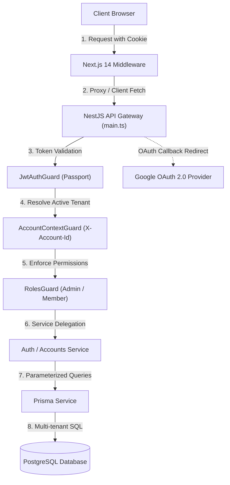

# Technical Specification: Foundation Architecture, Multi-Provider Authentication, and Account Workspaces

## 1. Technical Overview

### 1.1 What
This feature establishes the core foundation for the Financial Control platform. It implements a decoupled, full-stack architecture comprising a NestJS backend (utilizing Prisma ORM with PostgreSQL) and a Next.js 14+ frontend (App Router with TypeScript and Tailwind CSS v4). The system introduces multi-provider authentication supporting standard email/password (secured with industry-standard Argon2id hashing) alongside Google OAuth 2.0 (OpenID Connect). It provisions an isolated multi-tenant workspace architecture where every user owns a personal account as Administrator, can invite collaborators by email with role-based permissions (Administrator and Member), and can instantly toggle their active financial workspace context via a persistent header account switcher.

### 1.2 Why
A robust multi-tenant foundation is mandatory before implementing domain capabilities (categories, cards, invoices, expenses, incomes). Decoupling the backend (NestJS) from the frontend (Next.js) enforces clean separation of concerns, guarantees strict API boundaries, and protects sensitive database operations. Isolating data by `account_id` at the database and middleware levels prevents cross-tenant data leakage while enabling shared financial management for couples and households without credential sharing. Using Argon2id satisfies OWASP and NIST password storage guidelines, providing cryptographic resistance against GPU and ASIC-assisted brute-force attacks.

### 1.3 Scope

**Included:**
- Project workspace structure for `backend` (NestJS) and `frontend` (Next.js 14+).
- PostgreSQL database setup with Prisma schema, migrations, connection pooling, and multi-tenant foreign key conventions.
- User authentication with email/password using Argon2id hashing ($m=19\,\text{MiB}$, $t=2$, $p=1$) and input validation.
- Google OAuth 2.0 social sign-in flow via Passport.js on the backend, handling account linkage and new user auto-provisioning.
- JWT session management utilizing cryptographically signed Access Tokens (15-minute lifespan) and Refresh Tokens (7-day lifespan, database-tracked with rotation) delivered via secure, `HttpOnly`, `SameSite=Lax` cookies.
- Automatic account provisioning on user registration (defaulting to "[Name]'s Account" with role `ADMINISTRATOR`).
- Multi-account membership management: member invitation by email, role assignment (`ADMINISTRATOR`, `MEMBER`), pending invitation auto-claim on user sign-up, role updates, and access revocation.
- Tenant context resolution via `X-Account-Id` request header (with `active_account_id` cookie fallback) validated by a NestJS `AccountContextGuard`.
- Next.js root layout shell, authentication route middleware, responsive navigation header, account switcher dropdown, and `/settings/members` view.

**Excluded:**
- Financial entity endpoints (categories, cards, expenses, incomes) — these will be implemented in subsequent features (`F02`–`F07`).
- Granular per-row transaction privacy within an account (all members can view all records within that account).
- Multi-factor authentication (MFA/2FA) and enterprise SSO (SAML/Okta).

---

## 2. Architecture Impact

### 2.1 Affected Components and File Structure

```
financial/
├── backend/
│   ├── prisma/
│   │   ├── schema.prisma
│   │   └── migrations/
│   ├── src/
│   │   ├── common/
│   │   │   ├── decorators/
│   │   │   │   ├── current-user.decorator.ts
│   │   │   │   ├── current-account.decorator.ts
│   │   │   │   └── roles.decorator.ts
│   │   │   ├── guards/
│   │   │   │   ├── jwt-auth.guard.ts
│   │   │   │   ├── account-context.guard.ts
│   │   │   │   └── roles.guard.ts
│   │   │   └── filters/
│   │   │       └── http-exception.filter.ts
│   │   ├── modules/
│   │   │   ├── prisma/
│   │   │   │   ├── prisma.module.ts
│   │   │   │   └── prisma.service.ts
│   │   │   ├── auth/
│   │   │   │   ├── auth.module.ts
│   │   │   │   ├── auth.controller.ts
│   │   │   │   ├── auth.service.ts
│   │   │   │   ├── strategies/
│   │   │   │   │   ├── jwt.strategy.ts
│   │   │   │   │   └── google.strategy.ts
│   │   │   │   └── dto/
│   │   │   ├── users/
│   │   │   │   ├── users.module.ts
│   │   │   │   ├── users.service.ts
│   │   │   │   └── dto/
│   │   │   └── accounts/
│   │   │       ├── accounts.module.ts
│   │   │       ├── accounts.controller.ts
│   │   │       ├── accounts.service.ts
│   │   │       └── dto/
│   │   ├── app.module.ts
│   │   └── main.ts
│   ├── package.json
│   └── tsconfig.json
├── frontend/
│   ├── src/
│   │   ├── app/
│   │   │   ├── (auth)/
│   │   │   │   ├── login/page.tsx
│   │   │   │   └── register/page.tsx
│   │   │   ├── (dashboard)/
│   │   │   │   ├── layout.tsx
│   │   │   │   ├── page.tsx
│   │   │   │   └── settings/members/page.tsx
│   │   │   └── layout.tsx
│   │   ├── components/
│   │   │   ├── ui/
│   │   │   ├── layout/
│   │   │   │   ├── AppHeader.tsx
│   │   │   │   └── AccountSwitcher.tsx
│   │   │   └── members/
│   │   │       ├── MembersTable.tsx
│   │   │       └── InviteMemberModal.tsx
│   │   ├── lib/
│   │   │   ├── api-client.ts
│   │   │   └── auth-context.tsx
│   │   └── middleware.ts
│   ├── package.json
│   └── tsconfig.json
```

### 2.2 System Architecture and Data Flow



---

## 3. Technical Decisions

| Decision | Chosen Approach | Alternative Considered | Trade-off |
| :--- | :--- | :--- | :--- |
| **Project Architecture** | Decoupled Monorepo (`backend/` NestJS + `frontend/` Next.js 14+) | Unified Next.js API Routes / Full-stack app | Clean architectural boundaries and modular services in exchange for maintaining two separate `package.json` manifests and dev servers. |
| **Password Hashing** | Argon2id (`@node-rs/argon2`, $m=19\,\text{MiB}$, $t=2$, $p=1$) | bcrypt ($cost=12$) or PBKDF2 | Argon2id provides superior GPU/ASIC resistance and complies with OWASP gold standard, but consumes slightly more RAM per hashing worker thread. |
| **Session Delivery** | Two-token architecture (Short-lived JWT Access Token + Rotated Refresh Token in `HttpOnly`, `SameSite=Lax` cookies) | Bearer token in LocalStorage | Eliminates XSS token extraction vectors and guarantees revocation capabilities, requiring cookie forwarding in Next.js server-side fetches. |
| **Tenant Isolation** | Soft multi-tenancy: Shared database with non-nullable `account_id` foreign keys enforced by NestJS `AccountContextGuard` | Schema-per-tenant or Database-per-tenant | Significantly simplifies database migrations and cross-account queries while requiring strict discipline in service-layer query filtering. |
| **Tenant Header vs Route** | `X-Account-Id` header (with cookie fallback) checked against `account_memberships` table | Prefixing every API route with `/accounts/:id/...` | Keeps URL structures clean and uniform across all financial endpoints while allowing instant switching without client URL rewriting. |
| **Frontend Styling** | Tailwind CSS v4 with custom UI components | Tailwind CSS v3 / Vanilla CSS | Leverages the latest CSS-first configuration and lightning-fast Vite/PostCSS engine in Tailwind v4 with zero external component library lock-in. |

---

## 4. Component Overview

### 4.1 Backend (NestJS)

| File Path | New/Modified | Purpose | Key Responsibilities |
| :--- | :--- | :--- | :--- |
| `backend/src/modules/prisma/prisma.service.ts` | New | Database abstraction layer | Manages Prisma Client lifecycle, connection pooling, and connection teardown. |
| `backend/src/common/guards/jwt-auth.guard.ts` | New | Global authentication guard | Validates incoming JWT access tokens extracted from `access_token` cookies or Bearer headers. |
| `backend/src/common/guards/account-context.guard.ts` | New | Multi-tenant context guard | Extracts `X-Account-Id` header or cookie, verifies user membership, and attaches `{ account, role }` to the request object. |
| `backend/src/common/guards/roles.guard.ts` | New | RBAC authorization guard | Compares required `@Roles()` against `req.accountContext.role`, rejecting unauthorized attempts with HTTP 403. |
| `backend/src/modules/auth/auth.service.ts` | New | Authentication business logic | Executes user registration, password verification with Argon2id, token pair issuance, refresh token rotation, and Google profile sync. |
| `backend/src/modules/auth/strategies/google.strategy.ts` | New | OAuth OpenID Connect strategy | Validates Google OAuth authorization codes and extracts verified email, display name, and avatar picture. |
| `backend/src/modules/accounts/accounts.service.ts` | New | Workspace and membership logic | Creates personal accounts, lists user workspaces, handles member invitations by email, auto-claims pending invites, and updates roles. |
| `backend/src/modules/accounts/accounts.controller.ts` | New | Workspace HTTP endpoints | Exposes routes for workspace switching, member listing, inviting members, role updates, and access revocation. |

### 4.2 Frontend (Next.js 14+)

| File Path | New/Modified | Purpose | Key Responsibilities |
| :--- | :--- | :--- | :--- |
| `frontend/src/middleware.ts` | New | Edge route protection | Inspects `access_token` cookie; redirects unauthenticated visitors to `/login` and authenticated users away from auth pages. |
| `frontend/src/lib/api-client.ts` | New | Centralized HTTP client | Wraps `fetch` with automatic credentials inclusion, `X-Account-Id` header injection, and 401 automatic token refresh retry. |
| `frontend/src/lib/auth-context.tsx` | New | React authentication context | Provides user state, active account state, account list, and switching functions across client components. |
| `frontend/src/components/layout/AppHeader.tsx` | New | Top navigation bar | Renders application branding, quick action trigger, `AccountSwitcher` dropdown, and user profile avatar menu. |
| `frontend/src/components/layout/AccountSwitcher.tsx` | New | Workspace switcher component | Displays active account with role badge (`Admin`/`Member`), opens dropdown listing all user workspaces, and invokes switch action. |
| `frontend/src/app/(auth)/login/page.tsx` | New | Login interface | Provides email/password login form and Google OAuth one-click sign-in trigger. |
| `frontend/src/app/(auth)/register/page.tsx` | New | Registration interface | Provides account creation form with real-time password complexity validators and Google OAuth button. |
| `frontend/src/app/(dashboard)/settings/members/page.tsx` | New | Workspace collaboration view | Renders member list, role indicators, invite button (for Admins), and role change/revocation actions. |

### 4.3 Database (Prisma Migrations)

| Migration File | Tables Affected | Operation | Notes |
| :--- | :--- | :--- | :--- |
| `20261021_init_auth_and_accounts.sql` | `users`, `accounts`, `account_memberships`, `account_invitations`, `refresh_tokens` | CREATE | Baseline migration establishing users, authentication tables, multi-tenant accounts, and role structures. |

---

## 5. API Contracts

### 5.1 Endpoint: User Registration
- **Method:** `POST`
- **Path:** `/api/v1/auth/register`
- **Authentication:** Public

**Request:**

| Field | Type | Required | Validation | Description |
| :--- | :--- | :--- | :--- | :--- |
| `email` | `string` | Yes | Standard email format | Unique user email address |
| `password` | `string` | Yes | Min 8 chars, 1 uppercase, 1 lowercase, 1 digit | User password |
| `displayName` | `string` | Yes | 2 to 60 characters | User full name or nickname |

**Request Example:**
```json
{
  "email": "user@example.com",
  "password": "SecurePassword123",
  "displayName": "Alex Silva"
}
```

**Response (Success - 201 Created):**

| Field | Type | Description |
| :--- | :--- | :--- |
| `status` | `string` | "success" |
| `data.user.id` | `uuid` | Registered user ID |
| `data.user.email` | `string` | User email |
| `data.user.displayName` | `string` | Display name |
| `data.activeAccount.id` | `uuid` | Automatically provisioned default account ID |
| `data.activeAccount.name` | `string` | Default account name (e.g. "Alex Silva's Account") |
| `data.activeAccount.role` | `string` | "ADMINISTRATOR" |

*Note:* Sets `HttpOnly` cookies `access_token` and `refresh_token`.

**Response Example:**
```json
{
  "status": "success",
  "data": {
    "user": {
      "id": "e2b5e28a-7853-4f92-95b8-5c1cfad8b901",
      "email": "user@example.com",
      "displayName": "Alex Silva",
      "avatarUrl": null
    },
    "activeAccount": {
      "id": "7fa8e1b2-1111-4921-9876-0123456789ab",
      "name": "Alex Silva's Account",
      "role": "ADMINISTRATOR"
    }
  }
}
```

**Error Codes:**

| Code | HTTP Status | Description |
| :--- | :--- | :--- |
| `AUTH_EMAIL_EXISTS` | 409 | An account with this email address already exists. |
| `AUTH_WEAK_PASSWORD` | 400 | Password does not meet minimum complexity requirements. |

---

### 5.2 Endpoint: User Login
- **Method:** `POST`
- **Path:** `/api/v1/auth/login`
- **Authentication:** Public

**Request:**

| Field | Type | Required | Validation | Description |
| :--- | :--- | :--- | :--- | :--- |
| `email` | `string` | Yes | Valid email format | User login email |
| `password` | `string` | Yes | Non-empty string | User password |

**Request Example:**
```json
{
  "email": "user@example.com",
  "password": "SecurePassword123"
}
```

**Response (Success - 200 OK):**
```json
{
  "status": "success",
  "data": {
    "user": {
      "id": "e2b5e28a-7853-4f92-95b8-5c1cfad8b901",
      "email": "user@example.com",
      "displayName": "Alex Silva",
      "avatarUrl": null
    },
    "activeAccount": {
      "id": "7fa8e1b2-1111-4921-9876-0123456789ab",
      "name": "Alex Silva's Account",
      "role": "ADMINISTRATOR"
    }
  }
}
```

**Error Codes:**

| Code | HTTP Status | Description |
| :--- | :--- | :--- |
| `AUTH_INVALID_CREDENTIALS` | 401 | Invalid email or password. |

---

### 5.3 Endpoint: Google OAuth Callback
- **Method:** `GET`
- **Path:** `/api/v1/auth/google/callback`
- **Authentication:** Google OAuth 2.0 Code Grant

**Response (Success - 302 Redirect):**
Redirects to frontend `/` (or specified redirect target) with session cookies configured.

**Error Codes:**

| Code | HTTP Status | Description |
| :--- | :--- | :--- |
| `OAUTH_AUTH_FAILED` | 401 | Google authentication failed or was declined by user. |

---

### 5.4 Endpoint: List User Accounts
- **Method:** `GET`
- **Path:** `/api/v1/accounts`
- **Authentication:** JWT Bearer / Cookie

**Response (Success - 200 OK):**

| Field | Type | Description |
| :--- | :--- | :--- |
| `status` | `string` | "success" |
| `data` | `array` | List of workspaces user belongs to |
| `data[].id` | `uuid` | Account ID |
| `data[].name` | `string` | Account name |
| `data[].role` | `string` | User's role in this account (`ADMINISTRATOR` or `MEMBER`) |
| `data[].memberCount` | `integer` | Total number of members |

**Response Example:**
```json
{
  "status": "success",
  "data": [
    {
      "id": "7fa8e1b2-1111-4921-9876-0123456789ab",
      "name": "Alex Silva's Account",
      "role": "ADMINISTRATOR",
      "memberCount": 1
    },
    {
      "id": "9bc3d4e5-2222-4a32-9012-1234567890cd",
      "name": "Household Shared Account",
      "role": "MEMBER",
      "memberCount": 2
    }
  ]
}
```

---

### 5.5 Endpoint: Switch Active Account
- **Method:** `POST`
- **Path:** `/api/v1/accounts/:id/switch`
- **Authentication:** JWT Bearer / Cookie

**Response (Success - 200 OK):**
```json
{
  "status": "success",
  "data": {
    "activeAccount": {
      "id": "9bc3d4e5-2222-4a32-9012-1234567890cd",
      "name": "Household Shared Account",
      "role": "MEMBER"
    }
  }
}
```

**Error Codes:**

| Code | HTTP Status | Description |
| :--- | :--- | :--- |
| `ACCOUNT_FORBIDDEN` | 403 | You do not have access to this financial account. |
| `ACCOUNT_NOT_FOUND` | 404 | Account does not exist. |

---

### 5.6 Endpoint: Invite Member to Account
- **Method:** `POST`
- **Path:** `/api/v1/accounts/:id/invitations`
- **Authentication:** JWT Bearer + `ADMINISTRATOR` role

**Request:**

| Field | Type | Required | Validation | Description |
| :--- | :--- | :--- | :--- | :--- |
| `email` | `string` | Yes | Valid email format | Invitee email address |
| `role` | `string` | Yes | "ADMINISTRATOR" or "MEMBER" | Assigned role |

**Request Example:**
```json
{
  "email": "partner@example.com",
  "role": "MEMBER"
}
```

**Response (Success - 201 Created):**
```json
{
  "status": "success",
  "data": {
    "id": "a1b2c3d4-4444-4890-a123-abcdef012345",
    "accountId": "7fa8e1b2-1111-4921-9876-0123456789ab",
    "email": "partner@example.com",
    "role": "MEMBER",
    "status": "PENDING"
  }
}
```

**Error Codes:**

| Code | HTTP Status | Description |
| :--- | :--- | :--- |
| `ACCOUNT_FORBIDDEN` | 403 | Only administrators can invite members. |
| `INVITE_ALREADY_MEMBER` | 409 | This email address is already a member of this account. |
| `INVITE_PENDING_EXISTS` | 409 | A pending invitation already exists for this email address. |

---

### 5.7 Endpoint: Remove Member / Revoke Access
- **Method:** `DELETE`
- **Path:** `/api/v1/accounts/:id/members/:userId`
- **Authentication:** JWT Bearer + `ADMINISTRATOR` role

**Response (Success - 200 OK):**
```json
{
  "status": "success",
  "data": {
    "message": "Member removed successfully."
  }
}
```

**Error Codes:**

| Code | HTTP Status | Description |
| :--- | :--- | :--- |
| `MEMBER_SOLE_ADMIN` | 400 | You cannot revoke the sole administrator of an account. Promote another member first. |
| `ACCOUNT_FORBIDDEN` | 403 | Only administrators can remove members. |
| `MEMBER_NOT_FOUND` | 404 | Member not found in this account. |

---

## 6. Data Model

### 6.1 Database Schema (PostgreSQL)

#### Table: `users`
Stores user authentication credentials, display profiles, and social IDs.

| Column | Type | Nullable | Default | Description |
| :--- | :--- | :--- | :--- | :--- |
| `id` | `uuid` | No | `gen_random_uuid()` | Primary key |
| `email` | `varchar(255)` | No | - | Unique login email |
| `password_hash` | `varchar(255)` | Yes | `NULL` | Argon2id hash (null for OAuth-only users) |
| `display_name` | `varchar(100)` | No | - | User display name |
| `avatar_url` | `varchar(500)` | Yes | `NULL` | Profile picture URL |
| `google_id` | `varchar(100)` | Yes | `NULL` | Google OAuth subject identifier |
| `created_at` | `timestamptz` | No | `NOW()` | Creation timestamp |
| `updated_at` | `timestamptz` | No | `NOW()` | Last update timestamp |

**Indexes & Constraints:**
- `pk_users`: `PRIMARY KEY (id)`
- `uq_users_email`: `UNIQUE (email)`
- `uq_users_google_id`: `UNIQUE (google_id)`

---

#### Table: `accounts`
Represents an isolated financial workspace.

| Column | Type | Nullable | Default | Description |
| :--- | :--- | :--- | :--- | :--- |
| `id` | `uuid` | No | `gen_random_uuid()` | Primary key |
| `name` | `varchar(100)` | No | - | Account workspace name |
| `created_at` | `timestamptz` | No | `NOW()` | Creation timestamp |
| `updated_at` | `timestamptz` | No | `NOW()` | Last update timestamp |

**Indexes & Constraints:**
- `pk_accounts`: `PRIMARY KEY (id)`

---

#### Table: `account_memberships`
Join table linking users to accounts with specific permissions.

| Column | Type | Nullable | Default | Description |
| :--- | :--- | :--- | :--- | :--- |
| `id` | `uuid` | No | `gen_random_uuid()` | Primary key |
| `account_id` | `uuid` | No | - | Foreign key to `accounts(id)` |
| `user_id` | `uuid` | No | - | Foreign key to `users(id)` |
| `role` | `varchar(20)` | No | `'MEMBER'` | Role: `ADMINISTRATOR` or `MEMBER` |
| `created_at` | `timestamptz` | No | `NOW()` | Membership creation timestamp |
| `updated_at` | `timestamptz` | No | `NOW()` | Last update timestamp |

**Indexes & Constraints:**
- `pk_account_memberships`: `PRIMARY KEY (id)`
- `fk_memberships_account`: `FOREIGN KEY (account_id) REFERENCES accounts(id) ON DELETE CASCADE`
- `fk_memberships_user`: `FOREIGN KEY (user_id) REFERENCES users(id) ON DELETE CASCADE`
- `uq_memberships_user_account`: `UNIQUE (account_id, user_id)`
- `ix_memberships_user_id`: `INDEX (user_id)`

---

#### Table: `account_invitations`
Tracks invitations sent by administrators to external emails.

| Column | Type | Nullable | Default | Description |
| :--- | :--- | :--- | :--- | :--- |
| `id` | `uuid` | No | `gen_random_uuid()` | Primary key |
| `account_id` | `uuid` | No | - | Foreign key to `accounts(id)` |
| `email` | `varchar(255)` | No | - | Invitee email |
| `role` | `varchar(20)` | No | `'MEMBER'` | Proposed role |
| `status` | `varchar(20)` | No | `'PENDING'` | `PENDING`, `ACCEPTED`, or `REVOKED` |
| `token` | `varchar(64)` | No | - | Unique invitation claim token |
| `expires_at` | `timestamptz` | No | - | Invitation expiration date (7 days) |
| `created_at` | `timestamptz` | No | `NOW()` | Created timestamp |

**Indexes & Constraints:**
- `pk_account_invitations`: `PRIMARY KEY (id)`
- `fk_invitations_account`: `FOREIGN KEY (account_id) REFERENCES accounts(id) ON DELETE CASCADE`
- `ix_invitations_email_status`: `INDEX (email, status)`
- `uq_invitations_token`: `UNIQUE (token)`

---

#### Table: `refresh_tokens`
Tracks active and rotated refresh tokens for session revocation.

| Column | Type | Nullable | Default | Description |
| :--- | :--- | :--- | :--- | :--- |
| `id` | `uuid` | No | `gen_random_uuid()` | Primary key |
| `user_id` | `uuid` | No | - | Foreign key to `users(id)` |
| `token_hash` | `varchar(255)` | No | - | SHA-256 hash of the refresh token |
| `expires_at` | `timestamptz` | No | - | Token expiration timestamp (7 days) |
| `revoked_at` | `timestamptz` | Yes | `NULL` | Revocation timestamp |
| `created_at` | `timestamptz` | No | `NOW()` | Issue timestamp |

**Indexes & Constraints:**
- `pk_refresh_tokens`: `PRIMARY KEY (id)`
- `fk_refresh_tokens_user`: `FOREIGN KEY (user_id) REFERENCES users(id) ON DELETE CASCADE`
- `ix_refresh_tokens_hash`: `INDEX (token_hash)`

---

### 6.2 SQL Baseline Migration

```sql
-- Create extension for UUID generation
CREATE EXTENSION IF NOT EXISTS "pgcrypto";

-- Table: users
CREATE TABLE users (
    id UUID PRIMARY KEY DEFAULT gen_random_uuid(),
    email VARCHAR(255) NOT NULL,
    password_hash VARCHAR(255),
    display_name VARCHAR(100) NOT NULL,
    avatar_url VARCHAR(500),
    google_id VARCHAR(100),
    created_at TIMESTAMPTZ NOT NULL DEFAULT NOW(),
    updated_at TIMESTAMPTZ NOT NULL DEFAULT NOW()
);
CREATE UNIQUE INDEX uq_users_email ON users(LOWER(email));
CREATE UNIQUE INDEX uq_users_google_id ON users(google_id) WHERE google_id IS NOT NULL;

-- Table: accounts
CREATE TABLE accounts (
    id UUID PRIMARY KEY DEFAULT gen_random_uuid(),
    name VARCHAR(100) NOT NULL,
    created_at TIMESTAMPTZ NOT NULL DEFAULT NOW(),
    updated_at TIMESTAMPTZ NOT NULL DEFAULT NOW()
);

-- Table: account_memberships
CREATE TABLE account_memberships (
    id UUID PRIMARY KEY DEFAULT gen_random_uuid(),
    account_id UUID NOT NULL REFERENCES accounts(id) ON DELETE CASCADE,
    user_id UUID NOT NULL REFERENCES users(id) ON DELETE CASCADE,
    role VARCHAR(20) NOT NULL DEFAULT 'MEMBER' CHECK (role IN ('ADMINISTRATOR', 'MEMBER')),
    created_at TIMESTAMPTZ NOT NULL DEFAULT NOW(),
    updated_at TIMESTAMPTZ NOT NULL DEFAULT NOW(),
    CONSTRAINT uq_memberships_user_account UNIQUE (account_id, user_id)
);
CREATE INDEX ix_memberships_user_id ON account_memberships(user_id);

-- Table: account_invitations
CREATE TABLE account_invitations (
    id UUID PRIMARY KEY DEFAULT gen_random_uuid(),
    account_id UUID NOT NULL REFERENCES accounts(id) ON DELETE CASCADE,
    email VARCHAR(255) NOT NULL,
    role VARCHAR(20) NOT NULL DEFAULT 'MEMBER' CHECK (role IN ('ADMINISTRATOR', 'MEMBER')),
    status VARCHAR(20) NOT NULL DEFAULT 'PENDING' CHECK (status IN ('PENDING', 'ACCEPTED', 'REVOKED')),
    token VARCHAR(64) NOT NULL UNIQUE,
    expires_at TIMESTAMPTZ NOT NULL,
    created_at TIMESTAMPTZ NOT NULL DEFAULT NOW()
);
CREATE INDEX ix_invitations_email_status ON account_invitations(LOWER(email), status);

-- Table: refresh_tokens
CREATE TABLE refresh_tokens (
    id UUID PRIMARY KEY DEFAULT gen_random_uuid(),
    user_id UUID NOT NULL REFERENCES users(id) ON DELETE CASCADE,
    token_hash VARCHAR(255) NOT NULL,
    expires_at TIMESTAMPTZ NOT NULL,
    revoked_at TIMESTAMPTZ,
    created_at TIMESTAMPTZ NOT NULL DEFAULT NOW()
);
CREATE INDEX ix_refresh_tokens_hash ON refresh_tokens(token_hash);
```

---

## 7. Testing Strategy

### 7.1 Test File Structure

| Test File | Test Type | Target Component | Coverage Goal |
| :--- | :--- | :--- | :--- |
| `backend/test/auth/password.service.spec.ts` | Unit | Password hashing logic (Argon2id) | 100% |
| `backend/test/auth/auth.service.spec.ts` | Unit | Registration, token issuance, refresh rotation | 90% |
| `backend/test/accounts/accounts.service.spec.ts` | Unit | Account creation, member invites, role guards | 90% |
| `backend/test/guards/account-context.guard.spec.ts` | Unit | Multi-tenant header validation and role injection | 95% |
| `backend/test/e2e/auth.e2e-spec.ts` | Integration / E2E | Registration, login, logout, refresh cookies | 85% |
| `backend/test/e2e/accounts.e2e-spec.ts` | Integration / E2E | Account switcher, invitations, RBAC enforcement | 85% |
| `frontend/tests/components/AccountSwitcher.test.tsx` | Unit / Component | Switcher dropdown rendering and context change | 90% |
| `frontend/tests/middleware.test.ts` | Unit | Route redirects based on session cookies | 95% |

### 7.2 Key Test Functions and Assertions

| Test Function | Description | Assertions |
| :--- | :--- | :--- |
| `test_argon2id_hashing_and_verification` | Verifies Argon2id produces valid hash and rejects incorrect passwords | Hash starts with `$argon2id$`; `verify(hash, password)` returns `true`; invalid password returns `false`. |
| `test_register_creates_user_and_default_account` | Validates registration flow and auto-provisioning | User created in DB; Account created with name "[Name]'s Account"; Membership record exists with role `ADMINISTRATOR`. |
| `test_duplicate_email_registration_rejected` | Checks duplicate email prevention | Throws `ConflictException` with code `AUTH_EMAIL_EXISTS`; returns HTTP 409. |
| `test_account_context_guard_validates_membership` | Verifies `X-Account-Id` header is authenticated against memberships | Valid membership attaches `{ account, role }` to request; unauthorized account returns HTTP 403. |
| `test_sole_admin_cannot_revoke_own_access` | Enforces that an account never becomes orphaned | Removing the only administrator fails with HTTP 400 and code `MEMBER_SOLE_ADMIN`. |
| `test_member_cannot_invite_or_remove_users` | Enforces RBAC permissions on administrative endpoints | Member calling `POST /invitations` or `DELETE /members/:id` receives HTTP 403 Forbidden. |
| `test_pending_invitation_auto_claimed_on_signup` | Tests collaboration workflow for newly invited emails | Creating an account with an invited email automatically links the user to the inviting account. |
| `test_refresh_token_rotation_and_reuse_detection` | Validates secure token refresh mechanics | Old refresh token is marked revoked; new token pair issued; attempting to reuse revoked token invalidates all user tokens. |
| `test_nextjs_middleware_redirects_unauthenticated` | Checks route protection on frontend | Request to `/` without `access_token` redirects to `/login`; request to `/login` with valid token redirects to `/`. |
