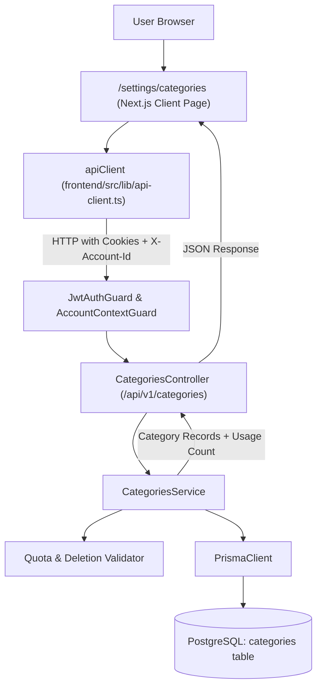

# Technical Specification: F02. Expense Categories Management

## 1. Technical Overview

### 1.1 What
F02 implements workspace-isolated financial categories for accounts, providing 8 automatically seeded system categories upon account creation, custom category CRUD operations (up to 50 custom categories per account), an allowlist of 30 curated financial and lifestyle icons, strict HEX color validation, and dependency protection preventing the deletion of categories in active transaction use.

### 1.2 Why
Categorization is the fundamental organizational backbone for personal and collaborative financial management. Expenses (F04), incomes (F05), and analytics (F07) rely on structured category definitions (ID, name, icon, color, and type) to aggregate cash flow, render visual tags, and calculate budget summaries without data inconsistency.

### 1.3 Scope

**Included:**
- Multi-tenant `categories` relational database table linked to `accounts` via `account_id` foreign key with cascade deletion.
- `CategoryType` enum (`EXPENSE`, `INCOME`) and `is_default` boolean flag.
- Automatic seeding of 8 default categories upon account creation: Food & Dining (`#FF6B6B`, `utensils`, EXPENSE), Housing & Rent (`#4D96FF`, `home`, EXPENSE), Utilities & Bills (`#FFD93D`, `zap`, EXPENSE), Transportation (`#6BCB77`, `car`, EXPENSE), Health & Medicine (`#9D4EDD`, `heart-pulse`, EXPENSE), Leisure & Entertainment (`#FF9234`, `film`, EXPENSE), Education (`#48CAE4`, `graduation-cap`, EXPENSE), and Income/Salary (`#2EC4B6`, `wallet`, INCOME).
- Custom category creation limited to a maximum of 50 custom categories per account workspace.
- Backend DTO validation enforcing category name length (2 to 40 characters), valid HEX format (`^#[0-9A-Fa-f]{6}$`), and an allowlist of 30 curated Lucide icon identifiers.
- Unique constraint preventing duplicate category names within the same account workspace.
- Edit capabilities for both system default and custom categories (name, color, icon).
- Deletion rules: System default categories (`is_default = true`) cannot be deleted; custom categories can only be deleted if they have zero attached transaction records.
- REST API endpoints under `/api/v1/categories` guarded by `JwtAuthGuard` and `AccountContextGuard`.
- Responsive Next.js settings interface at `/settings/categories` with category cards, transaction usage counter badges, icon selection modal, and color picker.

**Excluded:**
- Category-level monthly budget thresholds (budget limits deferred to future roadmap).
- Subcategory hierarchies or nested parent-child trees (all categories are flat single-tier entities).
- Direct expense and income transaction recording (handled in F04 and F05).

### 1.4 Traceability Matrix

| PRD Requirement / Section | Specification Mapping |
| :--- | :--- |
| **Section 6 - F02 Capabilities**: 8 pre-seeded system categories | Section 4 (Account Provisioning Hook) & Section 6 (Seed Data) |
| **Section 6 - F02 Capabilities**: Max 50 custom categories per account | Section 3 (Decision 2) & Section 5 (`POST /api/v1/categories` Error `CAT002`) |
| **Section 6 - F02 Capabilities**: Name 2-40 chars, Hex regex `^#[0-9A-Fa-f]{6}$` | Section 5 (DTO Validation Rules) & Section 6 (Data Model) |
| **Section 6 - F02 Capabilities**: 30 curated financial/lifestyle icons | Section 3 (Decision 3), Section 4 (Icon Catalog), Section 5 |
| **Section 6 - F02 Capabilities**: Deletion prevention with active transactions | Section 5 (`DELETE /api/v1/categories/:id` Error `CAT004`) |
| **Section 6 - F02 Experience**: `/settings/categories` grid and modal | Section 4 (Frontend Components) |
| **Section 9 - F02 Acceptance Criteria**: All 5 testable criteria | Section 7 (Acceptance Tests) |
| **Section 9 - Cross-Feature Integration**: Category definitions in F04/F05 | Section 7 (Integration Tests) |

---

## 2. Architecture Impact

### 2.1 Affected Components and File Structure

- **Backend (`backend/src/modules/categories/`)**:
  - `categories.module.ts`: NestJS module registering controller, service, Prisma dependency, and exporting `CategoriesService`.
  - `categories.controller.ts`: REST controller handling CRUD operations under `/api/v1/categories`.
  - `categories.service.ts`: Business logic for CRUD, account quotas, default category seeding, and reference verification.
  - `dto/create-category.dto.ts`: Input validation DTO for category creation.
  - `dto/update-category.dto.ts`: Partial input validation DTO for category updates.
  - `dto/category-response.dto.ts`: Output serialization mapping.
  - `constants/curated-icons.ts`: Shared array and validation allowlist of 30 curated Lucide icon identifiers.
- **Database (`backend/prisma/`)**:
  - `schema.prisma`: New `Category` model, `CategoryType` enum, and relation to `Account`.
  - `migrations/YYYYMMDD_add_categories/migration.sql`: PostgreSQL DDL script creating `categories` table and constraints.
- **Frontend (`frontend/src/`)**:
  - `app/(dashboard)/settings/categories/page.tsx`: Category management page with category grid, filters, and modal triggers.
  - `components/categories/CategoryCard.tsx`: Presentation card displaying icon, name, color badge, transaction count, and action buttons.
  - `components/categories/CategoryModal.tsx`: Creation and edit dialog with live preview.
  - `components/categories/IconPicker.tsx`: Curated 30-icon selector grid with search filter.
  - `components/categories/ColorPicker.tsx`: 16-color quick-select palette with custom HEX input.
  - `components/layout/AppHeader.tsx`: Navigation link to Categories in the workspace header.

### 2.2 Component Architecture and Data Flow



---

## 3. Technical Decisions

| Decision | Chosen Approach | Alternative Considered | Trade-off / Rationale |
| :--- | :--- | :--- | :--- |
| **Category Classification** | Add `type: CategoryType` enum (`EXPENSE`, `INCOME`) with `is_default: boolean` | Unified pool without type, or separate tables for expenses and incomes | Maintains normalized storage in a single table while allowing F04 (expenses) and F05 (incomes) to filter relevant categories cleanly. |
| **System Defaults Lifecycle** | Pre-seeded categories can have their name, color, and icon updated, but cannot be deleted (`is_default = true`) | Make defaults read-only, or allow deletion of defaults | Empower users to personalize labels and theme colors according to their lifestyle while guaranteeing essential baseline categories are never lost. |
| **Icon Allowlist** | Strict allowlist of 30 curated Lucide icon strings validated in DTO via `@IsIn(ALLOWED_ICONS)` | Free-text string, or SVG upload | Prevents arbitrary string pollution, guarantees consistent rendering in Next.js via Lucide React, and eliminates XSS/malicious SVG injection. |
| **Tenant Isolation & Unique Names** | Composite unique index `@@unique([accountId, name])` and mandatory `account_id` filtering | Account-agnostic categories or global system table | Strict multi-tenancy ensures custom categories from one account never collide with or leak into another account workspace. |
| **Custom Category Quota** | Enforce a maximum of 50 custom categories per account inside `CategoriesService.create` | Database trigger or unrestricted creation | Directly fulfills PRD Section 6 specification; protects UI rendering and prevents database bloat. |

---

## 4. Component Overview

### 4.1 Frontend Components

| File Path | New/Modified | Purpose | Key Responsibilities |
| :--- | :--- | :--- | :--- |
| `frontend/src/app/(dashboard)/settings/categories/page.tsx` | New | Main category management screen | Fetches categories for active account, supports tab filtering (All / Expense / Income), manages modal state. |
| `frontend/src/components/categories/CategoryCard.tsx` | New | Visual category representation | Renders icon with colored background badge, displays usage count, provides Edit and Delete action triggers. |
| `frontend/src/components/categories/CategoryModal.tsx` | New | Create / Edit category modal | Form handling, live card preview, validates name length, coordinates icon and color selectors. |
| `frontend/src/components/categories/IconPicker.tsx` | New | Interactive icon grid | Renders 30 curated icons in a searchable grid, handles active icon selection. |
| `frontend/src/components/categories/ColorPicker.tsx` | New | Color palette and HEX input | 16 curated swatches for one-click selection plus raw input validating `^#[0-9A-Fa-f]{6}$`. |
| `frontend/src/components/layout/AppHeader.tsx` | Modified | Workspace navigation | Adds direct link to `/settings/categories` in the navigation bar. |

### 4.2 Backend Components

| File Path | New/Modified | Purpose | Key Responsibilities |
| :--- | :--- | :--- | :--- |
| `backend/src/modules/categories/categories.module.ts` | New | NestJS Module definition | Bundles controller, service, PrismaModule, and exports `CategoriesService`. |
| `backend/src/modules/categories/categories.controller.ts` | New | REST endpoint handler | Exposes `/api/v1/categories` CRUD routes, injects active account from context, enforces validation pipe. |
| `backend/src/modules/categories/categories.service.ts` | New | Business logic provider | CRUD operations, seeds 8 defaults, enforces 50-category quota, verifies deletion integrity. |
| `backend/src/modules/categories/constants/curated-icons.ts` | New | Icon allowlist definition | Exports `CURATED_ICONS` constant array containing the 30 allowed Lucide icon names. |
| `backend/src/modules/categories/dto/create-category.dto.ts` | New | Validation schema for creation | Validates `name` (2-40 chars), `color` (hex regex), `icon` (allowlist), `type` (enum). |
| `backend/src/modules/categories/dto/update-category.dto.ts` | New | Validation schema for update | Partial DTO allowing optional `name`, `color`, and `icon` updates. |
| `backend/src/modules/auth/auth.service.ts` | Modified | Account provisioning hook | Calls `CategoriesService.seedDefaultCategories(accountId)` when provisioning a new account. |
| `backend/src/app.module.ts` | Modified | Root module aggregation | Imports `CategoriesModule`. |

### 4.3 Database Schema Components

| Migration File | Tables Affected | Operation | Notes |
| :--- | :--- | :--- | :--- |
| `YYYYMMDD_add_categories/migration.sql` | `categories` | CREATE | Creates table, enum `CategoryType`, foreign key to `accounts`, and unique composite index. |

### 4.4 Curated 30-Icon Allowlist Catalog

The 30 curated financial and lifestyle icons mapped to Lucide React:
1. `utensils` (Food & Dining)
2. `home` (Housing & Rent)
3. `zap` (Utilities & Energy)
4. `car` (Transportation)
5. `heart-pulse` (Health & Medicine)
6. `film` (Leisure & Movies)
7. `graduation-cap` (Education)
8. `wallet` (Income & Salary)
9. `shopping-bag` (Shopping)
10. `shopping-cart` (Supermarket)
11. `coffee` (Cafes & Snacks)
12. `plane` (Travel & Flights)
13. `fuel` (Gas & Fuel)
14. `bus` (Public Transit)
15. `dumbbell` (Fitness & Sports)
16. `tv` (Streaming & Subscriptions)
17. `smartphone` (Phone & Mobile)
18. `wifi` (Internet & Broadband)
19. `paw-print` (Pets & Veterinary)
20. `baby` (Childcare & Kids)
21. `gift` (Gifts & Donations)
22. `briefcase` (Business & Work)
23. `wrench` (Maintenance & Repairs)
24. `shield-check` (Insurance)
25. `trending-up` (Investments)
26. `piggy-bank` (Savings)
27. `landmark` (Taxes & Banking)
28. `book-open` (Books & Culture)
29. `sparkles` (Personal Care & Beauty)
30. `credit-card` (Credit Card Fees)

---

## 5. API Contracts

### 5.1 List Categories for Active Account
- **Method:** `GET`
- **Path:** `/api/v1/categories`
- **Authentication:** JWT Bearer (HttpOnly Cookie) + Header `X-Account-Id` (or active cookie)
- **Query Parameters:**
  - `type` (optional, string: `EXPENSE` | `INCOME`)

**Response (Success - 200 OK):**

| Field | Type | Description |
| :--- | :--- | :--- |
| `status` | `string` | Always `"success"` |
| `data` | `array` | List of category objects |
| `data[].id` | `string (uuid)` | Category unique identifier |
| `data[].accountId` | `string (uuid)` | Parent account workspace ID |
| `data[].name` | `string` | Category display name |
| `data[].type` | `string` | `EXPENSE` or `INCOME` |
| `data[].color` | `string` | 6-character hex color code (e.g., `#FF6B6B`) |
| `data[].icon` | `string` | Curated icon identifier (e.g., `utensils`) |
| `data[].isDefault` | `boolean` | `true` if pre-seeded system default |
| `data[].transactionCount` | `number` | Number of transactions using this category |
| `data[].canDelete` | `boolean` | Computed: `!isDefault && transactionCount === 0` |

**Response Example (200 OK):**
```json
{
  "status": "success",
  "data": [
    {
      "id": "550e8400-e29b-41d4-a716-446655440001",
      "accountId": "a1b2c3d4-e5f6-7a8b-9c0d-1e2f3a4b5c6d",
      "name": "Food & Dining",
      "type": "EXPENSE",
      "color": "#FF6B6B",
      "icon": "utensils",
      "isDefault": true,
      "transactionCount": 14,
      "canDelete": false,
      "createdAt": "2026-10-22T10:00:00.000Z",
      "updatedAt": "2026-10-22T10:00:00.000Z"
    },
    {
      "id": "550e8400-e29b-41d4-a716-446655440002",
      "accountId": "a1b2c3d4-e5f6-7a8b-9c0d-1e2f3a4b5c6d",
      "name": "Pet Supplies",
      "type": "EXPENSE",
      "color": "#9D4EDD",
      "icon": "paw-print",
      "isDefault": false,
      "transactionCount": 0,
      "canDelete": true,
      "createdAt": "2026-10-22T11:30:00.000Z",
      "updatedAt": "2026-10-22T11:30:00.000Z"
    }
  ]
}
```

---

### 5.2 Create Custom Category
- **Method:** `POST`
- **Path:** `/api/v1/categories`
- **Authentication:** JWT Bearer (HttpOnly Cookie) + Header `X-Account-Id`

**Request Body:**

| Field | Type | Required | Validation | Description |
| :--- | :--- | :--- | :--- | :--- |
| `name` | `string` | Yes | 2 to 40 characters, trimmed | Category name |
| `type` | `string` | Yes | Enum: `EXPENSE`, `INCOME` | Category classification |
| `color` | `string` | Yes | Regex `^#[0-9A-Fa-f]{6}$` | 6-character hex color |
| `icon` | `string` | Yes | Member of `CURATED_ICONS` (30 icons) | Valid icon identifier |

**Request Example:**
```json
{
  "name": "Streaming & Gaming",
  "type": "EXPENSE",
  "color": "#4D96FF",
  "icon": "tv"
}
```

**Response (Success - 201 Created):**
```json
{
  "status": "success",
  "data": {
    "id": "660e8400-e29b-41d4-a716-446655440099",
    "accountId": "a1b2c3d4-e5f6-7a8b-9c0d-1e2f3a4b5c6d",
    "name": "Streaming & Gaming",
    "type": "EXPENSE",
    "color": "#4D96FF",
    "icon": "tv",
    "isDefault": false,
    "transactionCount": 0,
    "canDelete": true,
    "createdAt": "2026-10-22T12:00:00.000Z",
    "updatedAt": "2026-10-22T12:00:00.000Z"
  }
}
```

---

### 5.3 Update Existing Category
- **Method:** `PATCH`
- **Path:** `/api/v1/categories/:id`
- **Authentication:** JWT Bearer (HttpOnly Cookie) + Header `X-Account-Id`

**Request Body:**

| Field | Type | Required | Validation | Description |
| :--- | :--- | :--- | :--- | :--- |
| `name` | `string` | No | 2 to 40 characters, trimmed | Updated category name |
| `color` | `string` | No | Regex `^#[0-9A-Fa-f]{6}$` | Updated hex color code |
| `icon` | `string` | No | Member of `CURATED_ICONS` | Updated icon identifier |

**Response (Success - 200 OK):**
```json
{
  "status": "success",
  "data": {
    "id": "660e8400-e29b-41d4-a716-446655440099",
    "accountId": "a1b2c3d4-e5f6-7a8b-9c0d-1e2f3a4b5c6d",
    "name": "Streaming & Entertainment",
    "type": "EXPENSE",
    "color": "#FF9234",
    "icon": "film",
    "isDefault": false,
    "transactionCount": 0,
    "canDelete": true,
    "createdAt": "2026-10-22T12:00:00.000Z",
    "updatedAt": "2026-10-22T12:05:00.000Z"
  }
}
```

---

### 5.4 Delete Custom Category
- **Method:** `DELETE`
- **Path:** `/api/v1/categories/:id`
- **Authentication:** JWT Bearer (HttpOnly Cookie) + Header `X-Account-Id`

**Response (Success - 200 OK):**
```json
{
  "status": "success",
  "data": {
    "message": "Category successfully deleted."
  }
}
```

---

### 5.5 Error Codes Reference

| Code | HTTP Status | Description |
| :--- | :--- | :--- |
| `CAT001` | 400 Bad Request | Invalid input (name length out of 2-40 bounds, invalid hex format, or icon not in curated 30 list). |
| `CAT002` | 400 Bad Request | Quota exceeded: Maximum of 50 custom categories reached for this account workspace. |
| `CAT003` | 409 Conflict | A category with this name already exists in this account workspace. |
| `CAT004` | 400 Bad Request | Category cannot be deleted because it is referenced by active transaction records. |
| `CAT005` | 403 Forbidden | Cannot delete a system default category (`is_default = true`). |
| `CAT006` | 404 Not Found | Category not found within the active account workspace. |

---

## 6. Data Model

### 6.1 Database Schema (`categories`)

#### Table: `categories`

| Column | Type | Nullable | Default | Description |
| :--- | :--- | :--- | :--- | :--- |
| `id` | `UUID` | No | `gen_random_uuid()` | Primary key |
| `account_id` | `UUID` | No | None | Multi-tenant account reference |
| `name` | `VARCHAR(40)` | No | None | Category display name (2–40 chars) |
| `type` | `VARCHAR(20)` | No | `'EXPENSE'` | Category classification (`EXPENSE` or `INCOME`) |
| `color` | `VARCHAR(7)` | No | None | Hexadecimal color code (e.g. `#FF6B6B`) |
| `icon` | `VARCHAR(50)` | No | None | Curated Lucide icon name |
| `is_default` | `BOOLEAN` | No | `false` | System pre-seeded flag |
| `created_at` | `TIMESTAMPTZ` | No | `CURRENT_TIMESTAMP` | Creation audit timestamp |
| `updated_at` | `TIMESTAMPTZ` | No | `CURRENT_TIMESTAMP` | Last updated timestamp |

#### Indexes:

| Index Name | Columns | Type | Purpose |
| :--- | :--- | :--- | :--- |
| `uq_categories_account_name` | `[account_id, name]` | Unique B-tree | Enforces unique category name per account workspace |
| `ix_categories_account_type` | `[account_id, type]` | B-tree | Fast filtered category queries by account and type |

#### Constraints:

| Constraint Name | Type | Definition | Purpose |
| :--- | :--- | :--- | :--- |
| `pk_categories` | PRIMARY KEY | `PRIMARY KEY (id)` | Entity identity |
| `fk_categories_account` | FOREIGN KEY | `FOREIGN KEY (account_id) REFERENCES accounts(id) ON DELETE CASCADE` | Referential integrity and cleanup on account deletion |

### 6.2 Prisma Model Definition

```prisma
enum CategoryType {
  EXPENSE
  INCOME
}

model Category {
  id        String       @id @default(uuid()) @db.Uuid
  accountId String       @map("account_id") @db.Uuid
  name      String       @db.VarChar(40)
  type      CategoryType @default(EXPENSE)
  color     String       @db.VarChar(7)
  icon      String       @db.VarChar(50)
  isDefault Boolean      @default(false) @map("is_default")
  createdAt DateTime     @default(now()) @map("created_at") @db.Timestamptz()
  updatedAt DateTime     @updatedAt @map("updated_at") @db.Timestamptz()

  account Account @relation(fields: [accountId], references: [id], onDelete: Cascade)

  @@unique([accountId, name], name: "uq_categories_account_name")
  @@index([accountId, type], name: "ix_categories_account_type")
  @@map("categories")
}
```

### 6.3 SQL Migration DDL

```sql
-- CreateEnum
CREATE TYPE "CategoryType" AS ENUM ('EXPENSE', 'INCOME');

-- CreateTable categories
CREATE TABLE "categories" (
    "id" UUID NOT NULL DEFAULT gen_random_uuid(),
    "account_id" UUID NOT NULL,
    "name" VARCHAR(40) NOT NULL,
    "type" "CategoryType" NOT NULL DEFAULT 'EXPENSE',
    "color" VARCHAR(7) NOT NULL,
    "icon" VARCHAR(50) NOT NULL,
    "is_default" BOOLEAN NOT NULL DEFAULT false,
    "created_at" TIMESTAMPTZ NOT NULL DEFAULT CURRENT_TIMESTAMP,
    "updated_at" TIMESTAMPTZ NOT NULL DEFAULT CURRENT_TIMESTAMP,

    CONSTRAINT "categories_pkey" PRIMARY KEY ("id"),
    CONSTRAINT "fk_categories_account" FOREIGN KEY ("account_id") REFERENCES "accounts"("id") ON DELETE CASCADE
);

-- CreateIndexes
CREATE UNIQUE INDEX "uq_categories_account_name" ON "categories"("account_id", "name");
CREATE INDEX "ix_categories_account_type" ON "categories"("account_id", "type");
```

---

## 7. Testing Strategy

### 7.1 Unit & Integration Test Matrix

| Test File | Test Type | Target Component | Coverage Goal |
| :--- | :--- | :--- | :--- |
| `backend/test/categories/categories.service.spec.ts` | Unit | `CategoriesService` business logic & validation | > 95% |
| `backend/test/categories/categories.controller.spec.ts` | Unit | `CategoriesController` route mappings & response transforms | > 90% |
| `backend/test/categories/categories.e2e-spec.ts` | Integration | HTTP endpoints, Guards, Account Isolation, Quotas | > 85% |

### 7.2 Specific Test Cases

| Test Function | Target Feature Requirement | Assertions & Behaviors |
| :--- | :--- | :--- |
| `should_seed_8_defaults_on_account_creation` | Acceptance Criteria 1 | Account creation spawns 8 categories with `isDefault: true`, correct colors, types, and icons. |
| `should_create_custom_category_successfully` | Acceptance Criteria 2 | Valid custom category is persisted with `isDefault: false` and returned with 201. |
| `should_reject_creation_exceeding_50_custom_limit` | Capabilities Quota | Adding 51st custom category throws 400 Bad Request with code `CAT002`. |
| `should_reject_invalid_hex_color` | Capabilities Validation | Color `invalid_hex` or `#123` throws 400 Bad Request with code `CAT001`. |
| `should_reject_unapproved_icon_string` | Capabilities Validation | Icon `unknown-icon-not-in-list` throws 400 Bad Request with code `CAT001`. |
| `should_reject_duplicate_name_within_account` | Data Model Unique Index | Creating category with existing name in active account throws 409 Conflict (`CAT003`). |
| `should_allow_same_name_in_different_accounts` | Multi-Tenant Isolation | Category named "Transport" can exist independently in Account A and Account B. |
| `should_update_category_name_color_and_icon` | Acceptance Criteria 3 | Successfully updates category attributes and persists changes in database. |
| `should_prevent_deletion_of_default_category` | Decision 2 & Business Rules | Deleting system category (`isDefault: true`) throws 403 Forbidden with code `CAT005`. |
| `should_delete_unused_custom_category` | Acceptance Criteria 4 | Deleting custom category with 0 transactions removes record and returns 200 OK. |
| `should_prevent_deletion_if_transactions_exist` | Acceptance Criteria 5 | Category with attached transactions cannot be deleted; returns 400 with code `CAT004`. |
| `should_isolate_categories_by_account_context` | Cross-Tenant Security | User in Account A cannot view, update, or delete categories belonging to Account B. |

### 7.3 Cross-Feature Integration Testing

| Integration Test | Source / Target Feature | Verification |
| :--- | :--- | :--- |
| `test_categories_available_for_expenses` | F02 $\to$ F04 | Categories returned by `GET /api/v1/categories?type=EXPENSE` correctly format ID, name, icon, and color for expense entry dropdowns. |
| `test_categories_available_for_incomes` | F02 $\to$ F05 | Categories returned by `GET /api/v1/categories?type=INCOME` correctly provide income category options (e.g. Salary / Investments). |
| `test_category_deletion_blocked_by_expenses` | F02 $\to$ F04 | Creating an expense associated with a custom category immediately switches `canDelete` to `false` and prevents API deletion. |
