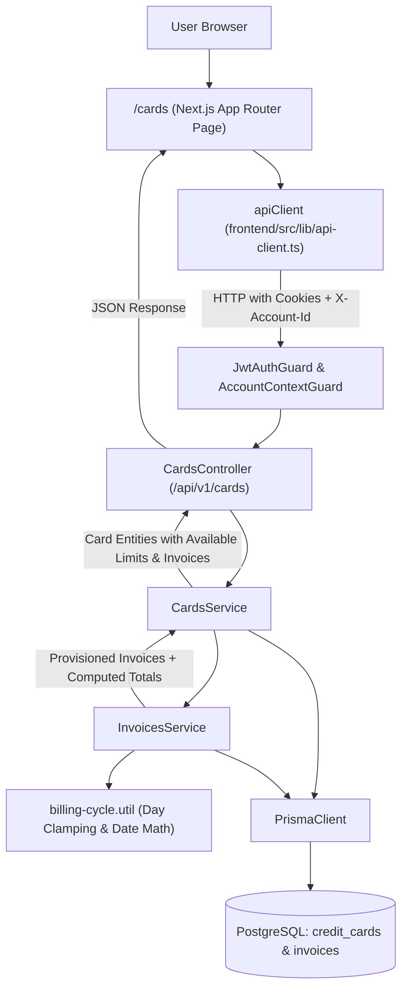

# Technical Specification: F03. Credit Card and Invoice Management

## 1. Technical Overview

### 1.1 What
F03 implements the credit card and statement invoice infrastructure for collaborative financial workspaces. It enables users to register, edit, archive, and delete credit cards with network branding (Visa, Mastercard, Elo, American Express, Hipercard), user-defined credit limits, and billing cycle configurations (closing day and payment due day). It provides an automated, on-demand invoice cycle generation engine with calendar month-end clamping (handling 28/29/30-day months), tracking open invoice balances, available credit limit calculations, and dependency protection preventing the deletion of cards associated with active or unsettled invoices.

### 1.2 Why
In modern personal and household finances, credit cards represent both major payment conveniences and significant deferred liabilities. In Brazil and international credit systems, multi-month installment purchases (F04) and statement settlement flows (F06, F07) are strictly governed by billing statement closing and payment due dates. F03 establishes the relational domain entities (`CreditCard` and `Invoice`) and the calendar cycle algorithms required to partition transactions into exact monthly statement periods without data corruption or statement date slippage.

### 1.3 Scope

**Included:**
- Multi-tenant relational schema for `credit_cards` and `invoices` with mandatory `account_id` foreign keys and cascade deletion upon workspace account deletion.
- Enums: `CardBrand` (`VISA`, `MASTERCARD`, `ELO`, `AMEX`, `HIPERCARD`) and `InvoiceStatus` (`OPEN`, `CLOSED`, `PAID`).
- Credit card parameters validation:
  - Nickname: 2 to 30 characters, unique per account.
  - Credit limit: Decimal between R$ 100.00 and R$ 1,000,000.00.
  - Closing day: Integer between 1 and 31.
  - Due day: Integer between 1 and 31.
  - Constraint: Closing day and due day cannot be identical (`CARD002`).
- On-demand rolling invoice generation (lazy provisioning):
  - Automatically provisions invoice records for previous cycle (paid/closed), current cycle (open/closed), and upcoming projected cycles.
  - Month-end day clamping: For shorter months (February 28/29, April/June/September/November 30), days 29–31 automatically clamp to the final calendar day of that specific month and year.
  - Due date month calculation: If `closingDay < dueDay`, closing and due dates fall in the same calendar month; if `closingDay > dueDay`, the payment due date falls in the subsequent calendar month.
- Dynamic status resolution: Invoices maintain `OPEN`, `CLOSED`, and `PAID` in database; if an invoice is not paid and `today > dueDate`, the API and UI dynamically present its status as `OVERDUE`.
- Available credit limit calculation: $\text{AvailableLimit} = \text{CreditLimit} - \sum(\text{Unpaid Invoices Total})$.
- Card archiving (`is_archived = true`): Hides inactive cards from expense entry while preserving all invoice history and reports.
- Deletion protection (`CARD003`): Blocks card deletion if the card contains unsettled invoices (`status != PAID` and total > 0) or attached transactions.
- REST API endpoints under `/api/v1/cards` and `/api/v1/cards/:id/invoices` protected by `JwtAuthGuard` and `AccountContextGuard`.
- Responsive Next.js interface at `/cards` with visual credit card containers, brand color themes, progress bars for available limits, invoice cycle accordion, and creation/edit modals.

**Excluded:**
- Direct bank statement synchronization or Open Finance API connections (out of scope per PRD Section 7).
- Individual purchase transaction recording or installment splitting (implemented in F04).
- Single-click invoice full settlement payments (implemented in F06).
- Card rewards points, cashback trackers, or annual fee waivers.

### 1.4 Traceability Matrix

| PRD Requirement / Section | Specification Section | Implementation Component |
| :--- | :--- | :--- |
| **Section 6 - F03 Capabilities**: Card parameters (nickname, brand, limit, closing/due days) | Section 5 (DTOs) & Section 6 (Data Model) | `create-card.dto.ts`, Prisma `CreditCard` |
| **Section 6 - F03 Capabilities**: Supported brands (Visa, Mastercard, Elo, Amex, Hipercard) | Section 3 (Decision 1) & Section 6 | `CardBrand` Enum, `BrandThemes.ts` |
| **Section 6 - F03 Capabilities**: Day clamping & cycle due date calculation | Section 3 (Decision 2) & Section 4 | `BillingCycleService.calculateDates()` |
| **Section 6 - F03 Capabilities**: Dynamic invoice provisioning and status | Section 3 (Decision 3) & Section 5 | `InvoicesService.ensureCycleInvoices()` |
| **Section 6 - F03 Capabilities**: Deletion prevention with active invoices (`CARD003`) | Section 5 (`DELETE /cards/:id`) | `CardsService.deleteCard()` |
| **Section 6 - F03 Experience**: Visual cards, available limit bar, invoice list | Section 4 (Frontend) | `CreditCardVisual.tsx`, `cards/page.tsx` |
| **Section 9 - F03 Acceptance Criteria**: All 4 testable acceptance criteria | Section 7 (Testing Strategy) | `cards.service.spec.ts` |
| **Section 9 - Cross-Feature Integration**: Card and invoice records consumed by F04/F06/F07 | Section 5 (API Contracts) | `CardsController`, `InvoicesController` |

---

## 2. Architecture Impact

### 2.1 Affected Components and File Structure

- **Backend (`backend/src/modules/cards/`)**:
  - `cards.module.ts`: NestJS module registering controllers, services, and exports for cards and invoices.
  - `cards.controller.ts`: REST controller for card CRUD, archiving, and invoice listing under `/api/v1/cards`.
  - `cards.service.ts`: Business logic for card creation, updates, quotas, archiving, and deletion guards.
  - `invoices.service.ts`: Invoice cycle generation, calendar clamping, and dynamic status calculation.
  - `dto/create-card.dto.ts`: Input validation DTO for credit card creation.
  - `dto/update-card.dto.ts`: Input validation DTO for credit card updates.
  - `dto/card-response.dto.ts`: Serialization DTO including computed open invoice balance and available limit.
  - `dto/invoice-response.dto.ts`: Output DTO for statement invoices with dynamic status.
  - `utils/billing-cycle.util.ts`: Pure functional utility for calendar date calculations, leap years, and clamping.
- **Database (`backend/prisma/`)**:
  - `schema.prisma`: New `CardBrand` enum, `InvoiceStatus` enum, `CreditCard` model, `Invoice` model, and account relations.
  - `migrations/20261023_add_cards_and_invoices/migration.sql`: DDL migration script.
- **Frontend (`frontend/src/`)**:
  - `app/(dashboard)/cards/page.tsx`: Main credit cards page with visual card carousel/grid, stats, and invoice drill-down.
  - `components/cards/CreditCardVisual.tsx`: Visual credit card presentation component with gradient brand themes and chips.
  - `components/cards/CardModal.tsx`: Creation and edit dialog with validation for closing/due days and credit limits.
  - `components/cards/InvoiceList.tsx`: Expandable statement list showing previous paid, current open, and projected invoices.
  - `components/cards/InvoiceStatusBadge.tsx`: Visual badge for `OPEN`, `CLOSED`, `PAID`, and `OVERDUE` states.
  - `components/layout/AppHeader.tsx`: Navigation link to `/cards`.

### 2.2 Component Architecture and Data Flow



---

## 3. Technical Decisions

| Decision | Chosen Approach | Alternative Considered | Trade-off / Rationale |
| :--- | :--- | :--- | :--- |
| **Card Network Brands** | Explicit PostgreSQL/Prisma enum `CardBrand` with values `VISA`, `MASTERCARD`, `ELO`, `AMEX`, `HIPERCARD`. | Free-form string or external lookup table. | Guarantees type safety, simplifies frontend brand theme mapping, and prevents malformed inputs while fully covering PRD specifications. |
| **Invoice Cycle Provisioning** | On-Demand Lazy Provisioning: whenever a card or its invoices are queried (or when an expense is recorded in F04), `InvoicesService.ensureCycleInvoices()` guarantees that the previous, current, and next 12 forward invoices exist. | Daily background cron job worker across all tenant databases. | Eliminates background worker complexity, avoids idle database writes for inactive accounts, and guarantees zero lag when a user creates a card and immediately views it. |
| **Month-End Day Clamping** | Pure functional clamping in `billing-cycle.util.ts`: if a closing or due day exceeds `new Date(year, month, 0).getDate()`, clamp to that month's last valid day. | Reject closing days > 28, or advance into the 1st day of the next month. | Directly matches credit card issuer practices in Brazil and international standards (e.g. day 31 in February closes on Feb 28 or Feb 29 in leap years). |
| **Invoice Overdue Determination** | Dynamic computation in application layer: persist `OPEN`, `CLOSED`, and `PAID` in database; if `status != PAID` and `today > dueDate`, serialize output as `OVERDUE`. | Persist `OVERDUE` in database and run midnight cron jobs to update flags. | Avoids stale database states, guarantees real-time consistency regardless of user timezone, and eliminates cron infrastructure requirements. |
| **Monetary Representation** | Store credit limit and invoice total as `Decimal(12, 2)` in PostgreSQL via Prisma, validated as currency strings or numbers. | Integer cents in database (`Int` or `BigInt`). | Aligns with standard financial decimal fields in Prisma, enables native mathematical aggregation (`_sum`), and avoids integer-to-decimal conversion boilerplate on read operations. |
| **Card Archiving vs Deletion** | Support `is_archived: Boolean @default(false)`: allows users to archive inactive cards, hiding them from daily workflows while preserving all historical invoices. `DELETE` is strictly reserved for cards with zero transactions and unsettled invoices. | Hard delete only, or soft delete (`deleted_at`) hiding past financial history. | Fulfills PRD Section 6 explicitly: users can archive cards while preventing data loss or orphan transactions in historical accounting periods. |

---

## 4. Component Overview

### 4.1 Frontend Components

| File Path | New/Modified | Purpose | Key Responsibilities |
| :--- | :--- | :--- | :--- |
| `frontend/src/app/(dashboard)/cards/page.tsx` | New | Credit cards management view | Fetches cards via `apiClient`, renders visual card grid, handles filter/archive states, and triggers modals. |
| `frontend/src/components/cards/CreditCardVisual.tsx` | New | Credit card physical visualizer | Renders card container with brand gradient, chip, masked number styling, available limit bar, and closing/due dates. |
| `frontend/src/components/cards/CardModal.tsx` | New | Card creation and edition modal | Form for nickname, brand selector, credit limit, closing day (1–31), and due day (1–31) with real-time validation. |
| `frontend/src/components/cards/InvoiceList.tsx` | New | Statement invoice cycle accordion | Displays previous, current open, and upcoming invoices with status badges, totals, and due date countdowns. |
| `frontend/src/components/cards/InvoiceStatusBadge.tsx` | New | Visual invoice status indicator | Renders styled badges for `OPEN` (indigo), `CLOSED` (amber), `PAID` (emerald), and `OVERDUE` (rose). |
| `frontend/src/components/cards/constants/brand-themes.ts` | New | Visual styling config for card brands | Brand color gradients, SVG icons/logos, and text styling for Visa, Mastercard, Elo, Amex, and Hipercard. |
| `frontend/src/components/layout/AppHeader.tsx` | Modified | Global application header | Adds navigation link to `/cards` with `CreditCard` icon alongside Categories and Members. |

### 4.2 Backend Components

| File Path | New/Modified | Purpose | Key Responsibilities |
| :--- | :--- | :--- | :--- |
| `backend/src/modules/cards/cards.module.ts` | New | NestJS Feature Module | Bundles `CardsController`, `CardsService`, `InvoicesService`, and exports services for F04 and F06. |
| `backend/src/modules/cards/cards.controller.ts` | New | REST Controller | Exposes endpoints for card CRUD, archiving, and invoice retrieval guarded by JWT and tenant context. |
| `backend/src/modules/cards/cards.service.ts` | New | Card Management Service | Implements business rules: nickname uniqueness per account, credit limit range, card archiving, and deletion guards (`CARD003`). |
| `backend/src/modules/cards/invoices.service.ts` | New | Invoice Cycle Service | Provisions invoices on-demand, manages cycle state transitions, and calculates available credit limits. |
| `backend/src/modules/cards/utils/billing-cycle.util.ts` | New | Billing Cycle Date Math Utility | Pure date calculations for closing/due date clamping, leap year detection, and target invoice cycle resolution. |
| `backend/src/modules/cards/dto/create-card.dto.ts` | New | Input Validation DTO | Enforces 2–30 char nickname, valid `CardBrand`, limit R$ 100–1,000,000, days 1–31, and `closingDay != dueDay`. |
| `backend/src/modules/cards/dto/update-card.dto.ts` | New | Input Validation DTO | Allows partial updates to nickname, credit limit, closing day, due day, and archive status. |
| `backend/src/app.module.ts` | Modified | Root Module | Imports and registers `CardsModule`. |

### 4.3 Database Schema & Migrations

| Migration File | Tables Affected | Operation | Notes |
| :--- | :--- | :--- | :--- |
| `20261023_add_cards_and_invoices/migration.sql` | `credit_cards`, `invoices` | CREATE | Adds tables, enums (`CardBrand`, `InvoiceStatus`), foreign keys, and compound uniqueness indexes. |

---

## 5. API Contracts

### 5.1 Card Management Endpoints

#### Endpoint: List Account Credit Cards
- **Method:** `GET`
- **Path:** `/api/v1/cards`
- **Authentication:** JWT Bearer (Cookie) + `X-Account-Id` header
- **Query Parameters:**
  - `includeArchived` (boolean, optional, default: `false`): Include archived cards.

**Response (Success - 200 OK):**
```json
{
  "status": "success",
  "data": [
    {
      "id": "770e8400-e29b-41d4-a716-446655440001",
      "accountId": "a10e8400-e29b-41d4-a716-446655440000",
      "nickname": "Nubank Platinum",
      "brand": "MASTERCARD",
      "creditLimit": 15000.00,
      "closingDay": 5,
      "dueDay": 12,
      "isArchived": false,
      "currentInvoice": {
        "id": "880e8400-e29b-41d4-a716-446655440010",
        "billingMonth": 11,
        "billingYear": 2026,
        "closingDate": "2026-11-05T23:59:59.999Z",
        "dueDate": "2026-11-12T23:59:59.999Z",
        "totalAmount": 2450.75,
        "status": "OPEN"
      },
      "availableLimit": 12549.25,
      "createdAt": "2026-10-22T20:00:00.000Z",
      "updatedAt": "2026-10-22T20:00:00.000Z"
    }
  ]
}
```

---

#### Endpoint: Create Credit Card
- **Method:** `POST`
- **Path:** `/api/v1/cards`
- **Authentication:** JWT Bearer (Cookie) + `X-Account-Id` header

**Request Body:**

| Field | Type | Required | Validation | Description |
| :--- | :--- | :--- | :--- | :--- |
| `nickname` | `string` | Yes | 2 to 30 characters | User-defined card label |
| `brand` | `string` | Yes | Enum: `VISA`, `MASTERCARD`, `ELO`, `AMEX`, `HIPERCARD` | Card network brand |
| `creditLimit` | `number` | Yes | Min: `100.00`, Max: `1000000.00` | Approved card credit line in BRL |
| `closingDay` | `integer`| Yes | Min: `1`, Max: `31` | Day of statement closing |
| `dueDay` | `integer`| Yes | Min: `1`, Max: `31`, `!= closingDay` | Day of invoice payment due date |

**Request Example:**
```json
{
  "nickname": "XP Visa Infinite",
  "brand": "VISA",
  "creditLimit": 50000.00,
  "closingDay": 25,
  "dueDay": 3
}
```

**Response (Success - 201 Created):**
```json
{
  "status": "success",
  "data": {
    "id": "770e8400-e29b-41d4-a716-446655440002",
    "accountId": "a10e8400-e29b-41d4-a716-446655440000",
    "nickname": "XP Visa Infinite",
    "brand": "VISA",
    "creditLimit": 50000.00,
    "closingDay": 25,
    "dueDay": 3,
    "isArchived": false,
    "availableLimit": 50000.00,
    "createdAt": "2026-10-22T21:00:00.000Z",
    "updatedAt": "2026-10-22T21:00:00.000Z"
  }
}
```

**Error Codes:**

| Code | HTTP Status | Description |
| :--- | :--- | :--- |
| `CARD001` | 400 Bad Request | Closing and due days must be valid calendar days between 1 and 31. |
| `CARD002` | 400 Bad Request | Closing day and due day cannot be the same day. |
| `CARD004` | 409 Conflict | A credit card with this nickname already exists in this account. |
| `CARD005` | 400 Bad Request | Credit limit must be between R$ 100.00 and R$ 1,000,000.00. |

---

#### Endpoint: Update Credit Card
- **Method:** `PATCH`
- **Path:** `/api/v1/cards/:id`
- **Authentication:** JWT Bearer (Cookie) + `X-Account-Id` header

**Request Body (Partial):**
```json
{
  "nickname": "Nubank Black",
  "creditLimit": 20000.00,
  "isArchived": false
}
```

**Response (Success - 200 OK):**
```json
{
  "status": "success",
  "data": {
    "id": "770e8400-e29b-41d4-a716-446655440001",
    "nickname": "Nubank Black",
    "brand": "MASTERCARD",
    "creditLimit": 20000.00,
    "closingDay": 5,
    "dueDay": 12,
    "isArchived": false,
    "updatedAt": "2026-10-22T21:15:00.000Z"
  }
}
```

---

#### Endpoint: Delete Credit Card
- **Method:** `DELETE`
- **Path:** `/api/v1/cards/:id`
- **Authentication:** JWT Bearer (Cookie) + `X-Account-Id` header

**Response (Success - 200 OK):**
```json
{
  "status": "success",
  "message": "Credit card successfully deleted."
}
```

**Error Codes:**

| Code | HTTP Status | Description |
| :--- | :--- | :--- |
| `CARD003` | 400 Bad Request | Cannot delete card with unsettled invoices or active future installments. Please archive the card or settle obligations first. |
| `CARD006` | 404 Not Found | Credit card not found in this account. |

---

### 5.2 Invoice Management Endpoints

#### Endpoint: List Card Invoices
- **Method:** `GET`
- **Path:** `/api/v1/cards/:id/invoices`
- **Authentication:** JWT Bearer (Cookie) + `X-Account-Id` header
- **Query Parameters:**
  - `year` (integer, optional): Filter by billing year (default: current year).

**Response (Success - 200 OK):**
```json
{
  "status": "success",
  "data": [
    {
      "id": "880e8400-e29b-41d4-a716-446655440009",
      "cardId": "770e8400-e29b-41d4-a716-446655440001",
      "billingMonth": 10,
      "billingYear": 2026,
      "closingDate": "2026-10-05T23:59:59.999Z",
      "dueDate": "2026-10-12T23:59:59.999Z",
      "totalAmount": 1820.50,
      "status": "PAID",
      "paidAt": "2026-10-11T14:30:00.000Z"
    },
    {
      "id": "880e8400-e29b-41d4-a716-446655440010",
      "cardId": "770e8400-e29b-41d4-a716-446655440001",
      "billingMonth": 11,
      "billingYear": 2026,
      "closingDate": "2026-11-05T23:59:59.999Z",
      "dueDate": "2026-11-12T23:59:59.999Z",
      "totalAmount": 2450.75,
      "status": "OPEN",
      "paidAt": null
    },
    {
      "id": "880e8400-e29b-41d4-a716-446655440011",
      "cardId": "770e8400-e29b-41d4-a716-446655440001",
      "billingMonth": 12,
      "billingYear": 2026,
      "closingDate": "2026-12-05T23:59:59.999Z",
      "dueDate": "2026-12-12T23:59:59.999Z",
      "totalAmount": 450.00,
      "status": "OPEN",
      "paidAt": null
    }
  ]
}
```

---

## 6. Data Model

### 6.1 Database Tables

#### Table: `credit_cards`

| Column | Type | Nullable | Default | Description |
| :--- | :--- | :--- | :--- | :--- |
| `id` | `UUID` | No | `gen_random_uuid()` | Primary Key |
| `account_id` | `UUID` | No | - | Foreign Key referencing `accounts(id)` with ON DELETE CASCADE |
| `nickname` | `VARCHAR(30)` | No | - | User-defined card nickname |
| `brand` | `CardBrand` | No | - | Card network brand (`VISA`, `MASTERCARD`, `ELO`, `AMEX`, `HIPERCARD`) |
| `credit_limit`| `DECIMAL(12,2)`| No | - | Monetary credit limit in BRL |
| `closing_day` | `INTEGER` | No | - | Statement closing day (1 to 31) |
| `due_day` | `INTEGER` | No | - | Payment due day (1 to 31) |
| `is_archived` | `BOOLEAN` | No | `false` | Soft archive flag |
| `created_at` | `TIMESTAMPTZ` | No | `NOW()` | Audit record creation timestamp |
| `updated_at` | `TIMESTAMPTZ` | No | `NOW()` | Audit record update timestamp |

**Indexes:**
- `@@index([accountId], name: "ix_credit_cards_account_id")`
- `@@unique([accountId, nickname], name: "uq_credit_cards_account_nickname")`

---

#### Table: `invoices`

| Column | Type | Nullable | Default | Description |
| :--- | :--- | :--- | :--- | :--- |
| `id` | `UUID` | No | `gen_random_uuid()` | Primary Key |
| `account_id` | `UUID` | No | - | Foreign Key referencing `accounts(id)` with ON DELETE CASCADE |
| `card_id` | `UUID` | No | - | Foreign Key referencing `credit_cards(id)` with ON DELETE CASCADE |
| `billing_month`| `INTEGER` | No | - | Calendar billing cycle month (1 to 12) |
| `billing_year` | `INTEGER` | No | - | Calendar billing cycle year (e.g., 2026) |
| `closing_date` | `TIMESTAMPTZ` | No | - | Clamped exact statement closing timestamp |
| `due_date` | `TIMESTAMPTZ` | No | - | Clamped exact payment due timestamp |
| `total_amount` | `DECIMAL(12,2)`| No | `0.00` | Aggregated total amount of expenses in invoice |
| `status` | `InvoiceStatus`| No | `OPEN` | Status: `OPEN`, `CLOSED`, `PAID` |
| `paid_at` | `TIMESTAMPTZ` | Yes | `NULL` | Timestamp of invoice payment settlement |
| `created_at` | `TIMESTAMPTZ` | No | `NOW()` | Record creation timestamp |
| `updated_at` | `TIMESTAMPTZ` | No | `NOW()` | Record update timestamp |

**Indexes:**
- `@@unique([cardId, billingYear, billingMonth], name: "uq_invoices_card_year_month")`
- `@@index([accountId, status], name: "ix_invoices_account_status")`
- `@@index([cardId, status], name: "ix_invoices_card_status")`

---

### 6.2 Prisma Schema Additions

```prisma
enum CardBrand {
  VISA
  MASTERCARD
  ELO
  AMEX
  HIPERCARD
}

enum InvoiceStatus {
  OPEN
  CLOSED
  PAID
}

model CreditCard {
  id          String      @id @default(uuid()) @db.Uuid
  accountId   String      @map("account_id") @db.Uuid
  nickname    String      @db.VarChar(30)
  brand       CardBrand
  creditLimit Decimal     @map("credit_limit") @db.Decimal(12, 2)
  closingDay  Int         @map("closing_day")
  dueDay      Int         @map("due_day")
  isArchived  Boolean     @default(false) @map("is_archived")
  createdAt   DateTime    @default(now()) @map("created_at") @db.Timestamptz()
  updatedAt   DateTime    @updatedAt @map("updated_at") @db.Timestamptz()

  account     Account     @relation(fields: [accountId], references: [id], onDelete: Cascade)
  invoices    Invoice[]

  @@unique([accountId, nickname], name: "uq_credit_cards_account_nickname")
  @@index([accountId], name: "ix_credit_cards_account_id")
  @@map("credit_cards")
}

model Invoice {
  id           String        @id @default(uuid()) @db.Uuid
  accountId    String        @map("account_id") @db.Uuid
  cardId       String        @map("card_id") @db.Uuid
  billingMonth Int           @map("billing_month")
  billingYear  Int           @map("billing_year")
  closingDate  DateTime      @map("closing_date") @db.Timestamptz()
  dueDate      DateTime      @map("due_date") @db.Timestamptz()
  totalAmount  Decimal       @default(0.00) @map("total_amount") @db.Decimal(12, 2)
  status       InvoiceStatus @default(OPEN)
  paidAt       DateTime?     @map("paid_at") @db.Timestamptz()
  createdAt    DateTime      @default(now()) @map("created_at") @db.Timestamptz()
  updatedAt    DateTime      @updatedAt @map("updated_at") @db.Timestamptz()

  account      Account       @relation(fields: [accountId], references: [id], onDelete: Cascade)
  card         CreditCard    @relation(fields: [cardId], references: [id], onDelete: Cascade)

  @@unique([cardId, billingYear, billingMonth], name: "uq_invoices_card_year_month")
  @@index([accountId, status], name: "ix_invoices_account_status")
  @@index([cardId, status], name: "ix_invoices_card_status")
  @@map("invoices")
}
```

---

### 6.3 DDL Migration Script

```sql
-- CreateEnum
CREATE TYPE "CardBrand" AS ENUM ('VISA', 'MASTERCARD', 'ELO', 'AMEX', 'HIPERCARD');

-- CreateEnum
CREATE TYPE "InvoiceStatus" AS ENUM ('OPEN', 'CLOSED', 'PAID');

-- CreateTable
CREATE TABLE "credit_cards" (
    "id" UUID NOT NULL DEFAULT gen_random_uuid(),
    "account_id" UUID NOT NULL,
    "nickname" VARCHAR(30) NOT NULL,
    "brand" "CardBrand" NOT NULL,
    "credit_limit" DECIMAL(12,2) NOT NULL,
    "closing_day" INTEGER NOT NULL,
    "due_day" INTEGER NOT NULL,
    "is_archived" BOOLEAN NOT NULL DEFAULT false,
    "created_at" TIMESTAMPTZ NOT NULL DEFAULT CURRENT_TIMESTAMP,
    "updated_at" TIMESTAMPTZ NOT NULL DEFAULT CURRENT_TIMESTAMP,

    CONSTRAINT "pk_credit_cards" PRIMARY KEY ("id")
);

-- CreateTable
CREATE TABLE "invoices" (
    "id" UUID NOT NULL DEFAULT gen_random_uuid(),
    "account_id" UUID NOT NULL,
    "card_id" UUID NOT NULL,
    "billing_month" INTEGER NOT NULL,
    "billing_year" INTEGER NOT NULL,
    "closing_date" TIMESTAMPTZ NOT NULL,
    "due_date" TIMESTAMPTZ NOT NULL,
    "total_amount" DECIMAL(12,2) NOT NULL DEFAULT 0.00,
    "status" "InvoiceStatus" NOT NULL DEFAULT 'OPEN',
    "paid_at" TIMESTAMPTZ,
    "created_at" TIMESTAMPTZ NOT NULL DEFAULT CURRENT_TIMESTAMP,
    "updated_at" TIMESTAMPTZ NOT NULL DEFAULT CURRENT_TIMESTAMP,

    CONSTRAINT "pk_invoices" PRIMARY KEY ("id")
);

-- Foreign Keys
ALTER TABLE "credit_cards" ADD CONSTRAINT "fk_credit_cards_account" FOREIGN KEY ("account_id") REFERENCES "accounts"("id") ON DELETE CASCADE ON UPDATE CASCADE;
ALTER TABLE "invoices" ADD CONSTRAINT "fk_invoices_account" FOREIGN KEY ("account_id") REFERENCES "accounts"("id") ON DELETE CASCADE ON UPDATE CASCADE;
ALTER TABLE "invoices" ADD CONSTRAINT "fk_invoices_card" FOREIGN KEY ("card_id") REFERENCES "credit_cards"("id") ON DELETE CASCADE ON UPDATE CASCADE;

-- Constraints and Indexes
CREATE UNIQUE INDEX "uq_credit_cards_account_nickname" ON "credit_cards"("account_id", "nickname");
CREATE INDEX "ix_credit_cards_account_id" ON "credit_cards"("account_id");

CREATE UNIQUE INDEX "uq_invoices_card_year_month" ON "invoices"("card_id", "billing_year", "billing_month");
CREATE INDEX "ix_invoices_account_status" ON "invoices"("account_id", "status");
CREATE INDEX "ix_invoices_card_status" ON "invoices"("card_id", "status");
```

---

## 7. Testing Strategy

### 7.1 Test File Structure

| Test File | Type | Target Module | Target Coverage |
| :--- | :--- | :--- | :--- |
| `backend/test/cards/billing-cycle.util.spec.ts` | Unit | Pure date clamping & cycle math | 100% |
| `backend/test/cards/cards.service.spec.ts` | Unit | Cards business rules, quotas & guards | 95% |
| `backend/test/cards/invoices.service.spec.ts` | Unit | Lazy provisioning & status transitions | 90% |

### 7.2 Specific Test Cases and Functions

#### `billing-cycle.util.spec.ts`
- `shouldClampDayToLastValidDayOfShortMonths()`: Verifies that day 31 in February clamps to Feb 28 (or Feb 29 in leap year 2028), and day 31 in April clamps to April 30.
- `shouldComputeDueDateInSameMonthWhenClosingBeforeDue()`: Verifies that closing day 5 and due day 12 produce closing and due dates in the exact same calendar month.
- `shouldComputeDueDateInNextMonthWhenClosingAfterDue()`: Verifies that closing day 25 and due day 3 produce due dates in the calendar month immediately following the closing day.
- `shouldResolveCorrectInvoiceCycleForTransactionDate()`: Verifies that a transaction on or before closing day falls into current cycle, while a transaction after closing day falls into subsequent cycle.

#### `cards.service.spec.ts`
- `shouldCreateCreditCardWithValidParameters()`: Successfully persists card and provisions current invoice cycle.
- `shouldRejectCardWhenClosingDayEqualsDueDay()`: Throws HTTP 400 with code `CARD002`.
- `shouldRejectCardWhenDaysAreOutOfRange()`: Throws HTTP 400 with code `CARD001` for days < 1 or > 31.
- `shouldRejectCardWhenCreditLimitOutOfRange()`: Throws HTTP 400 with code `CARD005` for limit < R$ 100 or > R$ 1,000,000.
- `shouldRejectDuplicateNicknameWithinSameAccount()`: Throws HTTP 409 with code `CARD004`.
- `shouldAllowDuplicateNicknameAcrossDifferentAccounts()`: Confirms multi-tenant nickname isolation.
- `shouldArchiveCardAndExcludeFromActiveList()`: Toggles `isArchived` flag.
- `shouldPreventDeletionWhenCardHasUnsettledInvoices()`: Throws HTTP 400 with code `CARD003` if any invoice has `status != PAID` and `totalAmount > 0`.
- `shouldAllowDeletionWhenCardHasNoAttachedTransactionsOrBalances()`: Deletes empty card cleanly.

#### `invoices.service.spec.ts`
- `shouldProvisionInvoicesForPreviousCurrentAndNextMonths()`: Guarantees rolling window creation without duplicate key violations.
- `shouldReturnDynamicallyOverdueStatusWhenTodayExceedsDueDate()`: Returns status `OVERDUE` in serialization when `status == CLOSED && today > dueDate`.
- `shouldCalculateAvailableCreditLimitCorrectly()`: Subtracts sum of unpaid invoices from approved credit line.
