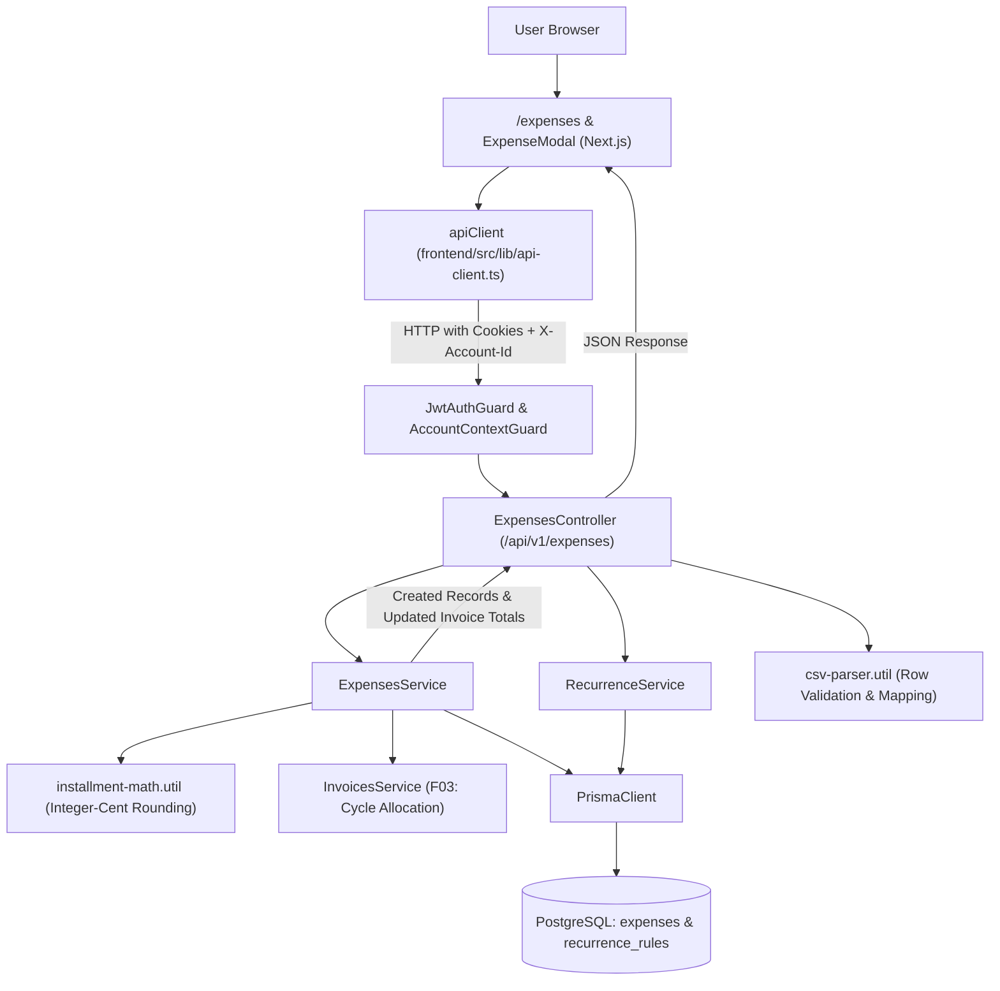

# Technical Specification: F04. Expense Entry and Recurrence Engine

## 1. Technical Overview

### 1.1 What
F04 implements the core expense registration, installment calculation, and recurrence scheduling engine for the collaborative financial workspace. It enables users to record individual cash outflows across direct payment rails (Debit Card, Pix, Boleto) and credit card purchases with multi-installment splitting (1x to 72x) powered by the banking-standard integer-cent distribution formula. It manages rolling 12-month materialized projections for recurring monthly commitments, allocates card installments into their respective billing statement invoices (F03), provides granular single or future-series deletion flows, and features a two-phase CSV batch import pipeline (preview and atomic confirmation).

### 1.2 Why
Accurate cash flow forecasting and debt management depend on exact penny reconciliation and transparent installment visibility. Repeating decimal rounding errors (dízimas periódicas) and fragmented tracking across cash vs credit channels obscure future disposable income. F04 enforces mathematical exactness down to the cent, links installments directly into statement billing cycles, and materializes recurring obligations into actionable ledger records that can be individually tracked, edited, and settled in downstream features (F06 and F07).

### 1.3 Scope

**Included (Core Scope + Full Scope Additions):**
- Relational schema for `expenses` and `recurrence_rules` with multi-tenant `account_id` foreign key isolation and cascade deletion.
- Enums:
  - `PaymentMethod`: `CREDIT_CARD`, `DEBIT_CARD`, `BOLETO`, `PIX`.
  - `PaymentStatus`: `PENDING`, `PAID`.
  - `RecurrenceFrequency`: `MONTHLY`.
- Cash expense entry (Debit, Pix, Boleto):
  - Description: 3 to 100 characters.
  - Amount: R$ 0.01 to R$ 999,999.99.
  - Date: Transaction date; Boleto due date defaults to transaction date + 3 days or user-selected; Debit and Pix default to transaction date.
  - Initial payment status toggle ("Paid now" vs "Pending").
- Credit card installment engine (1x to 72x):
  - Integer-cent rounding algorithm:
    $$\text{TotalCents} = \text{round}(\text{TotalAmount} \times 100)$$
    $$\text{BaseCents} = \lfloor \text{TotalCents} / N \rfloor$$
    $$\text{RemainderCents} = \text{TotalCents} - (\text{BaseCents} \times N)$$
    Installment 1 receives $\text{BaseCents} + \text{RemainderCents}$, installments 2 through $N$ receive $\text{BaseCents}$.
  - Common `installment_group_id` UUID binding all $N$ installments in a purchase series.
  - Automatic invoice cycle allocation (F03): Installment 1 targets the invoice corresponding to the transaction date (or next cycle if past closing day); subsequent installments ($k = 2..N$) are allocated to calendar months $M + k - 1$, generating invoice records if not already provisioned.
  - Available credit limit update: Deducts unpaid installments from the card's available credit line.
- Recurring monthly expense engine:
  - Parent recurrence template stored in `recurrence_rules`.
  - Materialized rolling 12-month forward instances created in `expenses` linked via `recurrence_rule_id`.
  - Future projections extended dynamically when querying forward months.
- Series editing & deletion:
  - Single deletion (`scope = 'SINGLE'`): Removes only the selected installment or recurring instance.
  - Future deletion (`scope = 'FUTURE'`): Removes the selected installment/instance and all subsequent instances in the series.
- Two-phase CSV batch import:
  - Phase 1: `POST /api/v1/expenses/import/preview`: Multipart CSV upload, parses and validates rows, maps Category and Card names/nicknames, checks limits, and returns validated rows with granular error messages.
  - Phase 2: `POST /api/v1/expenses/import/confirm`: Atomically commits validated rows to the database in a Prisma transaction.
- Interactive Next.js modal with real-time installment simulation table, payment method tabs, and dedicated CSV upload modal.

**Deferred / Out of Scope:**
- Automatic bank sync, Open Finance API integration, and OFX/PDF bank statement parsing (out of scope per PRD Section 7).
- Automatic barcode scanning or direct bank payment execution (out of scope per PRD Section 7).
- Variable installment values with compounding interest (all installments follow zero-interest integer-cent distribution).

### 1.4 Traceability Matrix

| PRD Requirement / Section | Specification Section | Implementation Component |
| :--- | :--- | :--- |
| **Section 6 - F04 Capabilities**: Description (3-100), Amount (0.01 - 999k), Methods (Credit, Debit, Boleto, Pix) | Section 5 (DTOs) & Section 6 (Data Model) | `create-expense.dto.ts`, Prisma `Expense` |
| **Section 6 - F04 Core Scope**: Exact integer-cent installment formula (1x to 72x) | Section 3 (Decision 1) & Section 4 | `installment-math.util.ts` |
| **Section 6 - F04 Core Scope**: Invoice allocation per closing day & subsequent months | Section 3 (Decision 2) & Section 4 | `ExpensesService.createCreditCardExpense()` |
| **Section 6 - F04 Full Scope**: 12-month forward recurring monthly scheduling engine | Section 3 (Decision 3) & Section 4 | `RecurrenceService.materializeProjections()` |
| **Section 6 - F04 Full Scope**: Bulk batch transaction import from structured CSV | Section 3 (Decision 4) & Section 5 | `csv-parser.util.ts`, `import/preview`, `import/confirm` |
| **Section 6 - F04 Experience**: Interactive modal, method toggles, live installment preview | Section 4 (Frontend Components) | `ExpenseModal.tsx`, `InstallmentPreviewTable.tsx` |
| **Section 9 - F04 Acceptance Criteria**: All 5 testable acceptance criteria | Section 7 (Testing Strategy) | `installment-math.util.spec.ts`, `expenses.service.spec.ts` |
| **Section 9 - Cross-Feature Integration**: Consumes F02 (Categories), F03 (Cards/Invoices); feeds F06 (Settlement) & F07 (Dashboard) | Section 2 & Section 5 | `ExpensesModule`, `InvoicesModule`, Foreign Keys |

---

## 2. Architecture Impact

### 2.1 Affected Components and File Structure

- **Backend (`backend/src/modules/expenses/`)**:
  - `expenses.module.ts`: NestJS module registering controller, services, imports (`PrismaModule`, `CardsModule`, `CategoriesModule`), and exports for F06 and F07.
  - `expenses.controller.ts`: REST controller exposing CRUD, series deletion, and CSV import endpoints under `/api/v1/expenses`.
  - `expenses.service.ts`: Core business logic for single expenses, installment distribution, series modification, and filtering.
  - `recurrence.service.ts`: Materialization engine for recurring monthly templates across 12-month forward projections.
  - `dto/create-expense.dto.ts`: Input validation DTO with polymorphic rules based on `paymentMethod` and `frequency`.
  - `dto/update-expense.dto.ts`: Input validation DTO for updating individual or future expenses.
  - `dto/csv-import.dto.ts`: DTOs for CSV preview response and batch confirmation payload.
  - `utils/installment-math.util.ts`: Pure functional utility implementing the integer-cent rounding formula.
  - `utils/csv-parser.util.ts`: Streaming CSV parser with row-by-row structural validation and normalization.
- **Database (`backend/prisma/`)**:
  - `schema.prisma`: New enums (`PaymentMethod`, `PaymentStatus`, `RecurrenceFrequency`), models (`Expense`, `RecurrenceRule`), and relations to `Account`, `Category`, `CreditCard`, and `Invoice`.
  - `migrations/20261024_add_expenses_and_recurrence/migration.sql`: DDL migration script.
- **Frontend (`frontend/src/`)**:
  - `app/(dashboard)/expenses/page.tsx`: Expenses ledger view with month filtering, method badges, and search.
  - `components/expenses/ExpenseModal.tsx`: Comprehensive transaction entry modal with live method switching and validation.
  - `components/expenses/InstallmentPreviewTable.tsx`: Real-time schedule preview showing installment amounts and target invoices.
  - `components/expenses/CsvImportModal.tsx`: Drag-and-drop CSV upload, validation table preview, and batch confirmation.
  - `components/layout/AppHeader.tsx`: Navigation link to `/expenses` with `Receipt` icon.

### 2.2 Component Architecture and Data Flow



---

## 3. Technical Decisions

| Decision | Chosen Approach | Alternative Considered | Trade-off / Rationale |
| :--- | :--- | :--- | :--- |
| **Installment Cent Allocation** | Exact integer-cent formula: $\text{BaseCents} = \lfloor \text{TotalCents} / N \rfloor$; remainder cents added exclusively to Installment 1. | Even float division with repeating decimals, or spread 1 cent across random installments. | Matches banking and credit card issuer standards in Brazil, eliminates repeating decimal discrepancies (dízimas periódicas), and guarantees mathematical cent reconciliation ($\sum \text{Installments} = \text{TotalAmount}$). |
| **Recurring Expense Architecture** | Template Parent (`recurrence_rules`) + Materialized Records (`expenses` linked via `recurrence_rule_id` across 12 forward months). | Virtual on-the-fly synthesis in memory. | Materialized records allow individual monthly bills to be edited, paid, or deleted independently (e.g., paying October rent while leaving November pending) and simplify settlement (F06) and dashboard aggregation (F07). |
| **Installment Series Linkage** | Common `installment_group_id: UUID` stored on each installment record with `installment_number` (1..N) and `installment_total` (N). | Normalized parent installment header table. | Reduces join overhead for ledger queries while enabling instant series identification, future deletion (`scope = 'FUTURE'`), and progress indicators (e.g., "3/10"). |
| **Invoice Integration & Rollover** | Directly assign `invoice_id` foreign key on card expenses; installment 1 targets current cycle (or next if past closing day); subsequent installments target sequential cycles $M + k - 1$ using `InvoicesService.ensureCycleInvoices()`. | Unlinked expenses aggregated by dates on the fly. | Enforces strict relational referential integrity, allows instant card statement lookup, and immediately updates invoice `total_amount` and card available limits. |
| **CSV Batch Import Flow** | Two-phase flow: Phase 1 parses and returns a validation preview (`valid: boolean`, line numbers, mapped entities); Phase 2 commits confirmed rows in a single atomic database transaction. | Single-step multipart form upload without user preview. | Prevents silent data corruption, allows users to review unmatched categories or card nicknames before persisting, and guarantees all-or-nothing transactional safety. |

---

## 4. Component Overview

### 4.1 Frontend Components

| File Path | New/Modified | Purpose | Key Responsibilities |
| :--- | :--- | :--- | :--- |
| `frontend/src/app/(dashboard)/expenses/page.tsx` | New | Expense ledger view | Displays monthly expense list, payment method sub-groupings, search filter, and opens modals. |
| `frontend/src/components/expenses/ExpenseModal.tsx` | New | Transaction entry dialog | Supports Cash (Debit, Pix, Boleto) and Credit Card inputs, category selector, and validation. |
| `frontend/src/components/expenses/InstallmentPreviewTable.tsx` | New | Real-time installment schedule | Displays calculated cents for installments 1..N with target statement invoice months. |
| `frontend/src/components/expenses/CsvImportModal.tsx` | New | Bulk CSV import dialog | File drag-and-drop, validation preview table with error tooltips, and atomic confirm action. |
| `frontend/src/components/layout/AppHeader.tsx` | Modified | Global application header | Adds navigation link to `/expenses` with `Receipt` icon. |

### 4.2 Backend Components

| File Path | New/Modified | Purpose | Key Responsibilities |
| :--- | :--- | :--- | :--- |
| `backend/src/modules/expenses/expenses.module.ts` | New | NestJS Feature Module | Bundles controller, services, imports `CardsModule` and `CategoriesModule`, and exports `ExpensesService`. |
| `backend/src/modules/expenses/expenses.controller.ts` | New | REST Controller | Exposes endpoints for expense CRUD, series deletion, and CSV preview/commit. |
| `backend/src/modules/expenses/expenses.service.ts` | New | Expense Business Logic | Single cash expenses, credit card installment generation, invoice total synchronization, and series deletion. |
| `backend/src/modules/expenses/recurrence.service.ts` | New | Recurrence Engine | Materializes 12-month forward instances from `RecurrenceRule`, handles series updates. |
| `backend/src/modules/expenses/utils/installment-math.util.ts` | New | Precision Financial Math | Implements integer-cent rounding algorithm with 100% cent conservation guarantee. |
| `backend/src/modules/expenses/utils/csv-parser.util.ts` | New | CSV Parser & Validator | Parses CSV streams, normalizes currency/dates, validates required columns, and maps category/card entities. |
| `backend/src/modules/expenses/dto/create-expense.dto.ts` | New | Validation DTO | Enforces 3-100 char description, currency bounds, payment method rules, and installment limits (1-72). |
| `backend/src/modules/expenses/dto/update-expense.dto.ts` | New | Validation DTO | Updates individual expense or entire forward series (`scope: 'SINGLE' | 'FUTURE'`). |
| `backend/src/app.module.ts` | Modified | Root Module | Imports and registers `ExpensesModule`. |

### 4.3 Database Schema & Migrations

| Migration File | Tables Affected | Operation | Notes |
| :--- | :--- | :--- | :--- |
| `20261024_add_expenses_and_recurrence/migration.sql` | `expenses`, `recurrence_rules` | CREATE | Adds tables, enums (`PaymentMethod`, `PaymentStatus`, `RecurrenceFrequency`), foreign keys, and indexes. |

---

## 5. API Contracts

### 5.1 Expense Entry Endpoints

#### Endpoint: List Expenses
- **Method:** `GET`
- **Path:** `/api/v1/expenses`
- **Authentication:** JWT Bearer (Cookie) + `X-Account-Id` header
- **Query Parameters:**
  - `month` (integer, optional, 1-12): Filter by transaction/billing month.
  - `year` (integer, optional): Filter by transaction/billing year.
  - `method` (enum, optional): Filter by `PaymentMethod`.
  - `categoryId` (UUID, optional): Filter by Category.
  - `cardId` (UUID, optional): Filter by Credit Card.
  - `status` (enum, optional): Filter by `PaymentStatus` (`PENDING`, `PAID`).

**Response (Success - 200 OK):**
```json
{
  "status": "success",
  "data": [
    {
      "id": "990e8400-e29b-41d4-a716-446655440001",
      "accountId": "a10e8400-e29b-41d4-a716-446655440000",
      "description": "Smart TV 55 pol 4K",
      "amount": 833.34,
      "transactionDate": "2026-10-22T14:30:00.000Z",
      "dueDate": "2026-11-12T23:59:59.999Z",
      "paymentMethod": "CREDIT_CARD",
      "paymentStatus": "PENDING",
      "categoryId": "c20e8400-e29b-41d4-a716-446655440001",
      "cardId": "770e8400-e29b-41d4-a716-446655440001",
      "invoiceId": "880e8400-e29b-41d4-a716-446655440010",
      "installmentGroupId": "550e8400-e29b-41d4-a716-446655440099",
      "installmentNumber": 1,
      "installmentTotal": 3,
      "isRecurring": false,
      "recurrenceRuleId": null,
      "notes": "Purchased on Amazon",
      "createdAt": "2026-10-22T14:35:00.000Z",
      "category": {
        "id": "c20e8400-e29b-41d4-a716-446655440001",
        "name": "Leisure & Entertainment",
        "color": "#FF9234",
        "icon": "film"
      },
      "card": {
        "id": "770e8400-e29b-41d4-a716-446655440001",
        "nickname": "Nubank Platinum",
        "brand": "MASTERCARD"
      }
    }
  ]
}
```

---

#### Endpoint: Create Expense
- **Method:** `POST`
- **Path:** `/api/v1/expenses`
- **Authentication:** JWT Bearer (Cookie) + `X-Account-Id` header

**Request Body (Credit Card with Installments):**

| Field | Type | Required | Validation | Description |
| :--- | :--- | :--- | :--- | :--- |
| `description` | `string` | Yes | 3 to 100 characters | Name or description of expense |
| `amount` | `number` | Yes | Min: `0.01`, Max: `999999.99` | Total transaction amount |
| `transactionDate` | `string` | Yes | ISO 8601 Date | Date when purchase was made |
| `paymentMethod` | `string` | Yes | `CREDIT_CARD`, `DEBIT_CARD`, `BOLETO`, `PIX` | Payment rail |
| `categoryId` | `string` | Yes | Valid UUID in account | Category classification |
| `cardId` | `string` | Cond. | Required if `paymentMethod == 'CREDIT_CARD'` | Target credit card |
| `installments` | `integer`| No | 1 to 72 (default: `1`) | Number of installments |
| `isRecurring` | `boolean`| No | Default: `false` | Monthly recurring flag |
| `paymentStatus` | `string` | No | `PENDING`, `PAID` (default: `PENDING`) | Cash payment status |
| `dueDate` | `string` | No | ISO 8601 Date | Custom due date (for Boleto) |
| `notes` | `string` | No | Max 255 chars | Optional memo |

**Request Example (Credit Card 3x):**
```json
{
  "description": "Smart TV 55 pol 4K",
  "amount": 2500.00,
  "transactionDate": "2026-10-22T14:30:00.000Z",
  "paymentMethod": "CREDIT_CARD",
  "categoryId": "c20e8400-e29b-41d4-a716-446655440001",
  "cardId": "770e8400-e29b-41d4-a716-446655440001",
  "installments": 3,
  "notes": "Amazon Prime Day"
}
```

**Response (Success - 201 Created):**
```json
{
  "status": "success",
  "data": {
    "installmentGroupId": "550e8400-e29b-41d4-a716-446655440099",
    "totalAmount": 2500.00,
    "installmentsGenerated": 3,
    "records": [
      {
        "id": "990e8400-e29b-41d4-a716-446655440001",
        "installmentNumber": 1,
        "amount": 833.34,
        "invoiceMonth": 11,
        "invoiceYear": 2026,
        "dueDate": "2026-11-12T23:59:59.999Z"
      },
      {
        "id": "990e8400-e29b-41d4-a716-446655440002",
        "installmentNumber": 2,
        "amount": 833.33,
        "invoiceMonth": 12,
        "invoiceYear": 2026,
        "dueDate": "2026-12-12T23:59:59.999Z"
      },
      {
        "id": "990e8400-e29b-41d4-a716-446655440003",
        "installmentNumber": 3,
        "amount": 833.33,
        "invoiceMonth": 1,
        "invoiceYear": 2027,
        "dueDate": "2027-01-12T23:59:59.999Z"
      }
    ]
  }
}
```

**Error Codes:**

| Code | HTTP Status | Description |
| :--- | :--- | :--- |
| `EXP001` | 400 Bad Request | Description must be between 3 and 100 characters. |
| `EXP002` | 400 Bad Request | Amount must be between R$ 0.01 and R$ 999,999.99. |
| `EXP003` | 400 Bad Request | Installments count must be an integer between 1 and 72. |
| `EXP004` | 400 Bad Request | Credit card payment method requires a valid cardId belonging to this account. |
| `EXP005` | 404 Not Found | Selected category not found in this account. |

---

#### Endpoint: Delete Expense
- **Method:** `DELETE`
- **Path:** `/api/v1/expenses/:id`
- **Authentication:** JWT Bearer (Cookie) + `X-Account-Id` header
- **Query Parameters:**
  - `scope` (`SINGLE` | `FUTURE`, default: `SINGLE`): Delete only this instance or this and all future installments/occurrences.

**Response (Success - 200 OK):**
```json
{
  "status": "success",
  "message": "Expense(s) successfully deleted.",
  "deletedCount": 3
}
```

---

### 5.2 CSV Batch Import Endpoints

#### Endpoint: Preview CSV Import
- **Method:** `POST`
- **Path:** `/api/v1/expenses/import/preview`
- **Authentication:** JWT Bearer (Cookie) + `X-Account-Id` header
- **Content-Type:** `multipart/form-data` (file: `expenses.csv`)

**CSV Specification Header:**
`description,amount,date,method,category,card_nickname,installments,notes`

**Response (Success - 200 OK):**
```json
{
  "status": "success",
  "data": {
    "totalRows": 4,
    "validRows": 3,
    "invalidRows": 1,
    "items": [
      {
        "rowNumber": 1,
        "isValid": true,
        "errors": [],
        "parsed": {
          "description": "Supermarket Weekly",
          "amount": 340.50,
          "date": "2026-10-20",
          "method": "DEBIT_CARD",
          "categoryName": "Food & Dining",
          "categoryId": "c20e8400-e29b-41d4-a716-446655440001",
          "cardNickname": null,
          "cardId": null,
          "installments": 1,
          "notes": ""
        }
      },
      {
        "rowNumber": 2,
        "isValid": false,
        "errors": [
          "Category 'Cryptocurrency' does not exist in this account",
          "Card nickname 'Santander' not found"
        ],
        "parsed": null
      }
    ]
  }
}
```

---

#### Endpoint: Confirm CSV Batch Import
- **Method:** `POST`
- **Path:** `/api/v1/expenses/import/confirm`
- **Authentication:** JWT Bearer (Cookie) + `X-Account-Id` header

**Request Body:**
```json
{
  "rows": [
    {
      "description": "Supermarket Weekly",
      "amount": 340.50,
      "transactionDate": "2026-10-20T10:00:00.000Z",
      "paymentMethod": "DEBIT_CARD",
      "categoryId": "c20e8400-e29b-41d4-a716-446655440001",
      "installments": 1
    }
  ]
}
```

**Response (Success - 201 Created):**
```json
{
  "status": "success",
  "data": {
    "importedCount": 1
  }
}
```

---

## 6. Data Model

### 6.1 Database Tables

#### Table: `recurrence_rules`

| Column | Type | Nullable | Default | Description |
| :--- | :--- | :--- | :--- | :--- |
| `id` | `UUID` | No | `gen_random_uuid()` | Primary Key |
| `account_id` | `UUID` | No | - | Foreign Key referencing `accounts(id)` with ON DELETE CASCADE |
| `description` | `VARCHAR(100)` | No | - | Description of recurring commitment |
| `amount` | `DECIMAL(12,2)`| No | - | Recurring amount |
| `frequency` | `RecurrenceFrequency`| No | `MONTHLY`| Recurrence interval |
| `day_of_month` | `INTEGER` | No | - | Day of month when expense occurs (1 to 31) |
| `start_date` | `TIMESTAMPTZ` | No | - | Initial cycle start date |
| `end_date` | `TIMESTAMPTZ` | Yes | `NULL` | Cancellation date |
| `payment_method`| `PaymentMethod`| No | - | Payment method rail |
| `category_id` | `UUID` | No | - | Foreign Key referencing `categories(id)` |
| `card_id` | `UUID` | Yes | `NULL` | Foreign Key referencing `credit_cards(id)` |
| `created_at` | `TIMESTAMPTZ` | No | `NOW()` | Audit creation timestamp |
| `updated_at` | `TIMESTAMPTZ` | No | `NOW()` | Audit update timestamp |

**Indexes:**
- `@@index([accountId], name: "ix_recurrence_rules_account_id")`

---

#### Table: `expenses`

| Column | Type | Nullable | Default | Description |
| :--- | :--- | :--- | :--- | :--- |
| `id` | `UUID` | No | `gen_random_uuid()` | Primary Key |
| `account_id` | `UUID` | No | - | Foreign Key referencing `accounts(id)` with ON DELETE CASCADE |
| `description` | `VARCHAR(100)` | No | - | Expense description |
| `amount` | `DECIMAL(12,2)`| No | - | Exact decimal amount for this entry |
| `transaction_date`| `TIMESTAMPTZ`| No | - | Date transaction was made |
| `due_date` | `TIMESTAMPTZ` | No | - | Payment due date (Boleto or card invoice due date) |
| `payment_method` | `PaymentMethod`| No | - | `CREDIT_CARD`, `DEBIT_CARD`, `BOLETO`, `PIX` |
| `payment_status` | `PaymentStatus`| No | `PENDING` | `PENDING` or `PAID` |
| `category_id` | `UUID` | No | - | Foreign Key referencing `categories(id)` ON DELETE RESTRICT |
| `card_id` | `UUID` | Yes | `NULL` | Foreign Key referencing `credit_cards(id)` ON DELETE RESTRICT |
| `invoice_id` | `UUID` | Yes | `NULL` | Foreign Key referencing `invoices(id)` ON DELETE SET NULL |
| `installment_group_id`| `UUID` | Yes | `NULL` | Shared UUID linking multi-installment purchases |
| `installment_number` | `INTEGER` | Yes | `NULL` | Current installment index ($1 \le k \le N$) |
| `installment_total` | `INTEGER` | Yes | `NULL` | Total count of installments ($N$) |
| `is_recurring` | `BOOLEAN` | No | `false` | True if generated from a recurring template |
| `recurrence_rule_id` | `UUID` | Yes | `NULL` | Foreign Key referencing `recurrence_rules(id)` ON DELETE SET NULL |
| `notes` | `VARCHAR(255)` | Yes | `NULL` | Optional memo |
| `created_at` | `TIMESTAMPTZ` | No | `NOW()` | Record creation timestamp |
| `updated_at` | `TIMESTAMPTZ` | No | `NOW()` | Record update timestamp |

**Indexes:**
- `@@index([accountId, transactionDate], name: "ix_expenses_account_date")`
- `@@index([accountId, paymentMethod], name: "ix_expenses_account_method")`
- `@@index([accountId, paymentStatus], name: "ix_expenses_account_status")`
- `@@index([invoiceId], name: "ix_expenses_invoice_id")`
- `@@index([installmentGroupId], name: "ix_expenses_installment_group")`
- `@@index([recurrenceRuleId], name: "ix_expenses_recurrence_rule")`

---

### 6.2 Prisma Schema Additions

```prisma
enum PaymentMethod {
  CREDIT_CARD
  DEBIT_CARD
  BOLETO
  PIX
}

enum PaymentStatus {
  PENDING
  PAID
}

enum RecurrenceFrequency {
  MONTHLY
}

model RecurrenceRule {
  id            String              @id @default(uuid()) @db.Uuid
  accountId     String              @map("account_id") @db.Uuid
  description   String              @db.VarChar(100)
  amount        Decimal             @db.Decimal(12, 2)
  frequency     RecurrenceFrequency @default(MONTHLY)
  dayOfMonth    Int                 @map("day_of_month")
  startDate     DateTime            @map("start_date") @db.Timestamptz()
  endDate       DateTime?           @map("end_date") @db.Timestamptz()
  paymentMethod PaymentMethod       @map("payment_method")
  categoryId    String              @map("category_id") @db.Uuid
  cardId        String?             @map("card_id") @db.Uuid
  createdAt     DateTime            @default(now()) @map("created_at") @db.Timestamptz()
  updatedAt     DateTime            @updatedAt @map("updated_at") @db.Timestamptz()

  account       Account             @relation(fields: [accountId], references: [id], onDelete: Cascade)
  category      Category            @relation(fields: [categoryId], references: [id], onDelete: Restrict)
  card          CreditCard?         @relation(fields: [cardId], references: [id], onDelete: SetNull)
  expenses      Expense[]

  @@index([accountId], name: "ix_recurrence_rules_account_id")
  @@map("recurrence_rules")
}

model Expense {
  id                 String         @id @default(uuid()) @db.Uuid
  accountId          String         @map("account_id") @db.Uuid
  description        String         @db.VarChar(100)
  amount             Decimal        @db.Decimal(12, 2)
  transactionDate    DateTime       @map("transaction_date") @db.Timestamptz()
  dueDate            DateTime       @map("due_date") @db.Timestamptz()
  paymentMethod      PaymentMethod  @map("payment_method")
  paymentStatus      PaymentStatus  @default(PENDING) @map("payment_status")
  categoryId         String         @map("category_id") @db.Uuid
  cardId             String?        @map("card_id") @db.Uuid
  invoiceId          String?        @map("invoice_id") @db.Uuid
  installmentGroupId String?        @map("installment_group_id") @db.Uuid
  installmentNumber  Int?           @map("installment_number")
  installmentTotal   Int?           @map("installment_total")
  isRecurring        Boolean        @default(false) @map("is_recurring")
  recurrenceRuleId   String?        @map("recurrence_rule_id") @db.Uuid
  notes              String?        @db.VarChar(255)
  createdAt          DateTime       @default(now()) @map("created_at") @db.Timestamptz()
  updatedAt          DateTime       @updatedAt @map("updated_at") @db.Timestamptz()

  account            Account        @relation(fields: [accountId], references: [id], onDelete: Cascade)
  category           Category       @relation(fields: [categoryId], references: [id], onDelete: Restrict)
  card               CreditCard?    @relation(fields: [cardId], references: [id], onDelete: Restrict)
  invoice            Invoice?       @relation(fields: [invoiceId], references: [id], onDelete: SetNull)
  recurrenceRule     RecurrenceRule?@relation(fields: [recurrenceRuleId], references: [id], onDelete: SetNull)

  @@index([accountId, transactionDate], name: "ix_expenses_account_date")
  @@index([accountId, paymentMethod], name: "ix_expenses_account_method")
  @@index([accountId, paymentStatus], name: "ix_expenses_account_status")
  @@index([invoiceId], name: "ix_expenses_invoice_id")
  @@index([installmentGroupId], name: "ix_expenses_installment_group")
  @@index([recurrenceRuleId], name: "ix_expenses_recurrence_rule")
  @@map("expenses")
}
```

---

### 6.3 DDL Migration Script

```sql
-- CreateEnum
CREATE TYPE "PaymentMethod" AS ENUM ('CREDIT_CARD', 'DEBIT_CARD', 'BOLETO', 'PIX');

-- CreateEnum
CREATE TYPE "PaymentStatus" AS ENUM ('PENDING', 'PAID');

-- CreateEnum
CREATE TYPE "RecurrenceFrequency" AS ENUM ('MONTHLY');

-- CreateTable
CREATE TABLE "recurrence_rules" (
    "id" UUID NOT NULL DEFAULT gen_random_uuid(),
    "account_id" UUID NOT NULL,
    "description" VARCHAR(100) NOT NULL,
    "amount" DECIMAL(12,2) NOT NULL,
    "frequency" "RecurrenceFrequency" NOT NULL DEFAULT 'MONTHLY',
    "day_of_month" INTEGER NOT NULL,
    "start_date" TIMESTAMPTZ NOT NULL,
    "end_date" TIMESTAMPTZ,
    "payment_method" "PaymentMethod" NOT NULL,
    "category_id" UUID NOT NULL,
    "card_id" UUID,
    "created_at" TIMESTAMPTZ NOT NULL DEFAULT CURRENT_TIMESTAMP,
    "updated_at" TIMESTAMPTZ NOT NULL DEFAULT CURRENT_TIMESTAMP,

    CONSTRAINT "pk_recurrence_rules" PRIMARY KEY ("id")
);

-- CreateTable
CREATE TABLE "expenses" (
    "id" UUID NOT NULL DEFAULT gen_random_uuid(),
    "account_id" UUID NOT NULL,
    "description" VARCHAR(100) NOT NULL,
    "amount" DECIMAL(12,2) NOT NULL,
    "transaction_date" TIMESTAMPTZ NOT NULL,
    "due_date" TIMESTAMPTZ NOT NULL,
    "payment_method" "PaymentMethod" NOT NULL,
    "payment_status" "PaymentStatus" NOT NULL DEFAULT 'PENDING',
    "category_id" UUID NOT NULL,
    "card_id" UUID,
    "invoice_id" UUID,
    "installment_group_id" UUID,
    "installment_number" INTEGER,
    "installment_total" INTEGER,
    "is_recurring" BOOLEAN NOT NULL DEFAULT false,
    "recurrence_rule_id" UUID,
    "notes" VARCHAR(255),
    "created_at" TIMESTAMPTZ NOT NULL DEFAULT CURRENT_TIMESTAMP,
    "updated_at" TIMESTAMPTZ NOT NULL DEFAULT CURRENT_TIMESTAMP,

    CONSTRAINT "pk_expenses" PRIMARY KEY ("id")
);

-- Foreign Keys
ALTER TABLE "recurrence_rules" ADD CONSTRAINT "fk_recurrence_account" FOREIGN KEY ("account_id") REFERENCES "accounts"("id") ON DELETE CASCADE ON UPDATE CASCADE;
ALTER TABLE "recurrence_rules" ADD CONSTRAINT "fk_recurrence_category" FOREIGN KEY ("category_id") REFERENCES "categories"("id") ON DELETE RESTRICT ON UPDATE CASCADE;
ALTER TABLE "recurrence_rules" ADD CONSTRAINT "fk_recurrence_card" FOREIGN KEY ("card_id") REFERENCES "credit_cards"("id") ON DELETE SET NULL ON UPDATE CASCADE;

ALTER TABLE "expenses" ADD CONSTRAINT "fk_expenses_account" FOREIGN KEY ("account_id") REFERENCES "accounts"("id") ON DELETE CASCADE ON UPDATE CASCADE;
ALTER TABLE "expenses" ADD CONSTRAINT "fk_expenses_category" FOREIGN KEY ("category_id") REFERENCES "categories"("id") ON DELETE RESTRICT ON UPDATE CASCADE;
ALTER TABLE "expenses" ADD CONSTRAINT "fk_expenses_card" FOREIGN KEY ("card_id") REFERENCES "credit_cards"("id") ON DELETE RESTRICT ON UPDATE CASCADE;
ALTER TABLE "expenses" ADD CONSTRAINT "fk_expenses_invoice" FOREIGN KEY ("invoice_id") REFERENCES "invoices"("id") ON DELETE SET NULL ON UPDATE CASCADE;
ALTER TABLE "expenses" ADD CONSTRAINT "fk_expenses_recurrence" FOREIGN KEY ("recurrence_rule_id") REFERENCES "recurrence_rules"("id") ON DELETE SET NULL ON UPDATE CASCADE;

-- Indexes
CREATE INDEX "ix_recurrence_rules_account_id" ON "recurrence_rules"("account_id");
CREATE INDEX "ix_expenses_account_date" ON "expenses"("account_id", "transaction_date");
CREATE INDEX "ix_expenses_account_method" ON "expenses"("account_id", "payment_method");
CREATE INDEX "ix_expenses_account_status" ON "expenses"("account_id", "payment_status");
CREATE INDEX "ix_expenses_invoice_id" ON "expenses"("invoice_id");
CREATE INDEX "ix_expenses_installment_group" ON "expenses"("installment_group_id");
CREATE INDEX "ix_expenses_recurrence_rule" ON "expenses"("recurrence_rule_id");
```

---

## 7. Testing Strategy

### 7.1 Test File Structure

| Test File | Type | Target Module | Target Coverage |
| :--- | :--- | :--- | :--- |
| `backend/test/expenses/installment-math.util.spec.ts` | Unit | Pure math rounding formula | 100% |
| `backend/test/expenses/csv-parser.util.spec.ts` | Unit | CSV parsing, sanitization, validation | 95% |
| `backend/test/expenses/expenses.service.spec.ts` | Unit | Expense CRUD, installment generation, series deletion | 95% |
| `backend/test/expenses/recurrence.service.spec.ts` | Unit | 12-month forward projections & materialization | 90% |

### 7.2 Specific Test Cases and Functions

#### `installment-math.util.spec.ts`
- `shouldCalculateExactInstallmentCentBreakdown()`: Tests R$ 100.00 in 3 installments (Yields: [33.34, 33.33, 33.33], sum = 100.00).
- `shouldConserveTotalSumDownToTheCent()`: Tests prime numbers and edge amounts across installment counts up to 72x ($\sum \text{Installments} == \text{TotalAmount}$ exact).
- `shouldHandleSingleInstallmentWithoutRoundingAdjustment()`: Tests 1x purchase returning exact original amount.

#### `expenses.service.spec.ts`
- `shouldCreateSingleCashExpense()`: Creates Debit, Pix, or Boleto expense with appropriate default due dates.
- `shouldCreateCreditCardInstallmentSeriesAndAllocateInvoices()`: Creates 3x expense, calls `InvoicesService.ensureCycleInvoices`, and links each installment to its respective monthly invoice.
- `shouldDeleteSingleInstallmentWhenScopeIsSingle()`: Deletes installment 2 without affecting installment 1 or 3.
- `shouldDeleteFutureInstallmentsWhenScopeIsFuture()`: Deletes installments 2 and 3 when deleting installment 2 with `scope = 'FUTURE'`.
- `shouldRejectExpenseWhenCardIdMissingForCreditCard()`: Throws HTTP 400 with code `EXP004`.
- `shouldRejectExpenseWhenAmountIsZeroOrNegative()`: Throws HTTP 400 with code `EXP002`.

#### `recurrence.service.spec.ts`
- `shouldCreateRecurrenceRuleAndMaterialize12Months()`: Validates creation of template and generation of 12 child records.
- `shouldStopMaterializationAtEndDate()`: Respects `endDate` when materializing monthly projections.

#### `csv-parser.util.spec.ts`
- `shouldParseValidCsvStreamAndMapEntities()`: Correctly parses valid CSV rows and matches category and card nicknames.
- `shouldIdentifyRowErrorsAndReturnValidationPreview()`: Reports invalid lines (missing required fields, unmapped categories) without throwing uncaught exceptions.
