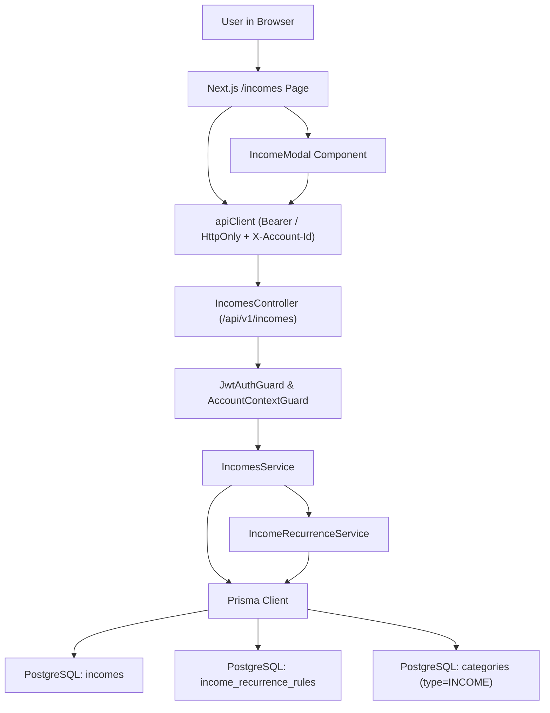
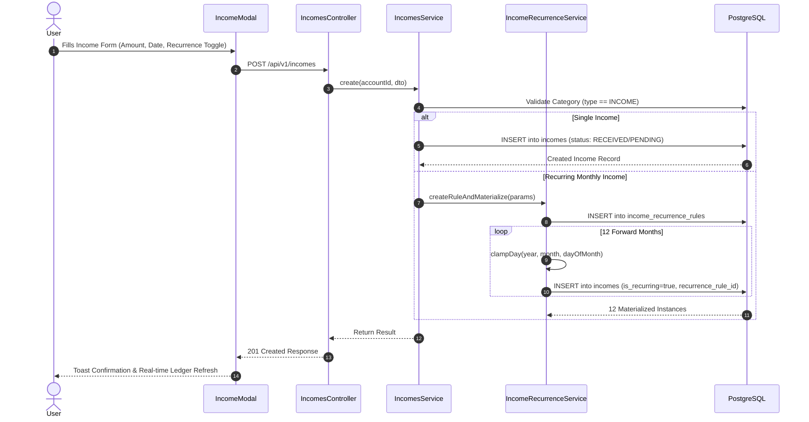

# Technical Specification: F05. Income Tracking and Cash Flow Entry

## 1. Technical Overview

### 1.1 What
F05 implements the core income management and cash flow intake engine for the collaborative financial workspace. It enables users to record one-time deposits (such as freelance payments, asset sales, or tax refunds) and schedule recurring monthly incomes (such as salaries, pensions, or rental yields). The engine manages rolling 12-month forward materialized projections for recurring income templates, supports dual status tracking (`RECEIVED` vs `PENDING`) with one-click reconciliation, enforces strict calendar date clamping and validation, restricts category assignments to `INCOME`-typed categories (F02), provides granular single-instance vs future-series deletion, and dynamically feeds income totals into downstream monthly ledger aggregation (F07).

### 1.2 Why
Accurate net disposable income calculation ($\text{Net Cash Flow} = \sum \text{Incomes} - \sum \text{Expenses}$) is impossible without reliable tracking of incoming funds alongside outgoing commitments. Personal finances require clear differentiation between expected future earnings and cash already received in the bank. Materializing recurring receipts across a rolling 12-month forward horizon eliminates recurring-math drift, gives users immediate visibility into their future financial posture, and allows single-month pay adjustments (e.g., bonuses, 13º salário, or unpaid leave) without altering the master recurring contract.

### 1.3 Scope

**Included:**
- Relational schema for `incomes` and `income_recurrence_rules` with multi-tenant `account_id` foreign key isolation and cascade deletion.
- Enum `IncomeStatus`:
  - `RECEIVED`: Payment settled and credited to the account.
  - `PENDING`: Projected or expected receipt awaiting settlement.
- Single income entry:
  - Description: 3 to 100 characters.
  - Monetary amount: R$ 0.01 to R$ 999,999.99.
  - Receipt date: Valid calendar date, constrained to a maximum of 24 months into the future.
  - Category assignment: Restricted to categories where `type = INCOME` (F02), pre-selecting `"Income/Salary"` by default.
  - Status toggle: Defaults intelligently to `RECEIVED` for past and present dates, and `PENDING` for future dates, with manual override.
  - Optional free-form notes: Up to 500 characters.
- Recurring monthly income engine:
  - Master template stored in `income_recurrence_rules`.
  - Materialized rolling 12-month forward instances created in `incomes` linked via `income_recurrence_rule_id`.
  - Automatic end-of-month calendar clamping (`clampDay`) for receipt dates on days 29–31 across short months.
- Series management & deletion:
  - Single deletion (`scope = 'SINGLE'`): Deletes only the selected monthly income instance.
  - Future series deletion (`scope = 'FUTURE'`): Deletes the selected instance and all future scheduled instances in that recurrence series.
- REST API endpoints under `/api/v1/incomes` protected by `JwtAuthGuard` and `AccountContextGuard`.
- Dedicated responsive Next.js ledger at `/incomes` with monthly navigation, financial KPI cards (Total Income, Received, Expected Pending), real-time status toggles, and unified modal integration.

**Deferred / Out of Scope:**
- Automatic bank account statement synchronization (Open Finance / PIX webhooks) per PRD Section 7.
- Complex tax deduction or net-salary calculation calculators (incomes record gross or net as entered by the user).
- Multi-currency conversions (all amounts are denominated in BRL cents/currency).

### 1.4 Traceability Matrix

| PRD Requirement / Section | Specification Section | Implementation Component |
| :--- | :--- | :--- |
| **Section 6 - F05 Capabilities**: Description (3-100), Amount (0.01 - 999k), Receipt date, Recurrence | Section 5 (DTOs) & Section 6 (Data Model) | `create-income.dto.ts`, Prisma `Income` |
| **Section 6 - F05 Capabilities**: Default pre-selected category `"Income/Salary"` | Section 4 & Section 5 | `IncomeModal.tsx`, `IncomesService.create()` |
| **Section 6 - F05 Experience**: Green accent highlights, monthly recurrence toggle, cash flow calculation | Section 2 & Section 4 (Frontend) | `IncomeModal.tsx`, `/incomes/page.tsx` |
| **Section 6 - F05 Error Handling**: Negative/zero amount, future date beyond 24 months | Section 5 (Error Codes) | `create-income.dto.ts`, `IncomesService` |
| **Section 9 - F05 Acceptance Criteria**: User records new income within active account | Section 5 & Section 7 | `POST /api/v1/incomes`, `incomes.service.spec.ts` |
| **Section 9 - F05 Acceptance Criteria**: Recurring income automatically replicates into subsequent months | Section 3 (Decision 1) & Section 6 | `IncomeRecurrenceService.materializeProjections()` |
| **Section 9 - Cross-Feature Integration**: Consumes F02 Categories, feeds F07 Dashboard Net Balance | Section 2 & Section 5 | `IncomesModule`, Foreign Keys, Prisma relations |

---

## 2. Architecture Impact

### 2.1 Affected Components and File Structure

- **Backend (`backend/src/modules/incomes/`)**:
  - `incomes.module.ts`: NestJS module registering controller, services, imports (`PrismaModule`, `CategoriesModule`), and exporting `IncomesService` for downstream dashboard aggregation (F07).
  - `incomes.controller.ts`: REST controller exposing endpoints for CRUD, monthly filtering, and series deletion under `/api/v1/incomes`.
  - `incomes.service.ts`: Business logic for single income entries, listing with month/year filters, and series-scoped deletions.
  - `income-recurrence.service.ts`: Materialization engine generating rolling 12-month forward instances in the `incomes` table.
  - `dto/create-income.dto.ts`: Input validation DTO enforcing field lengths, date bounds, and positive amounts.
  - `dto/update-income.dto.ts`: Partial update DTO for income descriptions, amounts, dates, notes, and settlement status.
- **Database (`backend/prisma/`)**:
  - `schema.prisma`: New enum `IncomeStatus` (`RECEIVED`, `PENDING`), models `Income` and `IncomeRecurrenceRule`, and relations on `Account` and `Category`.
  - `migrations/20261025_add_incomes_and_recurrence/migration.sql`: PostgreSQL DDL script creating tables, constraints, and indexes.
- **Frontend (`frontend/src/`)**:
  - `app/(dashboard)/incomes/page.tsx`: Dedicated ledger view featuring month navigator, KPI cards, filter bar, status toggle, and granular deletion modal.
  - `components/incomes/IncomeModal.tsx`: Creation and edit modal styled with emerald/green accents and category picker.
  - `components/layout/AppHeader.tsx`: Adds direct navigation link to `/incomes` with `TrendingUp` icon.
  - `app/(dashboard)/page.tsx`: Updates dashboard module card for F05 with active navigation to `/incomes`.

### 2.2 Mermaid Diagrams

#### Fullstack Architecture and Flow



#### Income Creation and Recurrence Lifecycle



---

## 3. Technical Decisions

| Decision | Chosen Approach | Alternative Considered | Trade-off |
| :--- | :--- | :--- | :--- |
| **1. Recurrence Architecture** | **Materialized Projections**: Persist master rule in `income_recurrence_rules` and materialize 12 rolling forward instances in `incomes`. | Virtual In-Memory Projections generated only on query time. | Requires database records upfront, but enables users to edit, mark as received, or delete specific months individually with full auditability and standard relational queries. |
| **2. Settlement Status Model** | **Explicit Enum (`RECEIVED` vs `PENDING`)**: Store status per income row with quick one-click toggle and auto-default based on calendar date. | Implicit binary based strictly on system date vs receipt date. | Requires storing a column in the database, but allows users to track anticipated client payments or variable bonuses that have not yet cleared. |
| **3. Navigation Structure** | **Dedicated `/incomes` Page**: Independent page with emerald branding, monthly KPIs, and direct AppHeader link. | Merged single page with tabs inside `/expenses`. | Adds a route to the application, but provides clear separation of concerns between liabilities/debts (expenses) and cash intake (incomes). |
| **4. Recurring Deletion Scoping** | **Granular Scoping (`SINGLE` vs `FUTURE`)**: Query parameter `?scope=SINGLE\|FUTURE` determining deletion cascade. | Deleting entire recurrence rule across all historical and future months. | Requires additional logic and user prompt modal, but prevents accidental destruction of past audited income history when a recurring income ends. |
| **5. Category Type Constraint** | **Enforced Database & DTO Filter**: Validate that `category.type === 'INCOME'` upon creation and update. | Allowing any category to be associated with income. | Stricter validation prevents corrupting expense category counters and ensures accurate financial reporting. |

---

## 4. Component Overview

### 4.1 Frontend Components

| File Path | New/Modified | Purpose | Key Responsibilities |
| :--- | :--- | :--- | :--- |
| `frontend/src/app/(dashboard)/incomes/page.tsx` | New | Main income ledger view | Month/year navigation, KPI summary cards (Total, Received, Pending), search/filter controls, status toggles, deletion modal. |
| `frontend/src/components/incomes/IncomeModal.tsx` | New | Income creation and edit modal | Category dropdown (filtered to `INCOME`), amount formatting, receipt date picker, recurrence checkbox, status selector. |
| `frontend/src/components/layout/AppHeader.tsx` | Modified | Top application navigation header | Adds direct `Incomes` navigation link with `TrendingUp` icon alongside `Expenses` and `Cards`. |
| `frontend/src/app/(dashboard)/page.tsx` | Modified | Dashboard home overview | Updates the F05 feature card to be an active link directing to `/incomes`. |

### 4.2 Backend Components

| File Path | New/Modified | Purpose | Key Responsibilities |
| :--- | :--- | :--- | :--- |
| `backend/src/modules/incomes/incomes.module.ts` | New | NestJS dependency injection module | Configures controllers, providers, imports `PrismaModule` and `CategoriesModule`, exports `IncomesService`. |
| `backend/src/modules/incomes/incomes.controller.ts` | New | REST endpoint controller | Exposes endpoints for income listing, creation, single retrieval, updates, and series deletion. |
| `backend/src/modules/incomes/incomes.service.ts` | New | Primary business logic provider | Implements CRUD, month/year date filtering on `receiptDate`, category validation, and scoped deletions. |
| `backend/src/modules/incomes/income-recurrence.service.ts` | New | Recurrence projection manager | Creates recurring templates and materializes 12 monthly instances with calendar date clamping. |
| `backend/src/modules/incomes/dto/create-income.dto.ts` | New | Income creation validation DTO | Validates description (3–100 chars), amount ($0.01–$999k), receipt date ($\le 24$ months), and recurrence flag. |
| `backend/src/modules/incomes/dto/update-income.dto.ts` | New | Partial income update DTO | Validates optional mutable fields (`description`, `amount`, `receiptDate`, `categoryId`, `status`, `notes`). |
| `backend/src/app.module.ts` | Modified | Root NestJS module | Registers `IncomesModule` in application imports. |

### 4.3 Database Layer

| Migration File | Tables Affected | Operation | Notes |
| :--- | :--- | :--- | :--- |
| `20261025_add_incomes_and_recurrence/migration.sql` | `incomes`, `income_recurrence_rules` | CREATE | Adds models, enum `IncomeStatus`, foreign key cascades to `accounts` and `categories`, and performance indexes. |

---

## 5. API Contracts

### 5.1 List Incomes
- **Method:** `GET`
- **Path:** `/api/v1/incomes`
- **Authentication:** JWT Bearer (HttpOnly Cookie) + `X-Account-Id` Header

**Query Parameters:**

| Parameter | Type | Required | Description |
| :--- | :--- | :--- | :--- |
| `month` | `integer` | No | Calendar month (1–12) to filter by `receiptDate`. |
| `year` | `integer` | No | Calendar year (e.g., 2026) to filter by `receiptDate`. |
| `categoryId` | `uuid` | No | Filter incomes belonging to a specific category. |
| `status` | `string` | No | Filter by settlement status: `RECEIVED` or `PENDING`. |
| `search` | `string` | No | Case-insensitive search on description or notes. |

**Response (Success - 200 OK):**
```json
{
  "status": "success",
  "data": [
    {
      "id": "e4a2c8b1-1234-4567-89ab-cdef01234567",
      "accountId": "a1b2c3d4-e5f6-7a8b-9c0d-1e2f3a4b5c6d",
      "description": "Salário Mensal",
      "amount": 7500.00,
      "receiptDate": "2026-10-05T12:00:00.000Z",
      "status": "RECEIVED",
      "categoryId": "c9d8e7f6-5432-10fe-dcba-9876543210ab",
      "isRecurring": true,
      "incomeRecurrenceRuleId": "f1e2d3c4-b5a6-9788-7654-3210fedcba98",
      "notes": "Depósito em conta corrente",
      "createdAt": "2026-10-01T10:00:00.000Z",
      "updatedAt": "2026-10-05T14:30:00.000Z",
      "category": {
        "id": "c9d8e7f6-5432-10fe-dcba-9876543210ab",
        "name": "Income/Salary",
        "color": "#2EC4B6",
        "icon": "wallet"
      }
    }
  ]
}
```

---

### 5.2 Create Income
- **Method:** `POST`
- **Path:** `/api/v1/incomes`
- **Authentication:** JWT Bearer (HttpOnly Cookie) + `X-Account-Id` Header

**Request:**

| Field | Type | Required | Validation | Description |
| :--- | :--- | :--- | :--- | :--- |
| `description` | `string` | Yes | 3 to 100 characters | Name/description of the income source. |
| `amount` | `number` | Yes | Min: 0.01, Max: 999999.99 | Monetary value of the income in BRL. |
| `receiptDate` | `string` | Yes | ISO 8601 date, $\le 24$ months ahead | Expected or actual deposit date. |
| `categoryId` | `uuid` | Yes | Valid UUID of an `INCOME` category | Associated category ID. |
| `isRecurring` | `boolean` | No | Default: `false` | When true, provisions 12 forward monthly projections. |
| `status` | `string` | No | Enum: `RECEIVED`, `PENDING` | Optional override for initial settlement state. |
| `notes` | `string` | No | Max 500 characters | Additional contextual notes. |

**Request Example:**
```json
{
  "description": "Consultoria Frontend",
  "amount": 3200.00,
  "receiptDate": "2026-10-25T14:00:00.000Z",
  "categoryId": "c9d8e7f6-5432-10fe-dcba-9876543210ab",
  "isRecurring": false,
  "status": "PENDING",
  "notes": "Pagamento na entrega do projeto"
}
```

**Response (Success - 201 Created):**
```json
{
  "status": "success",
  "data": {
    "id": "7b8a9c0d-1e2f-3a4b-5c6d-7e8f9a0b1c2d",
    "accountId": "a1b2c3d4-e5f6-7a8b-9c0d-1e2f3a4b5c6d",
    "description": "Consultoria Frontend",
    "amount": 3200.00,
    "receiptDate": "2026-10-25T14:00:00.000Z",
    "status": "PENDING",
    "categoryId": "c9d8e7f6-5432-10fe-dcba-9876543210ab",
    "isRecurring": false,
    "incomeRecurrenceRuleId": null,
    "notes": "Pagamento na entrega do projeto",
    "createdAt": "2026-10-23T06:40:00.000Z",
    "updatedAt": "2026-10-23T06:40:00.000Z"
  }
}
```

---

### 5.3 Get Income by ID
- **Method:** `GET`
- **Path:** `/api/v1/incomes/:id`
- **Authentication:** JWT Bearer + `X-Account-Id` Header

**Response (Success - 200 OK):**
```json
{
  "status": "success",
  "data": {
    "id": "7b8a9c0d-1e2f-3a4b-5c6d-7e8f9a0b1c2d",
    "description": "Consultoria Frontend",
    "amount": 3200.00,
    "receiptDate": "2026-10-25T14:00:00.000Z",
    "status": "PENDING",
    "categoryId": "c9d8e7f6-5432-10fe-dcba-9876543210ab",
    "category": {
      "id": "c9d8e7f6-5432-10fe-dcba-9876543210ab",
      "name": "Income/Salary",
      "color": "#2EC4B6",
      "icon": "wallet"
    }
  }
}
```

---

### 5.4 Update Income
- **Method:** `PATCH`
- **Path:** `/api/v1/incomes/:id`
- **Authentication:** JWT Bearer + `X-Account-Id` Header

**Request:**

| Field | Type | Required | Validation | Description |
| :--- | :--- | :--- | :--- | :--- |
| `description` | `string` | No | 3 to 100 characters | Updated description. |
| `amount` | `number` | No | Min: 0.01, Max: 999999.99 | Updated monetary amount. |
| `receiptDate` | `string` | No | ISO 8601 date, $\le 24$ months | Updated receipt date. |
| `categoryId` | `uuid` | No | Valid UUID of `INCOME` category | Updated category ID. |
| `status` | `string` | No | `RECEIVED` or `PENDING` | Toggled settlement state. |
| `notes` | `string` | No | Max 500 characters | Updated notes. |

**Request Example:**
```json
{
  "status": "RECEIVED"
}
```

**Response (Success - 200 OK):**
```json
{
  "status": "success",
  "data": {
    "id": "7b8a9c0d-1e2f-3a4b-5c6d-7e8f9a0b1c2d",
    "status": "RECEIVED",
    "updatedAt": "2026-10-25T15:00:00.000Z"
  }
}
```

---

### 5.5 Delete Income
- **Method:** `DELETE`
- **Path:** `/api/v1/incomes/:id`
- **Authentication:** JWT Bearer + `X-Account-Id` Header

**Query Parameters:**

| Parameter | Type | Required | Default | Description |
| :--- | :--- | :--- | :--- | :--- |
| `scope` | `string` | No | `SINGLE` | Either `SINGLE` (delete this record) or `FUTURE` (delete this and subsequent recurring records). |

**Response (Success - 200 OK):**
```json
{
  "status": "success",
  "message": "Income(s) successfully deleted.",
  "deletedCount": 1
}
```

---

### 5.6 Error Codes Table

| Code | HTTP Status | Description |
| :--- | :--- | :--- |
| `INC001` | 400 Bad Request | Description is required and must be between 3 and 100 characters. |
| `INC002` | 400 Bad Request | Income amount must be greater than zero and at most R$ 999,999.99. |
| `INC003` | 400 Bad Request | Receipt date cannot exceed 24 months into the future. |
| `INC004` | 404 Not Found | Selected category not found in this account. |
| `INC005` | 400 Bad Request | Selected category is not an income category (`type` must be `INCOME`). |
| `INC006` | 404 Not Found | Income record not found in this account. |
| `INC007` | 400 Bad Request | Invalid deletion scope specified (must be `SINGLE` or `FUTURE`). |

---

## 6. Data Model

### 6.1 PostgreSQL Schema Definition

#### Table: `incomes`

| Column | Type | Nullable | Default | Description |
| :--- | :--- | :--- | :--- | :--- |
| `id` | `uuid` | No | `gen_random_uuid()` | Primary key UUID. |
| `account_id` | `uuid` | No | - | Foreign key to `accounts(id)`. |
| `description` | `varchar(100)` | No | - | Name or description of the income source. |
| `amount` | `decimal(12, 2)` | No | - | Transaction value in Brazilian Reais. |
| `receipt_date` | `timestamptz` | No | - | Effective or projected deposit date. |
| `status` | `varchar(20)` | No | `'PENDING'` | Settlement status (`RECEIVED`, `PENDING`). |
| `category_id` | `uuid` | No | - | Foreign key to `categories(id)`. |
| `is_recurring` | `boolean` | No | `false` | Flag indicating whether this record belongs to a recurring series. |
| `income_recurrence_rule_id` | `uuid` | Yes | `null` | Foreign key to parent `income_recurrence_rules(id)`. |
| `notes` | `text` | Yes | `null` | Optional descriptive notes. |
| `created_at` | `timestamptz` | No | `now()` | Timestamp of creation. |
| `updated_at` | `timestamptz` | No | `now()` | Timestamp of last update. |

**Indexes:**

| Index Name | Columns | Type | Purpose |
| :--- | :--- | :--- | :--- |
| `ix_incomes_account_id` | `account_id` | btree | Tenant isolation filtering |
| `ix_incomes_account_receipt_date` | `account_id, receipt_date` | btree | Fast monthly ledger range queries |
| `ix_incomes_category_id` | `category_id` | btree | Category breakdown aggregations |
| `ix_incomes_status` | `account_id, status` | btree | Quick filtering by received vs pending |
| `ix_incomes_recurrence_rule_id` | `income_recurrence_rule_id` | btree | Fast cascading series updates and deletions |

**Constraints:**

| Constraint | Type | Definition | Purpose |
| :--- | :--- | :--- | :--- |
| `pk_incomes` | PRIMARY KEY | `id` | Unique record identity |
| `fk_incomes_account` | FOREIGN KEY | `account_id REFERENCES accounts(id) ON DELETE CASCADE` | Multi-tenant workspace lifecycle |
| `fk_incomes_category` | FOREIGN KEY | `category_id REFERENCES categories(id) ON DELETE RESTRICT` | Prevents deleting categories in use |
| `fk_incomes_recurrence` | FOREIGN KEY | `income_recurrence_rule_id REFERENCES income_recurrence_rules(id) ON DELETE SET NULL` | Safe series detachment |

---

#### Table: `income_recurrence_rules`

| Column | Type | Nullable | Default | Description |
| :--- | :--- | :--- | :--- | :--- |
| `id` | `uuid` | No | `gen_random_uuid()` | Primary key UUID. |
| `account_id` | `uuid` | No | - | Foreign key to `accounts(id)`. |
| `description` | `varchar(100)` | No | - | Master description of the recurring income. |
| `amount` | `decimal(12, 2)` | No | - | Standard monthly recurrence amount. |
| `day_of_month` | `integer` | No | - | Target calendar day of month (1–31). |
| `start_date` | `timestamptz` | No | - | Date when recurrence starts. |
| `end_date` | `timestamptz` | Yes | `null` | Optional date when recurrence terminates. |
| `category_id` | `uuid` | No | - | Foreign key to `categories(id)`. |
| `created_at` | `timestamptz` | No | `now()` | Timestamp of creation. |
| `updated_at` | `timestamptz` | No | `now()` | Timestamp of last update. |

**Indexes & Constraints:**

| Name | Type | Target | Purpose |
| :--- | :--- | :--- | :--- |
| `pk_income_recurrence_rules` | PRIMARY KEY | `id` | Unique rule identifier |
| `ix_income_recurrence_rules_account` | INDEX | `account_id` | Account workspace isolation |
| `fk_income_recurrence_account` | FOREIGN KEY | `account_id REFERENCES accounts(id) ON DELETE CASCADE` | Workspace cascading cleanup |
| `fk_income_recurrence_category` | FOREIGN KEY | `category_id REFERENCES categories(id) ON DELETE RESTRICT` | Referential category integrity |

---

### 6.2 SQL Migration DDL

```sql
-- CreateEnum
CREATE TYPE "IncomeStatus" AS ENUM ('RECEIVED', 'PENDING');

-- CreateTable income_recurrence_rules
CREATE TABLE "income_recurrence_rules" (
    "id" UUID NOT NULL DEFAULT gen_random_uuid(),
    "account_id" UUID NOT NULL,
    "description" VARCHAR(100) NOT NULL,
    "amount" DECIMAL(12, 2) NOT NULL,
    "day_of_month" INTEGER NOT NULL,
    "start_date" TIMESTAMPTZ NOT NULL,
    "end_date" TIMESTAMPTZ,
    "category_id" UUID NOT NULL,
    "created_at" TIMESTAMPTZ NOT NULL DEFAULT CURRENT_TIMESTAMP,
    "updated_at" TIMESTAMPTZ NOT NULL DEFAULT CURRENT_TIMESTAMP,

    CONSTRAINT "pk_income_recurrence_rules" PRIMARY KEY ("id")
);

-- CreateTable incomes
CREATE TABLE "incomes" (
    "id" UUID NOT NULL DEFAULT gen_random_uuid(),
    "account_id" UUID NOT NULL,
    "description" VARCHAR(100) NOT NULL,
    "amount" DECIMAL(12, 2) NOT NULL,
    "receipt_date" TIMESTAMPTZ NOT NULL,
    "status" "IncomeStatus" NOT NULL DEFAULT 'PENDING',
    "category_id" UUID NOT NULL,
    "is_recurring" BOOLEAN NOT NULL DEFAULT false,
    "income_recurrence_rule_id" UUID,
    "notes" TEXT,
    "created_at" TIMESTAMPTZ NOT NULL DEFAULT CURRENT_TIMESTAMP,
    "updated_at" TIMESTAMPTZ NOT NULL DEFAULT CURRENT_TIMESTAMP,

    CONSTRAINT "pk_incomes" PRIMARY KEY ("id")
);

-- Indexes
CREATE INDEX "ix_income_recurrence_rules_account" ON "income_recurrence_rules"("account_id");
CREATE INDEX "ix_incomes_account_id" ON "incomes"("account_id");
CREATE INDEX "ix_incomes_account_receipt_date" ON "incomes"("account_id", "receipt_date");
CREATE INDEX "ix_incomes_category_id" ON "incomes"("category_id");
CREATE INDEX "ix_incomes_status" ON "incomes"("account_id", "status");
CREATE INDEX "ix_incomes_recurrence_rule_id" ON "incomes"("income_recurrence_rule_id");

-- Foreign Keys
ALTER TABLE "income_recurrence_rules" ADD CONSTRAINT "fk_income_recurrence_account" FOREIGN KEY ("account_id") REFERENCES "accounts"("id") ON DELETE CASCADE ON UPDATE CASCADE;
ALTER TABLE "income_recurrence_rules" ADD CONSTRAINT "fk_income_recurrence_category" FOREIGN KEY ("category_id") REFERENCES "categories"("id") ON DELETE RESTRICT ON UPDATE CASCADE;
ALTER TABLE "incomes" ADD CONSTRAINT "fk_incomes_account" FOREIGN KEY ("account_id") REFERENCES "accounts"("id") ON DELETE CASCADE ON UPDATE CASCADE;
ALTER TABLE "incomes" ADD CONSTRAINT "fk_incomes_category" FOREIGN KEY ("category_id") REFERENCES "categories"("id") ON DELETE RESTRICT ON UPDATE CASCADE;
ALTER TABLE "incomes" ADD CONSTRAINT "fk_incomes_recurrence" FOREIGN KEY ("income_recurrence_rule_id") REFERENCES "income_recurrence_rules"("id") ON DELETE SET NULL ON UPDATE CASCADE;
```

---

## 7. Testing Strategy

### 7.1 Test File Structure

| Test File | Test Type | Target Component | Coverage Goal |
| :--- | :--- | :--- | :--- |
| `backend/test/incomes/incomes.service.spec.ts` | Unit | `IncomesService` | 95% |
| `backend/test/incomes/income-recurrence.service.spec.ts` | Unit | `IncomeRecurrenceService` | 95% |
| `backend/test/incomes/incomes.controller.spec.ts` | Unit | `IncomesController` | 90% |

### 7.2 Detailed Test Functions

#### `backend/test/incomes/incomes.service.spec.ts`
- `should create single income with valid parameters and default RECEIVED status for today`
  - Asserts: Category is checked for `type === 'INCOME'`, `prisma.income.create` called with sanitized data, returns created object.
- `should reject creation if category type is EXPENSE with INC005`
  - Asserts: Throws `BadRequestException` with error code `INC005`.
- `should reject creation if receipt date exceeds 24 months with INC003`
  - Asserts: Throws `BadRequestException` with error code `INC003`.
- `should reject negative or zero amount with INC002`
  - Asserts: Throws `BadRequestException` with error code `INC002`.
- `should list incomes filtered by year and month strictly on receiptDate`
  - Asserts: `prisma.income.findMany` invoked with UTC boundaries for that month on `receiptDate`.
- `should toggle status between RECEIVED and PENDING`
  - Asserts: Updates single record status without affecting other records.
- `should delete single income when scope is SINGLE`
  - Asserts: `prisma.income.delete` called for the specific ID, returns `deletedCount: 1`.
- `should delete current and all future instances when scope is FUTURE`
  - Asserts: Queries subsequent records where `receiptDate >= current.receiptDate` and `incomeRecurrenceRuleId === current.incomeRecurrenceRuleId`, executing `deleteMany`.

#### `backend/test/incomes/income-recurrence.service.spec.ts`
- `should create recurrence rule and materialize exactly 12 forward monthly projections`
  - Asserts: Rule persisted, 12 instances created across subsequent calendar months.
- `should clamp dayOfMonth correctly for short months (e.g., day 31 in February)`
  - Asserts: Projected February instance has day 28 (or 29 in leap year), April has day 30.
- `should respect endDate and cease materialization when target date exceeds endDate`
  - Asserts: Only months prior to `endDate` are generated.
