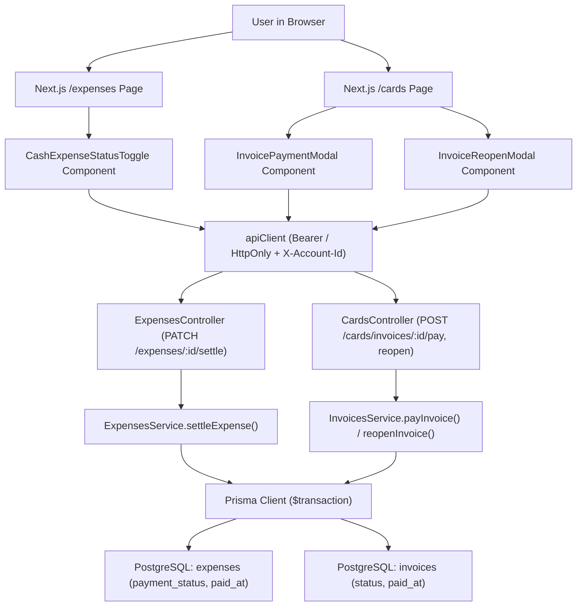
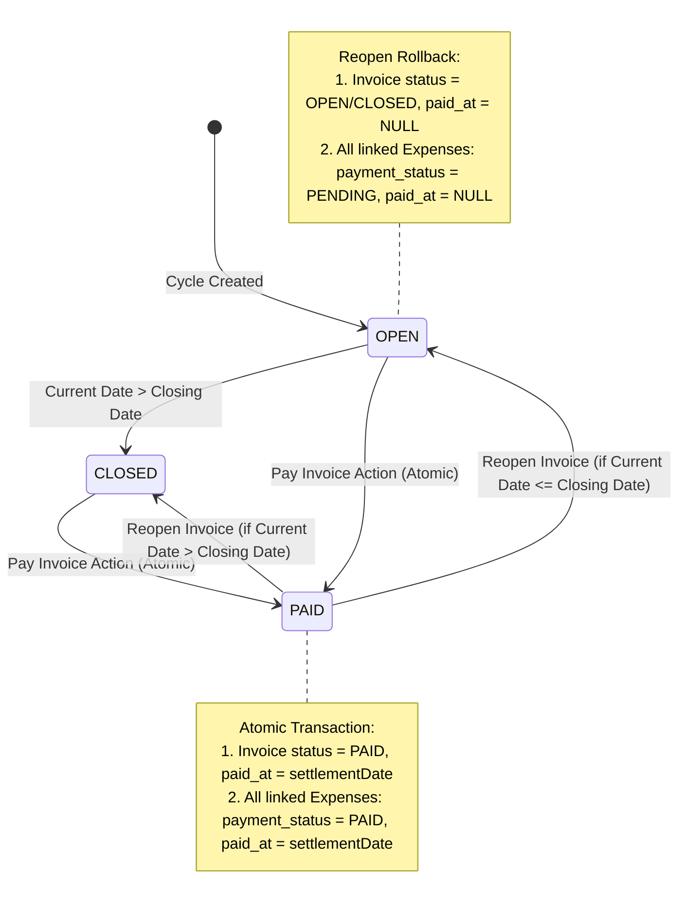

# Technical Specification: F06. Expense Settlement and Invoice Payment

## 1. Technical Overview

### 1.1 What
F06 implements the financial reconciliation and settlement engine for the collaborative financial workspace. It enables users to mark individual cash expenses (Debit Card, Pix, Boleto) as settled (`PAID`) or pending (`PENDING`), dynamically calculates and badges overdue obligations, performs atomic consolidation payments for entire credit card monthly invoices (marking the invoice and all linked purchase installments as `PAID` with a single action), provides safe invoice reopening with warning prompts and transaction rollback, and enforces optimistic concurrency control to handle simultaneous multi-user mutations.

### 1.2 Why
Financial control is meaningless without clear visibility into cash flow settlement status. Users need to distinguish between committed future liabilities and bills that have actually left their bank account. Individual cash outflows require instant, low-friction toggling with visual cues for overdue payments. Conversely, credit card billing operates as a monthly consolidated liability: paying each installment individually is tedious, error-prone, and contrary to real-world banking statements. By supporting both granular cash expense reconciliation and atomic invoice-level settlement with full rollback capabilities, F06 guarantees data integrity and feeds accurate paid/pending metrics into the downstream monthly analytics dashboard (F07).

### 1.3 Scope

**Included:**
- Database schema enhancement:
  - Add `paidAt DateTime?` to the `Expense` model in Prisma.
  - Track settlement timestamps for both cash expenses and invoice-settled credit card transactions.
- Granular Cash Expense Settlement:
  - Supports payment methods `DEBIT_CARD`, `PIX`, and `BOLETO`.
  - Dedicated endpoint `PATCH /api/v1/expenses/:id/settle` supporting status toggle or explicit status (`PAID`, `PENDING`) with optional `settlementDate`.
  - Protection rule: Prevents direct settlement of individual credit card transactions attached to an invoice, returning an explanatory error directing the user to settle via the credit card invoice.
- Status Determination & Overdue Calculation:
  - `PAID`: Explicitly marked by user or debit at creation (`paymentStatus = PAID`, `paidAt` recorded).
  - `PENDING`: Unmarked and system date $\le$ due date.
  - `OVERDUE`: Dynamic status when `paymentStatus = PENDING` and system date $>$ due date.
  - Serialization helper returning `displayStatus` (`PAID`, `PENDING`, `OVERDUE`) and `daysOverdue` count.
- Credit Card Monthly Invoice Settlement:
  - Dedicated endpoint `POST /api/v1/cards/invoices/:id/pay`.
  - Settles the entire monthly invoice as an atomic unit in a Prisma transaction:
    - Sets `invoice.status = PAID` and `invoice.paidAt = settlementDate || NOW()`.
    - Updates all linked expenses where `invoiceId = invoice.id` to `paymentStatus = PAID` and `paidAt = invoice.paidAt`.
- Invoice Reopening & Rollback:
  - Dedicated endpoint `POST /api/v1/cards/invoices/:id/reopen`.
  - Reverts invoice and contained transactions in an atomic Prisma transaction:
    - Reverts `invoice.status` to `OPEN` (or `CLOSED` if current date $>$ `closingDate`) and sets `invoice.paidAt = null`.
    - Reverts all linked expenses where `invoiceId = invoice.id` to `paymentStatus = PENDING` and sets `paidAt = null`.
- Optimistic Concurrency Control:
  - Detects concurrent modifications between sessions by comparing `expectedUpdatedAt` against the database record's `updatedAt`.
  - Throws `409 Conflict` with error code `CONCURRENT_STATUS_MUTATION` and the latest record state.
- Frontend Interactive Experience:
  - Reusable `CashExpenseStatusToggle` component with instant micro-animations, yellow `Pending` and green `Paid` states, and soft red pulsing badge for overdue items ("Overdue by X days").
  - Reusable `InvoicePaymentModal` with card nickname, billing month/year, total amount in BRL, payment date picker, and confirmation prompt.
  - Reusable `InvoiceReopenModal` displaying a warning prompt with the exact count of contained purchases that will revert to pending.
  - Integrated into `/expenses` ledger table (1-click cash toggle) and `/cards` invoice management views, structured for seamless embedding into the F07 Monthly Dashboard.

**Deferred / Out of Scope:**
- Automatic bank statement reconciliation via Open Finance or banking webhooks (PRD Section 7).
- Partial payments of credit card invoices (revolving credit / crédito rotativo) — invoices are paid in full per PRD Section 6 F06 Capabilities.
- Automated payment execution (triggering real-world PIX transfers or barcode payments through banking APIs) per PRD Section 7.

### 1.4 Traceability Matrix

| PRD Requirement / Section | Specification Section | Implementation Component |
| :--- | :--- | :--- |
| **Section 6 - F06 Capabilities**: Cash Expense Settlement (Debit, Pix, Boleto toggle) | Section 5 (API) & Section 4 (Backend) | `PATCH /api/v1/expenses/:id/settle`, `expenses.service.ts` |
| **Section 6 - F06 Capabilities**: Status determination (Paid, Pending, Overdue) | Section 5 (Serialization) & Section 4 | `expense-status.util.ts`, `CashExpenseStatusToggle.tsx` |
| **Section 6 - F06 Capabilities**: Credit Card Invoice Settlement (atomic invoice + installments payment) | Section 5 (API) & Section 6 (Data Model) | `POST /api/v1/cards/invoices/:id/pay`, `invoices.service.ts` |
| **Section 6 - F06 Capabilities**: Invoice Reopening with rollback and user confirmation | Section 5 (API) & Section 4 (Frontend) | `POST /api/v1/cards/invoices/:id/reopen`, `InvoiceReopenModal.tsx` |
| **Section 6 - F06 Experience**: Clickable status badges (yellow Pending, green Paid) with micro-animation | Section 4 (Frontend) | `CashExpenseStatusToggle.tsx` |
| **Section 6 - F06 Experience**: Overdue items pulse with soft red badge "Overdue by X days" | Section 4 (Frontend) | `CashExpenseStatusToggle.tsx` (Tailwind `animate-pulse`) |
| **Section 6 - F06 Experience**: "Pay Invoice (R$ Total)" action button and confirmation prompt | Section 4 (Frontend) | `InvoicePaymentModal.tsx` |
| **Section 6 - F06 Error Handling**: Reopening warning counting included purchases | Section 5 (API) & Section 4 (Frontend) | `InvoiceReopenModal.tsx`, `invoices.service.ts` |
| **Section 6 - F06 Error Handling**: Concurrent Status Mutation ("Transaction status was updated in another session") | Section 5 (Error Codes) & Section 3 | Optimistic Concurrency with `expectedUpdatedAt` (409) |
| **Section 9 - F06 Acceptance Criteria**: All 4 acceptance criteria | Section 7 (Testing Strategy) | `settlement.spec.ts`, `invoices.service.spec.ts` |
| **Section 9 - Cross-Feature Integration**: Consumes F03 Cards/Invoices, F04 Expenses; provides paid/pending data for F07 | Section 2 & Section 5 | Prisma relations, exported services |

---

## 2. Architecture Impact

### 2.1 Affected Components and File Structure

- **Backend (`backend/src/modules/`)**:
  - `expenses/expenses.controller.ts`: Add `PATCH :id/settle` endpoint with `JwtAuthGuard` and `AccountContextGuard`.
  - `expenses/expenses.service.ts`: Implement `settleExpense()` method with validation blocking credit card purchases and optimistic concurrency checking.
  - `expenses/dto/settle-expense.dto.ts`: New DTO for settlement status toggle/override, settlement date, and concurrency timestamp.
  - `expenses/utils/expense-status.util.ts`: Helper function computing `displayStatus` (`PAID`, `PENDING`, `OVERDUE`) and `daysOverdue`.
  - `cards/cards.controller.ts`: Add `POST invoices/:id/pay` and `POST invoices/:id/reopen` endpoints.
  - `cards/invoices.service.ts`: Implement `payInvoice()` and `reopenInvoice()` methods using atomic Prisma transactions (`$transaction`).
  - `cards/dto/pay-invoice.dto.ts`: New DTO for invoice payment date and concurrency timestamp.
  - `cards/dto/reopen-invoice.dto.ts`: New DTO for confirmation acknowledgement and concurrency timestamp.
- **Database (`backend/prisma/`)**:
  - `schema.prisma`: Add `paidAt DateTime? @map("paid_at") @db.Timestamptz()` to the `Expense` model, plus index `@@index([accountId, paidAt], name: "ix_expenses_account_paid_at")`.
  - `migrations/20261026_add_expense_paid_at/migration.sql`: PostgreSQL DDL script adding `paid_at` column and index.
- **Frontend (`frontend/src/`)**:
  - `components/settlement/CashExpenseStatusToggle.tsx`: Interactive badge button supporting 1-click settlement toggle, pending yellow state, green paid state, and pulsing red overdue indicator.
  - `components/settlement/InvoicePaymentModal.tsx`: Modal dialog displaying card details, total invoice amount, settlement date input, and payment confirmation.
  - `components/settlement/InvoiceReopenModal.tsx`: Warning dialog prompting confirmation to reopen a paid invoice, displaying the count of included purchases that will revert to pending.
  - `app/(dashboard)/expenses/page.tsx`: Update expenses table to integrate `CashExpenseStatusToggle` with instant local optimistic updates and conflict error handling.
  - `app/(dashboard)/cards/page.tsx`: Add "Pay Invoice" and "Reopen" action buttons on card invoices triggering `InvoicePaymentModal` and `InvoiceReopenModal`.

### 2.2 Mermaid Diagrams

#### Fullstack Architecture and Settlement Flows



#### Invoice Settlement and Rollback State Machine



---

## 3. Technical Decisions

| Decision | Chosen Approach | Alternative Considered | Trade-off |
| :--- | :--- | :--- | :--- |
| **API Endpoints Structure** | Dedicated intent-revealing action endpoints (`PATCH /expenses/:id/settle`, `POST /cards/invoices/:id/pay`, `POST /cards/invoices/:id/reopen`). | Generic REST `PATCH` on `/expenses/:id` and `/cards/invoices/:id` with arbitrary field updates. | Requires dedicated route definitions and DTOs, but guarantees atomic state transitions, explicit business logic separation, and prevents illegal field tampering. |
| **Credit Card Expense Settlement Boundary** | Block individual direct settlement on credit card expenses; require settling via the parent monthly invoice. | Allow users to check off individual credit card installments independently. | Disallowing individual credit card settlement strictly adheres to PRD F06 requirements, prevents accounting mismatch between invoice totals and installment statuses, and reflects real-world banking statement mechanics. |
| **Overdue Status Representation** | Dynamic computation in business logic and serialization based on `paymentStatus === 'PENDING'` and `currentDate > dueDate`. | Persistent `OVERDUE` database enum value updated by recurring cron job. | Dynamic evaluation eliminates cron scheduling latency, avoids desynchronization across server restarts or time zones, and allows zero-maintenance real-time queries. |
| **Concurrency Control Strategy** | Optimistic concurrency checking via `expectedUpdatedAt` timestamp payload compared against database `updatedAt`. | Pessimistic database row locking (`SELECT FOR UPDATE`) or simple Last-Write-Wins (LWW). | Optimistic locking prevents stale overwrites across simultaneous browser tabs without introducing database transaction deadlocks or blocking read traffic. |
| **UI Integration Strategy** | Dual integration in existing `/expenses` and `/cards` views, implemented as modular components (`CashExpenseStatusToggle`, `InvoicePaymentModal`, `InvoiceReopenModal`) ready for F07 embedding. | Creating an isolated, temporary `/settlement` page. | Keeps user workflows contextual within existing transaction ledgers and card management screens, while providing ready-to-use components for the F07 Monthly Dashboard. |

---

## 4. Component Overview

### Frontend Components

| File Path | New/Modified | Purpose | Key Responsibilities |
| :--- | :--- | :--- | :--- |
| `frontend/src/components/settlement/CashExpenseStatusToggle.tsx` | New | Interactive status badge for cash transactions | Renders `Pending` (yellow) or `Paid` (green) button; renders soft red pulsing badge for overdue items; performs optimistic UI update with rollback on error; blocks credit card items with informative tooltip. |
| `frontend/src/components/settlement/InvoicePaymentModal.tsx` | New | Confirmation dialog for paying a credit card invoice | Displays card brand, nickname, invoice cycle, total amount in BRL; provides date picker for payment date (defaults to today); executes `POST /cards/invoices/:id/pay`; triggers parent data refresh. |
| `frontend/src/components/settlement/InvoiceReopenModal.tsx` | New | Confirmation warning dialog for reopening a paid invoice | Fetches or displays count of included purchases; warns user that all included transactions will revert to pending; executes `POST /cards/invoices/:id/reopen`. |
| `frontend/src/app/(dashboard)/expenses/page.tsx` | Modified | Main expenses ledger table | Replaces static status badge with `CashExpenseStatusToggle`; displays days overdue badge; handles 409 conflict toasts with automatic data re-fetch. |
| `frontend/src/app/(dashboard)/cards/page.tsx` | Modified | Credit cards and invoices list | Adds "Pay Invoice (R$ Total)" action button with green checkmark when paid; adds "Reopen" link for paid invoices; mounts `InvoicePaymentModal` and `InvoiceReopenModal`. |

### Backend Components

| File Path | New/Modified | Purpose | Key Responsibilities |
| :--- | :--- | :--- | :--- |
| `backend/src/modules/expenses/expenses.controller.ts` | Modified | REST controller for expenses | Exposes `PATCH /api/v1/expenses/:id/settle` guarded by JWT and account context. |
| `backend/src/modules/expenses/expenses.service.ts` | Modified | Core expense business logic | Implements `settleExpense()`: validates account ownership, ensures payment method is not `CREDIT_CARD`, verifies optimistic concurrency, and updates `paymentStatus` and `paidAt`. |
| `backend/src/modules/expenses/dto/settle-expense.dto.ts` | New | Validation DTO for cash expense settlement | Validates optional `status` (`PAID`, `PENDING`), optional `settlementDate` (ISO 8601), and optional `expectedUpdatedAt` (ISO 8601). |
| `backend/src/modules/expenses/utils/expense-status.util.ts` | New | Pure utility for dynamic status calculation | Calculates `displayStatus` (`PAID`, `PENDING`, `OVERDUE`) and `daysOverdue` comparing `dueDate` against reference date. |
| `backend/src/modules/cards/cards.controller.ts` | Modified | REST controller for cards & invoices | Exposes `POST /api/v1/cards/invoices/:id/pay` and `POST /api/v1/cards/invoices/:id/reopen`. |
| `backend/src/modules/cards/invoices.service.ts` | Modified | Invoice lifecycle management | Implements atomic `payInvoice()` and `reopenInvoice()` in Prisma `$transaction`, setting status, `paidAt`, and cascading across all child expense records. |
| `backend/src/modules/cards/dto/pay-invoice.dto.ts` | New | Validation DTO for invoice payment | Validates optional `paymentDate` (ISO 8601) and optional `expectedUpdatedAt`. |
| `backend/src/modules/cards/dto/reopen-invoice.dto.ts` | New | Validation DTO for invoice reopening | Validates boolean `confirmReopen: true` and optional `expectedUpdatedAt`. |

### Database Migrations

| Migration File | Tables Affected | Operation | Notes |
| :--- | :--- | :--- | :--- |
| `backend/prisma/migrations/20261026_add_expense_paid_at/migration.sql` | `expenses` | ALTER TABLE / ADD COLUMN | Adds nullable `paid_at TIMESTAMPTZ` and index on `(account_id, paid_at)`. |

---

## 5. API Contracts

### Endpoint 1: Settle Cash Expense
- **Method:** `PATCH`
- **Path:** `/api/v1/expenses/:id/settle`
- **Authentication:** JWT Bearer + `X-Account-Id` header (or session account context)

**Request:**

| Field | Type | Required | Validation | Description |
| :--- | :--- | :--- | :--- | :--- |
| `status` | `string` | No | Enum: `PAID`, `PENDING` | Target status. If omitted, toggles current status. |
| `settlementDate` | `string` | No | ISO 8601 date string | Settlement date. Defaults to current timestamp when marking `PAID`, or `null` when marking `PENDING`. |
| `expectedUpdatedAt` | `string` | No | ISO 8601 date string | Timestamp of last known record state for optimistic concurrency checking. |

**Request Example:**
```json
{
  "status": "PAID",
  "settlementDate": "2026-10-23T10:00:00.000Z",
  "expectedUpdatedAt": "2026-10-23T09:15:30.123Z"
}
```

**Response (Success - 200 OK):**

| Field | Type | Description |
| :--- | :--- | :--- |
| `status` | `string` | `"success"` |
| `data.id` | `uuid` | Expense ID |
| `data.description` | `string` | Expense description |
| `data.amount` | `number` | Transaction amount |
| `data.paymentMethod` | `string` | `DEBIT_CARD`, `PIX`, or `BOLETO` |
| `data.paymentStatus` | `string` | `PAID` or `PENDING` |
| `data.displayStatus` | `string` | Computed status: `PAID`, `PENDING`, or `OVERDUE` |
| `data.daysOverdue` | `number` | Days past due date (0 if not overdue) |
| `data.paidAt` | `string \| null` | ISO timestamp of settlement |
| `data.updatedAt` | `string` | Updated timestamp for future concurrency checks |

**Response Example:**
```json
{
  "status": "success",
  "data": {
    "id": "770e8400-e29b-41d4-a716-446655440001",
    "description": "Internet Fibra Óptica",
    "amount": 129.90,
    "paymentMethod": "BOLETO",
    "paymentStatus": "PAID",
    "displayStatus": "PAID",
    "daysOverdue": 0,
    "dueDate": "2026-10-20T00:00:00.000Z",
    "paidAt": "2026-10-23T10:00:00.000Z",
    "updatedAt": "2026-10-23T10:00:00.120Z"
  }
}
```

**Error Codes:**

| Code | HTTP Status | Description |
| :--- | :--- | :--- |
| `EXP_NOT_FOUND` | 404 | Expense not found in active account. |
| `SETTLE_CREDIT_CARD_FORBIDDEN` | 422 | Individual credit card expenses must be settled via the credit card invoice (`POST /cards/invoices/:id/pay`). |
| `CONCURRENT_STATUS_MUTATION` | 409 | Transaction status was updated in another session. Returns latest data in error payload. |

---

### Endpoint 2: Pay Credit Card Invoice
- **Method:** `POST`
- **Path:** `/api/v1/cards/invoices/:id/pay`
- **Authentication:** JWT Bearer + `X-Account-Id` header

**Request:**

| Field | Type | Required | Validation | Description |
| :--- | :--- | :--- | :--- | :--- |
| `paymentDate` | `string` | No | ISO 8601 date string | Settlement date. Defaults to current timestamp. |
| `expectedUpdatedAt` | `string` | No | ISO 8601 date string | Last known invoice `updatedAt` for concurrency check. |

**Request Example:**
```json
{
  "paymentDate": "2026-10-25T14:30:00.000Z",
  "expectedUpdatedAt": "2026-10-22T08:00:00.000Z"
}
```

**Response (Success - 200 OK):**

| Field | Type | Description |
| :--- | :--- | :--- |
| `status` | `string` | `"success"` |
| `data.id` | `uuid` | Invoice ID |
| `data.cardId` | `uuid` | Credit card ID |
| `data.billingMonth` | `number` | Month number (1–12) |
| `data.billingYear` | `number` | Year (e.g., 2026) |
| `data.totalAmount` | `number` | Total invoice sum settled |
| `data.status` | `string` | `PAID` |
| `data.paidAt` | `string` | ISO timestamp of payment |
| `data.settledExpensesCount` | `number` | Count of underlying expense installments marked `PAID` |
| `data.updatedAt` | `string` | Updated timestamp |

**Response Example:**
```json
{
  "status": "success",
  "data": {
    "id": "880e8400-e29b-41d4-a716-446655440002",
    "cardId": "330e8400-e29b-41d4-a716-446655440003",
    "billingMonth": 10,
    "billingYear": 2026,
    "totalAmount": 2450.75,
    "status": "PAID",
    "paidAt": "2026-10-25T14:30:00.000Z",
    "settledExpensesCount": 14,
    "updatedAt": "2026-10-23T10:05:00.000Z"
  }
}
```

**Error Codes:**

| Code | HTTP Status | Description |
| :--- | :--- | :--- |
| `INVOICE_NOT_FOUND` | 404 | Invoice not found in active account. |
| `INVOICE_ALREADY_PAID` | 400 | Invoice is already marked as PAID. |
| `CONCURRENT_STATUS_MUTATION` | 409 | Invoice was updated in another session. Refreshed latest data. |

---

### Endpoint 3: Reopen Credit Card Invoice
- **Method:** `POST`
- **Path:** `/api/v1/cards/invoices/:id/reopen`
- **Authentication:** JWT Bearer + `X-Account-Id` header

**Request:**

| Field | Type | Required | Validation | Description |
| :--- | :--- | :--- | :--- | :--- |
| `confirmReopen` | `boolean` | Yes | Must be `true` | Explicit user confirmation acknowledging purchase rollback. |
| `expectedUpdatedAt` | `string` | No | ISO 8601 date string | Last known invoice `updatedAt`. |

**Request Example:**
```json
{
  "confirmReopen": true,
  "expectedUpdatedAt": "2026-10-23T10:05:00.000Z"
}
```

**Response (Success - 200 OK):**

| Field | Type | Description |
| :--- | :--- | :--- |
| `status` | `string` | `"success"` |
| `data.id` | `uuid` | Invoice ID |
| `data.status` | `string` | Reverted status: `OPEN` or `CLOSED` |
| `data.paidAt` | `null` | Cleared payment timestamp |
| `data.revertedExpensesCount` | `number` | Count of purchases reverted to `PENDING` |
| `data.updatedAt` | `string` | Updated timestamp |

**Response Example:**
```json
{
  "status": "success",
  "data": {
    "id": "880e8400-e29b-41d4-a716-446655440002",
    "status": "CLOSED",
    "paidAt": null,
    "revertedExpensesCount": 14,
    "updatedAt": "2026-10-23T10:10:00.000Z"
  }
}
```

**Error Codes:**

| Code | HTTP Status | Description |
| :--- | :--- | :--- |
| `INVOICE_NOT_FOUND` | 404 | Invoice not found in active account. |
| `INVOICE_NOT_PAID` | 400 | Invoice is not currently in PAID status. |
| `CONFIRMATION_REQUIRED` | 400 | User confirmation (`confirmReopen: true`) is required to reopen an invoice. |
| `CONCURRENT_STATUS_MUTATION` | 409 | Invoice was updated in another session. Refreshed latest data. |

---

## 6. Data Model

### Table: `expenses` (Modifications)

| Column | Type | Nullable | Default | Description |
| :--- | :--- | :--- | :--- | :--- |
| `id` | `uuid` | No | `uuid()` | Primary Key |
| `account_id` | `uuid` | No | - | Foreign Key $\rightarrow$ `accounts.id` (ON DELETE CASCADE) |
| `description` | `varchar(100)` | No | - | Transaction description |
| `amount` | `numeric(12,2)` | No | - | Transaction amount in BRL |
| `transaction_date`| `timestamptz` | No | - | Date transaction occurred |
| `due_date` | `timestamptz` | No | - | Payment due date |
| `payment_method` | `enum` | No | - | `CREDIT_CARD`, `DEBIT_CARD`, `BOLETO`, `PIX` |
| `payment_status` | `enum` | No | `'PENDING'` | `PENDING`, `PAID` |
| **`paid_at`** *(New)* | `timestamptz` | Yes | `NULL` | Timestamp of financial settlement |
| `category_id` | `uuid` | No | - | Foreign Key $\rightarrow$ `categories.id` |
| `card_id` | `uuid` | Yes | `NULL` | Foreign Key $\rightarrow$ `credit_cards.id` |
| `invoice_id` | `uuid` | Yes | `NULL` | Foreign Key $\rightarrow$ `invoices.id` |
| `installment_group_id` | `uuid` | Yes | `NULL` | Grouping ID for installment series |
| `installment_number` | `integer` | Yes | `NULL` | Current installment index (e.g. 1) |
| `installment_total` | `integer` | Yes | `NULL` | Total installment count (e.g. 3) |
| `is_recurring` | `boolean` | No | `false` | Recurring monthly commitment flag |
| `recurrence_rule_id`| `uuid` | Yes | `NULL` | Foreign Key $\rightarrow$ `recurrence_rules.id` |
| `notes` | `varchar(255)` | Yes | `NULL` | Optional user notes |
| `created_at` | `timestamptz` | No | `now()` | Record creation timestamp |
| `updated_at` | `timestamptz` | No | `now()` | Automatic update timestamp |

### Indexes

| Index Name | Columns | Type | Purpose |
| :--- | :--- | :--- | :--- |
| `ix_expenses_account_paid_at` | `account_id, paid_at` | btree | Fast aggregation of paid vs pending cash flows for F07 |
| `ix_expenses_invoice_id` | `invoice_id` | btree | Existing index; optimized for cascading invoice payment/reopening |

### Migration DDL Example

```sql
-- Migration: 20261026_add_expense_paid_at
-- Add paid_at column to expenses table
ALTER TABLE "expenses" ADD COLUMN "paid_at" TIMESTAMPTZ;

-- Create index for settlement queries and date filtering
CREATE INDEX "ix_expenses_account_paid_at" ON "expenses"("account_id", "paid_at");
```

---

## 7. Testing Strategy

### Test File Structure

| Test File | Test Type | Target | Coverage Goal |
| :--- | :--- | :--- | :--- |
| `backend/test/expenses/expense-status.util.spec.ts` | Unit | Status calculation utility | 100% |
| `backend/test/expenses/settlement.service.spec.ts` | Unit | `ExpensesService.settleExpense` | 95% |
| `backend/test/cards/invoice-settlement.service.spec.ts`| Unit | `InvoicesService.payInvoice` & `reopenInvoice` | 95% |
| `backend/test/settlement/settlement.e2e-spec.ts` | Integration | REST endpoints under `/expenses/:id/settle`, `/cards/invoices/:id/pay`, `/reopen` | 90% |

### Specific Test Functions and Assertions

#### 1. Unit: `expense-status.util.spec.ts`
- `should compute displayStatus as PAID when paymentStatus is PAID`:
  - Assert `displayStatus === 'PAID'` and `daysOverdue === 0` regardless of due date.
- `should compute displayStatus as PENDING when paymentStatus is PENDING and dueDate is in future`:
  - Assert `displayStatus === 'PENDING'` and `daysOverdue === 0`.
- `should compute displayStatus as OVERDUE when paymentStatus is PENDING and dueDate is in past`:
  - Assert `displayStatus === 'OVERDUE'` and `daysOverdue` equals exact calendar difference in days.

#### 2. Unit: `settlement.service.spec.ts`
- `should toggle cash expense from PENDING to PAID and set paidAt`:
  - Assert `paymentStatus === 'PAID'` and `paidAt` is truthy timestamp.
- `should toggle cash expense from PAID to PENDING and clear paidAt`:
  - Assert `paymentStatus === 'PENDING'` and `paidAt === null`.
- `should throw SETTLE_CREDIT_CARD_FORBIDDEN when attempting to settle CREDIT_CARD expense directly`:
  - Assert `UnprocessableEntityException` with code `SETTLE_CREDIT_CARD_FORBIDDEN`.
- `should throw CONCURRENT_STATUS_MUTATION (409) when expectedUpdatedAt does not match`:
  - Assert `ConflictException` with code `CONCURRENT_STATUS_MUTATION` and current record data in response.

#### 3. Unit: `invoice-settlement.service.spec.ts`
- `should atomically pay invoice and mark all underlying expenses as PAID`:
  - Mock Prisma `$transaction`.
  - Assert `invoice.status === 'PAID'`, `invoice.paidAt` is set, and `expense.updateMany` was called with `invoiceId` setting `paymentStatus = 'PAID'` and `paidAt`.
- `should throw INVOICE_ALREADY_PAID when attempting to pay an invoice already PAID`:
  - Assert `BadRequestException` with code `INVOICE_ALREADY_PAID`.
- `should atomically reopen invoice and revert all underlying expenses to PENDING`:
  - Assert `invoice.status === 'OPEN'` (or `CLOSED` if closingDate passed), `invoice.paidAt === null`, and `expense.updateMany` was called setting `paymentStatus = 'PENDING'` and `paidAt = null`.
- `should throw CONFIRMATION_REQUIRED if confirmReopen is false or missing`:
  - Assert `BadRequestException` with code `CONFIRMATION_REQUIRED`.
- `should throw CONCURRENT_STATUS_MUTATION when invoice expectedUpdatedAt does not match`:
  - Assert `ConflictException` with code `CONCURRENT_STATUS_MUTATION`.

#### 4. Acceptance & Integration Tests (Section 9 Acceptance Criteria)
- `[F06-AC1] Cash expense status toggle`: Clicking cash status badge updates status between Pending and Paid and persists to database.
- `[F06-AC2] Overdue badge display`: Expense with past due date and pending status displays `OVERDUE` badge with calculated days overdue.
- `[F06-AC3] Consolidated invoice settlement`: Paying credit card invoice marks invoice Paid and all linked installments Paid.
- `[F06-AC4] Reopening invoice rollback`: Reopening paid invoice restores invoice to Open/Closed and all included purchases to Pending with user confirmation prompt.
