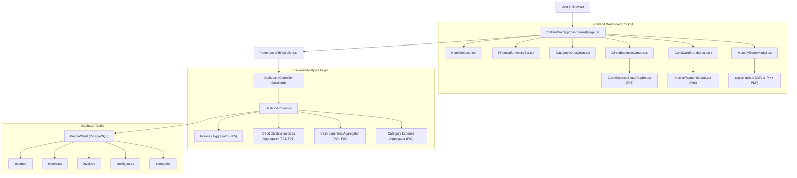

# Technical Specification: F07. Monthly Expense Grouping and Analytics Dashboard

## 1. Technical Overview

### 1.1 What
F07 implements the central financial analytics cockpit and monthly consolidation dashboard for the collaborative financial workspace. It provides a 12-month forward/backward month navigation selector, an executive top-level Financial Summary Bar (Total Projected Income, Total Committed Expenses, Total Paid to Date, Total Pending, and Projected Net Balance), a brand-grouped Credit Card block with multi-level accordions (Brand $\rightarrow$ Cards $\rightarrow$ Invoices $\rightarrow$ Itemized Purchases), a segregated Direct Expenses block with subtotals and counts for Boletos, PIX, and Debit cards with interactive settlement toggles, an interactive SVG Category Distribution Donut Chart, and client-side monthly statement export in CSV and print-optimized PDF formats.

### 1.2 Why
Individual expense and income entries (F04, F05), credit card billing cycles (F03), and settlement workflows (F06) create granular data streams that can overwhelm users without an organized monthly consolidation view. Users need to understand at a glance:
1. Whether their net cash flow for the month will be positive or negative.
2. How their credit card liabilities are split across card brands and payment dates.
3. What bills (Boletos, PIX, Debit) are due, paid, or still pending.
4. Where money is being spent by category.
5. An audit-ready statement export for accounting or offline review.

By providing a unified monthly analytical view that synthesizes all previous modules (F01–F06) into a single high-performance screen, F07 delivers the primary value proposition of the financial control system.

### 1.3 Scope

**Included:**
- **Monthly Selector Navigation**:
  - Horizontal timeline selector supporting one-click navigation across the previous month, current month, and the next 12 forward-projected months.
  - Quick "Hoje / Mês Atual" reset button.
  - Synchronized state with URL query parameters or active view state.
- **Top-Level Financial Summary Bar**:
  - **Total Projected Income**: Sum of all one-time deposits and materialized recurring incomes for the active month.
  - **Total Committed Expenses**: Total liabilities for the month (Consolidated Credit Card Invoices + Cash Expenses).
  - **Total Paid to Date**: Sum of paid invoices (`status = PAID`) + settled cash expenses (`paymentStatus = PAID`).
  - **Total Pending**: Sum of open/closed unpaid invoices (`status != PAID`) + pending cash expenses (`paymentStatus = PENDING`).
  - **Projected Net Balance**: $\text{Total Income} - \text{Total Committed Expenses}$ with distinct emerald (surplus) vs rose (deficit) visual styling.
- **Block 1: Credit Cards (Grouped by Network Brand)**:
  - Multi-tier grouping hierarchy: **Network Brand** (Visa, Mastercard, Elo, Amex, Hipercard, Other) $\rightarrow$ **Card Accounts** $\rightarrow$ **Monthly Invoices** $\rightarrow$ **Itemized Purchases**.
  - Brand header displaying brand badge/logo, item count, and total aggregated brand liability for the month.
  - Card-level container showing nickname, statement closing date, invoice due date, invoice payment status badge (`PAID`, `OPEN`, `CLOSED`, `OVERDUE`), invoice total, and quick "Pagar" / "Reabrir" modal triggers.
  - Expandable accordion table listing itemized purchases with date, description, category badge, installment badge (e.g. "3/10"), and amount in BRL.
- **Block 2: Other Expenses (Direct Methods)**:
  - Segregated into 3 explicit payment method categories: **Boleto Bancário**, **Pix Instantâneo**, and **Débito em Conta**.
  - Group header with method icon, item count, subtotal liability, paid subtotal, and pending subtotal.
  - Itemized transaction rows with description, category badge, due date, purchase date, formatted amount, and interactive `CashExpenseStatusToggle` (F06) with dynamic overdue indicator.
- **Full Scope Additions - Category Donut Chart**:
  - Custom native SVG Donut component (pure React + SVG arcs/dasharrays, 0 external dependencies) visualizing expense distribution across categories for the selected month.
  - Dynamic percentage calculation ($\frac{\text{Category Expense}}{\text{Total Expenses}} \times 100$).
  - Interactive slice hover highlighting category legend chips and center summary text.
  - Color-coded matching the user's category palette.
- **Full Scope Additions - Monthly Statement Export**:
  - **CSV Export**: Client-side RFC-4180 compliant CSV export formatted with UTF-8 BOM, `;` delimiter for Excel compatibility, formatted Brazilian currency (BRL), and date columns.
  - **PDF Export**: Print-ready statement layout via dedicated `@media print` stylesheet triggered by browser's native print engine, generating crisp vector A4 financial reports without backend headless browser overhead.
- **Root Page Integration**:
  - Elevates `/` (`frontend/src/app/(dashboard)/page.tsx`) from the initial splash screen to the full-featured Monthly Analytics Dashboard.

**Deferred / Out of Scope:**
- Automatic bank statement sync via Open Finance / Banking APIs (PRD Section 7).
- Multi-currency conversions (strictly BRL).
- Predictive AI cash flow forecasts beyond scheduled recurrence materializations (PRD Section 7).
- Server-side headless PDF rasterization (Puppeteer) — handled client-side via print media queries.

### 1.4 Traceability Matrix

| PRD Requirement / Section | Specification Section | Implementation Component |
| :--- | :--- | :--- |
| **Section 6 - F07 Core Scope**: 12-month forward selector header | Section 4 & Section 5 | `MonthSelector.tsx`, `GET /api/v1/dashboard/monthly` |
| **Section 6 - F07 Core Scope**: Top-Level Financial Summary Bar (5 metrics) | Section 4 & Section 5 | `FinancialSummaryBar.tsx`, `DashboardService.getMonthlySummary` |
| **Section 6 - F07 Core Scope**: Block 1 Credit Cards grouped by Brand | Section 4 & Section 5 | `CreditCardBrandGroup.tsx`, `DashboardService.getCreditCardBlock` |
| **Section 6 - F07 Core Scope**: Block 2 Other Expenses (Boleto, Pix, Debit) | Section 4 & Section 5 | `DirectExpensesGroup.tsx`, `DashboardService.getDirectExpensesBlock` |
| **Section 6 - F07 Full Scope**: Visual breakdown Category Donut Chart | Section 4 & Section 5 | `CategoryDonutChart.tsx`, `DashboardService.getCategoryBreakdown` |
| **Section 6 - F07 Full Scope**: Export monthly statement to CSV and PDF | Section 4 & Section 5 | `MonthlyExportModal.tsx`, `export-utils.ts` |
| **Section 6 - F07 Experience**: Smooth month-transition and clean visual hierarchy | Section 4 (Frontend) | `page.tsx`, Tailwind CSS micro-animations |
| **Section 9 - Acceptance**: Selecting a month updates all data exclusively for that month | Section 5 & Section 7 | `GET /api/v1/dashboard/monthly?year=YYYY&month=MM` |
| **Section 9 - Integration**: Installments (F04) correctly populate invoices (F03) in dashboard | Section 5 & Section 7 | `dashboard.service.spec.ts` |
| **Section 9 - Integration**: Settlement (F06) updates paid/pending calculations in dashboard | Section 5 & Section 7 | `CashExpenseStatusToggle.tsx`, `dashboard.service.ts` |
| **Section 9 - Integration**: Incomes (F05) dynamically feed into summary calculations | Section 5 & Section 7 | `FinancialSummaryBar.tsx`, `dashboard.service.ts` |

---

## 2. Architecture Impact

### 2.1 Affected Components List

```
backend/src/
├── app.module.ts                                   # Register DashboardModule
└── modules/
    └── dashboard/
        ├── dashboard.module.ts                     # NestJS module definition
        ├── dashboard.controller.ts                 # REST controller for dashboard analytics
        ├── dashboard.service.ts                    # Business aggregation and grouping engine
        ├── dto/
        │   └── monthly-dashboard-query.dto.ts      # Query DTO (year, month validation)
        └── interfaces/
            └── monthly-dashboard.interface.ts      # Structured TypeScript response interfaces

frontend/src/
├── app/(dashboard)/
│   └── page.tsx                                    # Primary Dashboard View (replaces placeholder)
├── components/
│   └── dashboard/
│       ├── MonthSelector.tsx                       # 12-month forward/backward timeline navigator
│       ├── FinancialSummaryBar.tsx                 # 5 executive KPI summary cards
│       ├── CreditCardBrandGroup.tsx                # Brand-grouped credit card accordion block
│       ├── DirectExpensesGroup.tsx                 # Boleto, PIX, Debit segregated block
│       ├── CategoryDonutChart.tsx                  # Native SVG Donut chart with hover tooltips
│       └── MonthlyExportModal.tsx                  # Export modal with CSV download & Print/PDF trigger
└── lib/
    └── export-utils.ts                             # CSV generation with UTF-8 BOM & print styling helpers
```

### 2.2 Mermaid Architecture Diagram



---

## 3. Technical Decisions

| Decision | Chosen Approach | Alternative Considered | Trade-off / Rationale |
| :--- | :--- | :--- | :--- |
| **Analytics Aggregation Architecture** | Dedicated consolidated backend endpoint `GET /api/v1/dashboard/monthly?year=YYYY&month=MM` | Frontend orchestrating multiple client calls to `/expenses`, `/incomes`, `/cards` | Eliminates network waterfalls; guarantees decimal precision calculations; simplifies frontend caching and loading state. |
| **Category Donut Chart Implementation** | Custom native SVG Donut component in React/Tailwind with interactive hover and center label | Adding external chart library (e.g. Recharts, Chart.js) | Zero bundle weight increase (0 kB); instant server/client hydration; full styling control matching project color tokens. |
| **Statement Export Strategy** | RFC-4180 CSV generation in frontend + `@media print` A4 PDF layout | Server-side PDF generation (Puppeteer / PDFKit) | Eliminates heavyweight native dependencies on Docker backend; instant client-side execution; utilizes browser's vector print engine. |
| **Credit Card Grouping Hierarchy** | Group by Network Brand (`brand`) $\rightarrow$ Card accounts $\rightarrow$ Active month invoice $\rightarrow$ Itemized purchases | Flat list of cards without brand grouping | Fulfills PRD Section 6 explicitly; optimizes visualization when users possess multiple cards from the same issuer/brand. |
| **Status Re-conciliation on Dashboard** | Reuse `CashExpenseStatusToggle` and `InvoicePaymentModal` with optimistic local state update | Read-only dashboard with redirects to `/expenses` or `/cards` | Allows users to reconcile payments directly from the dashboard without navigating away, immediately updating the summary KPIs. |

---

## 4. Component Overview

### 4.1 Frontend Components

| File Path | New/Modified | Purpose | Key Responsibilities |
| :--- | :--- | :--- | :--- |
| `frontend/src/app/(dashboard)/page.tsx` | Modified | Root dashboard page | Coordinates month state, fetches consolidated analytics, renders summary, blocks, donut chart, and export modal. |
| `frontend/src/components/dashboard/MonthSelector.tsx` | New | 12-month forward timeline | Displays carousel of months with current month highlight, previous/next buttons, and quick "Hoje" jump. |
| `frontend/src/components/dashboard/FinancialSummaryBar.tsx` | New | Top-level financial KPI cards | Displays Total Income, Total Expenses, Paid, Pending, and Net Balance with dynamic surplus/deficit badge. |
| `frontend/src/components/dashboard/CreditCardBrandGroup.tsx` | New | Brand-grouped card section | Renders Visa/Mastercard/Elo/Amex/Hipercard brand headers, card accordions, invoice due dates, and transaction tables. |
| `frontend/src/components/dashboard/DirectExpensesGroup.tsx` | New | Boleto, Pix, Debit section | Displays 3 distinct sub-panels with subtotals, item counts, and itemized rows with interactive status toggles. |
| `frontend/src/components/dashboard/CategoryDonutChart.tsx` | New | SVG Donut category chart | Renders vector donut chart segments, percentage breakdown, center metric label, and interactive legend chips. |
| `frontend/src/components/dashboard/MonthlyExportModal.tsx` | New | Export dialog | Allows user to download CSV statement or launch print-to-PDF view with custom options. |
| `frontend/src/lib/export-utils.ts` | New | Export helper utilities | Formats table rows into UTF-8 BOM CSV strings; injects print stylesheet for clean A4 printing. |

### 4.2 Backend Components

| File Path | New/Modified | Purpose | Key Responsibilities |
| :--- | :--- | :--- | :--- |
| `backend/src/modules/dashboard/dashboard.module.ts` | New | Dashboard feature module | Encapsulates controller, service, and Prisma injection; registers module in `app.module.ts`. |
| `backend/src/modules/dashboard/dashboard.controller.ts` | New | Analytics HTTP controller | Exposes `GET /api/v1/dashboard/monthly`; validates query params with `AccountContextGuard`. |
| `backend/src/modules/dashboard/dashboard.service.ts` | New | Analytics aggregation service | Executes parallel Prisma queries, calculates summary KPIs, groups cards by brand, and calculates category percentages. |
| `backend/src/modules/dashboard/dto/monthly-dashboard-query.dto.ts` | New | Request validation DTO | Validates `year` (1970–2100) and `month` (1–12) with `class-validator`. |
| `backend/src/modules/dashboard/interfaces/monthly-dashboard.interface.ts` | New | Data response interfaces | Strong TypeScript typing for `MonthlyDashboardResponse`, `SummaryMetrics`, `BrandGroup`, `DirectGroup`, `CategoryBreakdown`. |

### 4.3 Database Optimization

No new database tables or schema migrations are required for F07. F07 reads from existing tables created in F01–F06.
Query performance is guaranteed by existing indexes:
- `ix_expenses_account_date` on `expenses(account_id, transaction_date)`
- `ix_expenses_account_status` on `expenses(account_id, payment_status)`
- `ix_expenses_account_paid_at` on `expenses(account_id, paid_at)`
- `ix_incomes_account_receipt_date` on `incomes(account_id, receipt_date)`
- `uq_invoices_card_cycle` on `invoices(card_id, billing_year, billing_month)`
- `ix_credit_cards_account_id` on `credit_cards(account_id)`

---

## 5. API Contracts

### 5.1 Endpoint: Consolidated Monthly Dashboard Analytics

- **Method**: `GET`
- **Path**: `/api/v1/dashboard/monthly`
- **Authentication**: JWT Bearer (`AccountContextGuard`)

#### Query Parameters

| Parameter | Type | Required | Validation | Description |
| :--- | :--- | :--- | :--- | :--- |
| `year` | `integer` | Yes | `min: 2000, max: 2100` | Target calendar year (e.g. 2026) |
| `month` | `integer` | Yes | `min: 1, max: 12` | Target calendar month (1 = Jan, 12 = Dec) |

#### Response Schema (Success - 200 OK)

```json
{
  "status": "success",
  "data": {
    "period": {
      "year": 2026,
      "month": 10,
      "monthName": "Outubro",
      "startDate": "2026-10-01T00:00:00.000Z",
      "endDate": "2026-10-31T23:59:59.999Z"
    },
    "summary": {
      "totalIncome": 5000.00,
      "totalExpenses": 2842.00,
      "totalPaid": 842.00,
      "totalPending": 2000.00,
      "netBalance": 2158.00,
      "incomeCount": 2,
      "expenseCount": 8
    },
    "creditCards": {
      "totalLiability": 1820.00,
      "totalPaid": 0.00,
      "totalPending": 1820.00,
      "brandGroups": [
        {
          "brand": "VISA",
          "brandName": "Visa",
          "totalAmount": 1200.00,
          "cardCount": 1,
          "cards": [
            {
              "cardId": "3498e840-e29b-41d4-a716-446655440001",
              "nickname": "Nubank Roxinho",
              "brand": "VISA",
              "closingDay": 18,
              "dueDay": 25,
              "invoice": {
                "id": "550e8400-e29b-41d4-a716-446655440000",
                "billingMonth": 10,
                "billingYear": 2026,
                "closingDate": "2026-10-18T23:59:59.999Z",
                "dueDate": "2026-10-25T23:59:59.999Z",
                "totalAmount": 1200.00,
                "status": "OPEN",
                "paidAt": null,
                "items": [
                  {
                    "id": "exp-1",
                    "description": "Notebook Dell",
                    "amount": 400.00,
                    "transactionDate": "2026-08-10T14:30:00.000Z",
                    "installmentNumber": 3,
                    "installmentTotal": 10,
                    "category": {
                      "id": "cat-1",
                      "name": "Equipamentos",
                      "color": "#6366f1",
                      "icon": "Laptop"
                    }
                  }
                ]
              }
            }
          ]
        }
      ]
    },
    "directExpenses": {
      "totalLiability": 1022.00,
      "totalPaid": 842.00,
      "totalPending": 180.00,
      "methods": {
        "BOLETO": {
          "label": "Boleto Bancário",
          "itemCount": 1,
          "subtotal": 180.00,
          "paidAmount": 0.00,
          "pendingAmount": 180.00,
          "items": [
            {
              "id": "exp-bol-1",
              "description": "Condomínio",
              "amount": 180.00,
              "dueDate": "2026-10-10T00:00:00.000Z",
              "transactionDate": "2026-10-01T00:00:00.000Z",
              "paymentStatus": "PENDING",
              "displayStatus": "OVERDUE",
              "daysOverdue": 13,
              "paidAt": null,
              "updatedAt": "2026-10-01T12:00:00.000Z",
              "category": {
                "id": "cat-moradia",
                "name": "Moradia",
                "color": "#f59e0b",
                "icon": "Home"
              }
            }
          ]
        },
        "PIX": {
          "label": "Pix Instantâneo",
          "itemCount": 2,
          "subtotal": 520.00,
          "paidAmount": 520.00,
          "pendingAmount": 0.00,
          "items": []
        },
        "DEBIT_CARD": {
          "label": "Débito em Conta",
          "itemCount": 1,
          "subtotal": 322.00,
          "paidAmount": 322.00,
          "pendingAmount": 0.00,
          "items": []
        }
      }
    },
    "categoryBreakdown": [
      {
        "categoryId": "cat-1",
        "name": "Equipamentos",
        "color": "#6366f1",
        "icon": "Laptop",
        "amount": 1200.00,
        "percentage": 42.22
      },
      {
        "categoryId": "cat-moradia",
        "name": "Moradia",
        "color": "#f59e0b",
        "icon": "Home",
        "amount": 700.00,
        "percentage": 24.63
      }
    ]
  }
}
```

#### Error Codes

| Code | HTTP Status | Description |
| :--- | :--- | :--- |
| `DASH_INVALID_PERIOD` | 400 | The specified year or month is out of valid range (1–12, 2000–2100). |
| `AUTH_UNAUTHORIZED` | 401 | Missing or expired JWT session token. |
| `ACC_CONTEXT_REQUIRED` | 403 | User does not have active membership in the requested workspace. |

---

## 6. Data Model & Aggregation Engine

### 6.1 Aggregation Logic

The dashboard engine synthesizes data through 4 concurrent queries using Prisma:

1. **Incomes Query**:
   ```typescript
   where: {
     accountId,
     receiptDate: { gte: startOfMonth, lte: endOfMonth }
   }
   ```
   Sums `totalIncome = sum(amount)`.

2. **Credit Cards & Invoices Query**:
   ```typescript
   where: {
     accountId,
     isArchived: false
   },
   include: {
     invoices: {
       where: { billingYear: year, billingMonth: month },
       include: {
         expenses: {
           include: { category: true }
         }
       }
     }
   }
   ```
   Groups invoices by `card.brand`. Computes brand subtotal, paid status, and individual item breakdown.

3. **Direct Expenses Query**:
   ```typescript
   where: {
     accountId,
     paymentMethod: { in: ['BOLETO', 'PIX', 'DEBIT_CARD'] },
     dueDate: { gte: startOfMonth, lte: endOfMonth }
   },
   include: {
     category: true
   }
   ```
   Subdivides by method (`BOLETO`, `PIX`, `DEBIT_CARD`). Evaluates `displayStatus` (`PAID`, `PENDING`, `OVERDUE`).

4. **Category Breakdown Grouping**:
   Aggregates total spent per category across both Credit Card purchases and Direct Expenses:
   $$\text{Percentage} = \frac{\text{Category Amount}}{\text{Total Month Expenses}} \times 100$$
   Sorted descending by amount.

---

## 7. Testing Strategy

### 7.1 Test Matrix

| Test File | Test Type | Target Scope | Coverage Goal |
| :--- | :--- | :--- | :--- |
| `backend/test/dashboard/dashboard.service.spec.ts` | Unit | Calculation of 5 KPI summary values, brand grouping, method grouping, and percentage distribution | 95% |
| `backend/test/dashboard/dashboard.controller.spec.ts` | Unit | Validation pipes, year/month bounds, authenticated workspace context | 90% |
| `backend/test/dashboard/dashboard-integration.spec.ts` | Integration | End-to-end endpoint verification across seeded incomes, cards, invoices, and direct expenses | 85% |

### 7.2 Specific Test Cases

1. **`should correctly calculate 5 summary metrics`**:
   - Total Income = Sum of incomes in month.
   - Total Expenses = Invoices total + Direct expenses total.
   - Total Paid = Paid Invoices + Paid Direct expenses.
   - Total Pending = Open/Closed unpaid Invoices + Pending Direct expenses.
   - Net Balance = Total Income - Total Expenses (verifying positive and negative balance styling).
2. **`should group credit cards by network brand`**:
   - Verifies cards with same brand (e.g. 2 Visa cards) are nested under the single "VISA" brand group with combined total liability.
3. **`should correctly segregate other expenses into Boleto, PIX, and Debit`**:
   - Verifies each direct group computes item count, subtotal, paid, and pending independently.
4. **`should compute category breakdown percentages totaling 100%`**:
   - Verifies category percentages are mathematically accurate and sort descending.
5. **`Cross-Feature Acceptance Criteria (PRD Section 9)`**:
   - Verify selecting a month changes output exclusively for that calendar month.
   - Verify installment expenses (F04) correctly roll up into card invoices (F03) and appear in the dashboard.
   - Verify settling an invoice (F06) shifts amount from Pending to Paid in the summary bar.
   - Verify new income entry (F05) immediately increments Total Income and Net Balance.
