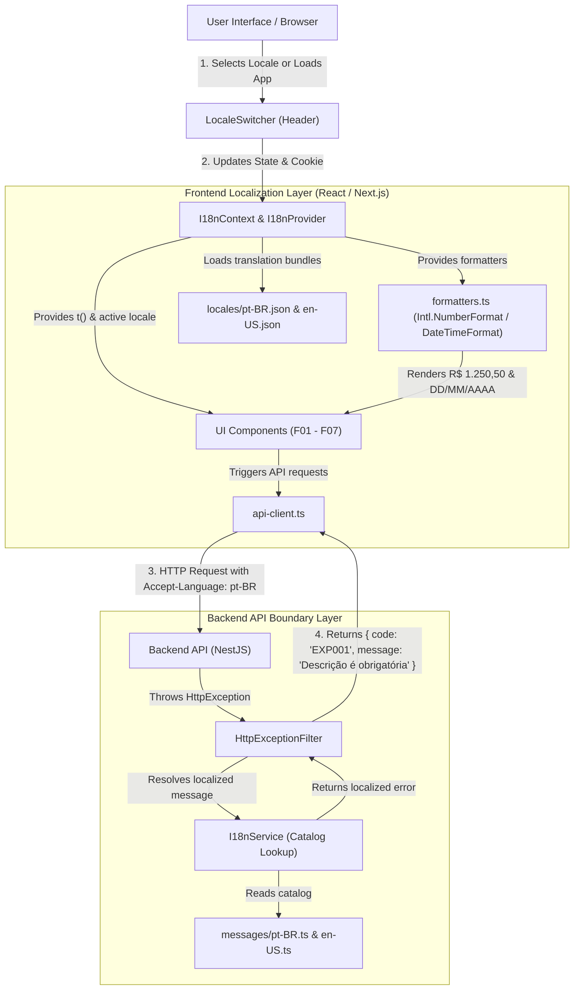

# Technical Specification: F08. Internationalization and Localization Architecture (i18n / pt-BR)

## 1. Technical Overview

### 1.1 What
F08 implements the internationalization (i18n) and Brazilian Portuguese (`pt-BR`) localization architecture for the Financial Control platform. It establishes Brazilian Portuguese as the active default standard for all user-facing formatting—including monetary values (`R$ 1.250,50`), calendar dates (`DD/MM/AAAA`), billing cycles (`out/2026`), and 24-hour timestamps (`HH:mm`)—while cleanly decoupling application strings into modular translation catalogs (`locales/pt-BR.json`, `locales/en-US.json`). The architecture provides a lightweight, reactive frontend `I18nProvider`, standard ECMAScript Internationalization (`Intl`) formatting utilities, a header/settings locale switcher with multi-layer persistence (cookie `NEXT_LOCALE`, `localStorage`, and browser language detection), an API client request interceptor forwarding `Accept-Language`, and a centralized backend NestJS exception and validation localization filter that returns localized error messages while preserving immutable machine-readable error codes (e.g., `EXP001`, `AUTH002`).

### 1.2 Why
Financial applications require strict cultural and grammatical alignment with the user's economic environment:
1. In Brazil, monetary values are conventionally formatted with a comma (`,`) as the decimal separator and a period (`.`) as the thousands separator, prefixed by `R$ ` (e.g., `R$ 1.250,50` rather than `$1,250.50`).
2. Calendar dates follow little-endian ordering (`DD/MM/YYYY`) rather than middle-endian (`MM/DD/YYYY`). Displaying `10/05/2026` to a Brazilian user must unambiguously represent May 10, 2026, not October 5, 2026.
3. Credit card statements, invoice settlement badges, and recurring obligations must be presented in clear Brazilian Portuguese vocabulary (e.g., "Fatura Fechada", "Pendente", "Pago", "Vencido", "Parcela 3 de 10").
4. A scalable enterprise architecture must not hardcode Portuguese strings into TSX templates or backend exception classes. By establishing a decoupled translation dictionary architecture, the application can activate future locales (e.g., `en-US`, `es-ES`, `pt-PT`) with zero modifications to component layouts or financial business logic.

### 1.3 Scope

**Included (Core Scope):**
- **Default Locale & Detection Pipeline**:
  - Brazilian Portuguese (`pt-BR`) established as the primary and fallback locale.
  - Multi-tier locale negotiation: `NEXT_LOCALE` cookie $\rightarrow$ `localStorage` key $\rightarrow$ browser `navigator.language` / `Accept-Language` header $\rightarrow$ fallback to `pt-BR`.
- **Decoupled Translation Catalogs**:
  - Complete extraction of UI labels, buttons, navigation menus, placeholders, toast notifications, and modal prompts into `locales/pt-BR.json` and `locales/en-US.json`.
  - Type-safe dictionary keys with dot-notation path traversal (e.g., `t('dashboard.summary.netBalance')`) and dynamic variable interpolation (e.g., `t('expenses.installmentProgress', { current: 3, total: 10 })`).
  - Graceful fallback: Missing keys log a development notice and render the key path or fall back to the primary dictionary rather than throwing runtime exceptions.
- **Centralized Native Formatting Utilities**:
  - Currency formatter (`formatCurrency`): Utilizes `Intl.NumberFormat` configured with locale rules (BRL `R$ 1.250,50` vs USD `$1,250.50`), supporting both decimal numbers and integer-cent values.
  - Date formatter (`formatDate`): Provides standard numeric (`DD/MM/YYYY`), short month/year (`out/2026`), and verbose date (`24 de outubro de 2026`) outputs.
  - Time formatter (`formatTime`, `formatDateTime`): Formats 24-hour time strings (`14:30`) and combined timestamps (`24/10/2026 14:30`).
  - Decimal parsing utility (`parseLocalizedNumber`): Parses localized string inputs (e.g., `"1.250,50"`) into standard JavaScript floats (`1250.50`) for form submissions.
- **Frontend Reactive Context & Header Switcher**:
  - `I18nProvider` wrapping the root application tree in `frontend/src/app/layout.tsx`.
  - `LocaleSwitcher` dropdown integrated into `AppHeader.tsx` allowing instant language toggling without page reloading or loss of unsaved state.
  - Automatic injection of `Accept-Language` into all outgoing requests in `apiClient`.
- **Backend API Boundary Localization**:
  - NestJS centralized `HttpExceptionFilter` and `ValidationPipe` updated to inspect `Accept-Language` headers.
  - Machine-readable error codes (`AUTH001`, `EXP001`, `CARD001`, `CAT001`, etc.) mapped to localized human-readable messages in `backend/src/common/i18n/`.
  - Internal database enums (`VISA`, `MASTERCARD`, `BOLETO`, `PENDING`, `PAID`, `ADMINISTRATOR`) remain immutable English identifiers, localized strictly at the presentation layer.

**Deferred / Full Scope Additions:**
- Storing user locale preference in the database `User` table for cross-device persistence across clean browser profiles.
- Automatic geo-IP-based locale suggestion.
- Additional language bundles (`es-ES`, `pt-PT`, `de-DE`).

### 1.4 Traceability Matrix

| PRD Requirement / Section | Specification Section | Implementation Component |
| :--- | :--- | :--- |
| **Section 6 - F08 Core Scope**: Default locale pt-BR and locale detection | Section 4 & Section 5 | `i18n-context.tsx`, `types.ts`, `middleware.ts` |
| **Section 6 - F08 Core Scope**: Modular JSON translation catalogs | Section 4 | `locales/pt-BR.json`, `locales/en-US.json` |
| **Section 6 - F08 Core Scope**: Centralized currency, date, time formatters | Section 4 | `formatters.ts`, `useFormatters()` |
| **Section 6 - F08 Core Scope**: UI Locale switcher in header | Section 4 | `LocaleSwitcher.tsx`, `AppHeader.tsx` |
| **Section 6 - F08 Core Scope**: Backend localized error handler | Section 4 & Section 5 | `http-exception.filter.ts`, `i18n.service.ts` |
| **Section 6 - F08 Experience**: Zero layout shift and instant language toggle | Section 4 (Frontend) | `I18nProvider`, `LocaleSwitcher.tsx` |
| **Section 6 - F08 Error Handling**: Unsupported locale fallback to pt-BR | Section 4 & Section 5 | `i18n-context.tsx`, `i18n.service.ts` |
| **Section 9 - Acceptance**: Application loads in pt-BR by default | Section 5 & Section 7 | `i18n-context.spec.tsx` |
| **Section 9 - Acceptance**: Currency formatting renders BRL standard (R$ 1.250,50) | Section 4 & Section 7 | `formatters.spec.ts` |
| **Section 9 - Acceptance**: Dates render DD/MM/YYYY and 24h time notation | Section 4 & Section 7 | `formatters.spec.ts` |
| **Section 9 - Acceptance**: Modular JSON dictionaries and Accept-Language API | Section 5 & Section 7 | `http-exception.filter.spec.ts`, `api-client.ts` |
| **Section 9 - Cross-Feature**: Localization across F01-F07 UI components | Section 4 & Section 7 | Application-wide template string migration |

---

## 2. Architecture Impact

### 2.1 Affected Components List

```
frontend/
├── src/
│   ├── app/
│   │   └── layout.tsx                              # Wrap application tree with I18nProvider
│   ├── components/
│   │   ├── layout/
│   │   │   ├── AppHeader.tsx                       # Embed LocaleSwitcher component
│   │   │   └── LocaleSwitcher.tsx                  # New interactive locale dropdown component
│   │   ├── dashboard/                              # Localize summary metrics, charts, tables
│   │   ├── expenses/                               # Localize expense modal, badges, inputs
│   │   ├── cards/                                  # Localize card lists, limits, invoice headers
│   │   ├── categories/                             # Localize category names and modals
│   │   ├── incomes/                                # Localize income entries and filters
│   │   └── settlement/                             # Localize settlement prompts and actions
│   ├── lib/
│   │   ├── api-client.ts                           # Attach Accept-Language header to fetch requests
│   │   ├── export-utils.ts                         # Localize CSV headers and date/currency formats
│   │   └── i18n/
│   │       ├── types.ts                            # Locale types, dictionary schema, formatter contracts
│   │       ├── formatters.ts                       # Pure Intl formatting helpers (currency, date, time)
│   │       └── i18n-context.tsx                    # React Context, I18nProvider, and useTranslation hook
│   └── locales/
│       ├── pt-BR.json                              # Brazilian Portuguese translation dictionary
│       └── en-US.json                              # English reference translation dictionary

backend/
├── src/
│   ├── main.ts                                     # Add Accept-Language to CORS allowed headers
│   └── common/
│       ├── filters/
│       │   └── http-exception.filter.ts            # Localize response error messages via I18nService
│       └── i18n/
│           ├── i18n.types.ts                       # Backend locale and error message dictionary types
│           ├── i18n.service.ts                     # Catalog lookup, locale parsing, message resolution
│           └── messages/
│               ├── pt-BR.ts                        # Portuguese error messages mapped by error code
│               └── en-US.ts                        # English fallback error messages
```

### 2.2 Mermaid Diagram



---

## 3. Technical Decisions

| Decision | Chosen Approach | Alternative Considered | Trade-off |
| :--- | :--- | :--- | :--- |
| **i18n Architecture** | Lightweight native React Context + modular JSON dictionaries + `Intl` API | `next-intl` or `react-i18next` third-party dependencies | Zero extra npm bundle overhead, zero complex Next.js 14 App Router server/client wrapping issues, 100% fine-grained control over cookie persistence and formatting helpers. |
| **Locale Storage & Routing** | Cookie (`NEXT_LOCALE`) + `localStorage` + client React state (No URL prefixes) | Path-based routing (`/pt-BR/dashboard`, `/en-US/cards`) | Path-based routing forces refactoring all Next.js App Router folders into `[locale]` segments, breaking internal links and authentication middleware redirects. Cookie/storage approach keeps the URL clean and enables instant client re-rendering without reload. |
| **Backend Message Localization** | Centralized translation in NestJS `HttpExceptionFilter` driven by `Accept-Language` header | Translating messages inside domain services or Prisma layer | Keeps core services and database entities completely language-agnostic. Error codes remain stable machine-readable constants (`EXP001`), while user-facing messages are localized exclusively at the API boundary. |
| **Currency & Number Formatting** | Centralized `formatCurrency` helper wrapping `Intl.NumberFormat` with support for decimal floats and integer cents | Manual string splitting or regex formatting | Native `Intl` strictly adheres to official BRL currency standards (e.g. non-breaking space between `R$` and value, period thousands separator, comma decimal separator). |
| **Missing Translation Key Strategy** | Development console warning with fallback to `en-US` and then returning the raw translation key string | Throwing a runtime error or rendering empty string | Prevents UI crashes when minor translation keys are missing while alerting developers during testing. |

---

## 4. Component Overview

### 4.1 Frontend Components & Modules

| File Path | New/Modified | Purpose | Key Responsibilities |
| :--- | :--- | :--- | :--- |
| `frontend/src/locales/pt-BR.json` | New | Brazilian Portuguese dictionary | Complete translated string catalog for common labels, auth, categories, cards, expenses, incomes, settlement, and dashboard. |
| `frontend/src/locales/en-US.json` | New | English reference dictionary | Mirror string catalog for English localization and missing-key fallback. |
| `frontend/src/lib/i18n/types.ts` | New | TypeScript definitions | Interfaces for supported locales (`pt-BR`, `en-US`), translation dictionary shape, and formatter function signatures. |
| `frontend/src/lib/i18n/formatters.ts` | New | Pure localization formatters | Functions: `formatCurrency(val, locale)`, `formatDate(date, locale, format)`, `formatTime(date, locale)`, `formatDateTime(date, locale)`, and `parseLocalizedNumber(str)`. |
| `frontend/src/lib/i18n/i18n-context.tsx` | New | React Context & Provider | Manages active locale, persists choice in cookie and localStorage, provides `t(key, params)` helper and `useTranslation()` hook. |
| `frontend/src/components/layout/LocaleSwitcher.tsx` | New | Header language dropdown | Accessible button and dropdown menu to switch between `Português (Brasil)` and `English (US)` with visual checkmark indicator. |
| `frontend/src/components/layout/AppHeader.tsx` | Modified | Top application navigation | Embeds `LocaleSwitcher` beside the account switcher and user profile icon. |
| `frontend/src/app/layout.tsx` | Modified | Root HTML shell | Wraps application children with `I18nProvider` and sets dynamic `lang` attribute on `<html>`. |
| `frontend/src/lib/api-client.ts` | Modified | HTTP request client | Automatically adds `Accept-Language: <active_locale>` to every outgoing fetch header. |
| `frontend/src/components/dashboard/*` | Modified | Dashboard UI components | Replace hardcoded English strings with `t()` calls and apply `formatCurrency` / `formatDate`. |
| `frontend/src/components/cards/*` | Modified | Cards & Invoices components | Localize card brands, limit cards, invoice status chips, and date headers. |
| `frontend/src/components/expenses/*` | Modified | Expenses modal & tables | Localize expense form inputs, payment method badges, installment previews, and validation toasts. |
| `frontend/src/components/settlement/*` | Modified | Settlement modals | Localize confirmation dialogs, payment prompts, and reopen warnings. |
| `frontend/src/components/categories/*` | Modified | Category components | Localize pre-seeded category labels and category modal buttons. |
| `frontend/src/components/incomes/*` | Modified | Income entry components | Localize recurring toggles, deposit forms, and filter tags. |

### 4.2 Backend Components & Modules

| File Path | New/Modified | Purpose | Key Responsibilities |
| :--- | :--- | :--- | :--- |
| `backend/src/common/i18n/i18n.types.ts` | New | Backend i18n types | Defines supported backend locales and structured message catalog types. |
| `backend/src/common/i18n/messages/pt-BR.ts` | New | Portuguese error catalog | Keyed catalog mapping error codes (`AUTH001`, `EXP001`, `CARD001`, etc.) and validation messages to Brazilian Portuguese. |
| `backend/src/common/i18n/messages/en-US.ts` | New | English error catalog | Keyed catalog mapping error codes to English fallback messages. |
| `backend/src/common/i18n/i18n.service.ts` | New | Translation service | Parses `Accept-Language` header, performs fallback resolution, and interpolates error message variables. |
| `backend/src/common/filters/http-exception.filter.ts` | Modified | Central exception filter | Injects `I18nService` to translate exception messages before responding to the client. |
| `backend/src/main.ts` | Modified | App bootstrap | Adds `Accept-Language` to CORS `allowedHeaders` array. |

### 4.3 Database Migration

No database schema migration is required for the Core Scope. Locale preferences are stored client-side via the `NEXT_LOCALE` cookie and `localStorage`.

---

## 5. API Contracts

### 5.1 Localized Request Header Protocol

All frontend requests executed via `apiClient` include the client's currently selected language:

- **Header Name:** `Accept-Language`
- **Supported Values:** `pt-BR`, `pt`, `en-US`, `en`
- **Default / Fallback:** `pt-BR`

### 5.2 Localized Error Response Contract

When an API endpoint encounters a business or validation error, the backend central exception filter formats the output using the requested language while retaining the consistent machine-readable error code.

**Endpoint: Generic API Error Response**
- **Method:** ANY
- **Path:** `/api/v1/*`

**Response Example (Portuguese - `Accept-Language: pt-BR`):**
- **HTTP Status:** 400 Bad Request
```json
{
  "status": "error",
  "statusCode": 400,
  "code": "EXP001",
  "message": "A descrição da despesa é obrigatória e deve ter entre 3 e 100 caracteres.",
  "timestamp": "2026-10-24T23:55:00.000Z",
  "path": "/api/v1/expenses"
}
```

**Response Example (English - `Accept-Language: en-US`):**
- **HTTP Status:** 400 Bad Request
```json
{
  "status": "error",
  "statusCode": 400,
  "code": "EXP001",
  "message": "Expense description is required and must be between 3 and 100 characters.",
  "timestamp": "2026-10-24T23:55:00.000Z",
  "path": "/api/v1/expenses"
}
```

**Catalog of Standard Error Codes:**

| Code | HTTP Status | pt-BR Message | en-US Message |
| :--- | :--- | :--- | :--- |
| `AUTH001` | 401 | "Credenciais inválidas. Verifique seu e-mail e senha." | "Invalid credentials. Please verify your email and password." |
| `AUTH002` | 403 | "Sessão expirada. Faça login novamente." | "Session expired. Please log in again." |
| `AUTH003` | 403 | "Você não tem permissão para realizar esta operação." | "You do not have permission to perform this operation." |
| `ACCT001` | 404 | "Conta ou espaço de trabalho não encontrado." | "Account or workspace not found." |
| `CAT001` | 400 | "Não é possível excluir uma categoria vinculada a despesas ou receitas existentes." | "Cannot delete a category referenced by existing expenses or incomes." |
| `CARD001` | 400 | "Os dias de fechamento e vencimento devem ser dias válidos entre 1 e 31 e distintos entre si." | "Closing and due days must be valid distinct calendar days between 1 and 31." |
| `CARD002` | 400 | "Não é possível excluir cartão com faturas pendentes ou parcelas ativas." | "Cannot delete card with unsettled invoices or active future installments." |
| `EXP001` | 400 | "Por favor, preencha todos os campos obrigatórios: descrição, valor, data e método de pagamento." | "Please fill in all mandatory fields: description, amount, date, and payment method." |
| `EXP002` | 400 | "O valor da transação deve ser maior que zero." | "Transaction amount must be greater than zero." |
| `EXP003` | 400 | "O número de parcelas deve ser entre 1 e 72." | "Installment count must be between 1 and 72." |
| `INC001` | 400 | "O valor da receita deve ser maior que zero." | "Income amount must be greater than zero." |
| `SETTLE001`| 400 | "Esta fatura já está marcada como paga." | "This invoice is already settled as paid." |
| `INTERNAL_ERROR` | 500 | "Ocorreu um erro interno no servidor. Tente novamente mais tarde." | "An internal server error occurred. Please try again later." |

---

## 6. Data Model

### 6.1 Architecture Model
The Core Scope relies on client-side session persistence. The locale is managed through:
1. `NEXT_LOCALE` cookie (persists across SSR requests and page navigations).
2. Browser `localStorage` item `financial_control_locale` (persists client preference).
3. Browser environment fallback via `navigator.language`.

### 6.2 Full Scope Database Schema (Deferred)
For future cross-device synchronization, the `users` table can be extended as follows:

```sql
-- Full Scope Addition (Deferred)
ALTER TABLE users ADD COLUMN preferred_locale VARCHAR(10) NOT NULL DEFAULT 'pt-BR';
```

---

## 7. Testing Strategy

### 7.1 Test File Structure

| Test File | Test Type | Target | Coverage Goal |
| :--- | :--- | :--- | :--- |
| `frontend/src/lib/i18n/__tests__/formatters.spec.ts` | Unit | Formatting helpers (`formatCurrency`, `formatDate`, `formatTime`, `parseLocalizedNumber`) | 100% |
| `frontend/src/lib/i18n/__tests__/i18n-context.spec.tsx` | Unit | `I18nProvider`, key interpolation, fallback mechanisms | 95% |
| `backend/src/common/i18n/i18n.service.spec.ts` | Unit | `I18nService` locale negotiation and message lookup | 100% |
| `backend/src/common/filters/http-exception.filter.spec.ts` | Unit / Integration | `HttpExceptionFilter` with localized error headers | 90% |

### 7.2 Specific Test Functions & Assertions

#### `frontend/src/lib/i18n/__tests__/formatters.spec.ts`
- `test_format_currency_pt_br_decimal`: Asserts `formatCurrency(1250.50, 'pt-BR')` returns `"R$ 1.250,50"`.
- `test_format_currency_pt_br_zero`: Asserts `formatCurrency(0, 'pt-BR')` returns `"R$ 0,00"`.
- `test_format_currency_pt_br_cents`: Asserts `formatCurrency(10050, 'pt-BR', { isCents: true })` returns `"R$ 100,50"`.
- `test_format_currency_en_us`: Asserts `formatCurrency(1250.50, 'en-US')` returns `"$1,250.50"`.
- `test_format_date_pt_br`: Asserts `formatDate(new Date('2026-10-24T12:00:00Z'), 'pt-BR')` returns `"24/10/2026"`.
- `test_format_date_short_month_pt_br`: Asserts `formatDate(new Date('2026-10-24'), 'pt-BR', 'shortMonth')` returns `"out/2026"`.
- `test_format_time_24h_pt_br`: Asserts `formatTime(new Date('2026-10-24T14:30:00'), 'pt-BR')` returns `"14:30"`.
- `test_parse_localized_number_pt_br`: Asserts `parseLocalizedNumber("1.250,50")` returns `1250.50`.

#### `frontend/src/lib/i18n/__tests__/i18n-context.spec.tsx`
- `test_default_locale_is_pt_br`: Asserts provider initializes with `pt-BR` when no cookie or storage is set.
- `test_translation_key_resolution`: Asserts `t('dashboard.summary.totalIncome')` returns `"Receita Total"`.
- `test_translation_interpolation`: Asserts `t('expenses.installmentProgress', { current: 2, total: 5 })` returns `"Parcela 2 de 5"`.
- `test_fallback_on_missing_key`: Asserts requesting an unknown key returns the key path without throwing an unhandled exception.
- `test_locale_switch_updates_render`: Asserts calling `setLocale('en-US')` updates rendered translations dynamically.

#### `backend/src/common/i18n/i18n.service.spec.ts`
- `test_resolve_locale_from_header_pt_br`: Asserts header `"pt-BR,pt;q=0.9"` resolves to `"pt-BR"`.
- `test_resolve_locale_from_header_en`: Asserts header `"en-US,en;q=0.8"` resolves to `"en-US"`.
- `test_resolve_locale_fallback`: Asserts header `"fr-FR"` resolves to fallback `"pt-BR"`.
- `test_get_error_message_pt_br`: Asserts `getMessage('EXP001', 'pt-BR')` returns the Portuguese error text.
- `test_get_error_message_en_us`: Asserts `getMessage('EXP001', 'en-US')` returns the English error text.
