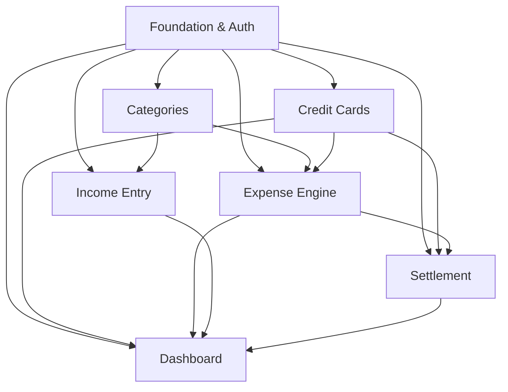

# Financial Control

## 1. Executive Summary

Financial Control is a collaborative personal finance web application engineered to give individuals, couples, and shared households complete visibility and granular control over their committed, pending, and paid expenses. Designed specifically to navigate the complexities of modern personal cash flow, the platform reconciles disparate payment methods—including credit card accounts across multiple card networks, direct bank debits, scheduled bank slips (boletos), and instant PIX transfers—into a unified monthly financial dashboard.

The application incorporates a flexible multi-provider authentication system supporting both standard email/password registration and one-click Google OAuth social login. Built on a multi-account workspace architecture, every registered user is provisioned with their own account workspace as Administrator. Administrators can invite other users by email with role-based permissions (Administrator or Member) to collaboratively manage household or shared finances. Users with access to multiple accounts can seamlessly toggle their active financial context through an intuitive account switcher, ensuring clear boundary separation between individual personal expenses and shared household obligations.

At a high level, users configure their payment methods, credit cards, and custom expense categories within their active account workspace. When registering expenses, users define the transaction type, payment instrument, and frequency—whether a one-time charge, a fixed installment plan, or a perpetual monthly recurring obligation. The system models credit card billing cycles with exact closing and due dates, automates multi-month installment scheduling using industry-standard integer-cent decimal rounding formulas, and organizes obligations into two distinct operational groups: credit cards categorized by card network brand (Visa, Mastercard, Elo, etc.) with invoice lifecycles, and a dedicated grouping for direct non-card expenses (Pix, Boleto, and Debit) with pending versus paid status toggles. Paired with simplified income entry, the system projects end-of-month cash balances.

## 2. Problem and Opportunity

### The Problem

**Fragmented Payment Channels Across Multiple Issuers**
- Modern personal spending is scattered across multiple credit cards, bank accounts, digital wallets, and instant payment rails.
- Individuals must manually log in to 3 to 6 distinct banking applications to calculate total committed monthly expenses.
- Lack of centralized aggregation leads to an estimated 15% to 25% discrepancy between perceived monthly spending and actual bank debits.

**Installment Ambiguity and Statement Surprises**
- Long-term installment plans (e.g., 10x or 12x purchases) obscure future committed cash flow, causing users to overcommit in subsequent months.
- Financial systems frequently introduce fractional cent rounding errors or repeating decimal discrepancies (dízimas periódicas) when dividing purchase amounts, leading to mismatches between recorded budgets and actual card statements.
- Users struggle to track when recurring obligations or installment plans conclude, creating uncertainty in future disposable income projections.

**Siloed and Insecure Shared Finances**
- Couples, family members, or housemates managing joint expenses resort to sharing personal banking credentials or maintaining cumbersome, error-prone manual spreadsheets.
- Existing tools force an all-or-nothing approach: either a purely single-user application or an overly complex corporate accounting tool with unnecessary administrative overhead.
- Users lack a way to maintain their private individual finances while simultaneously co-managing a joint household account without logging in and out of different profiles.

**Unclear Settlement Status for Upcoming Obligations**
- Bank slips (boletos) and scheduled PIX payments lack a consolidated view indicating whether an obligation is still pending, overdue, or settled.
- Manual tracking in static spreadsheets suffers from high friction, inconsistent status updates, and a lack of automated credit card statement rollover.
- Delayed payment awareness results in avoidable late fees, interest charges, and credit score penalties.

### The Opportunity

**Collaborative Account Workspaces with Instant Context Switching**
- Financial Control provides multi-account workspaces with lightweight role-based access (Administrator and Member), enabling secure multi-user collaboration without credential sharing.
- A seamless account switcher in the top navigation bar allows users to toggle between their personal account and shared family accounts in under 500 milliseconds.

**Centralized Obligation Architecture**
- Financial Control unifies credit card invoices and cash expenses into a single, intuitive interface, reducing tracking time from hours per week to under 5 minutes per transaction check.
- Providing distinct visual separation between credit card network groupings and direct cash outflows allows users to understand immediately how much credit liability they hold versus immediate liquid cash required.

**Precision Math and Automated Obligation Projection**
- Applying the banking standard installment rounding algorithm guarantees 100% cent-exact statement reconciliation, eliminating rounding discrepancies.
- Automated forward projection of multi-month installment schedules and recurring monthly charges empowers users to inspect cash commitments up to 12 months in advance.

**Frictionless Settlement and Cash Flow Clarity**
- Individual one-click status transitions for cash obligations (Pix, Boleto, Debit) coupled with whole-invoice settlement for credit cards streamline expense clearing.
- Integrating lightweight income entry alongside pending and paid obligations yields an instant projected net balance, giving users total confidence in their month-end liquidity.

## 3. Target Audience

### Primary Users

**Active Credit Card and Multi-Payment Optimizer**
- Holds 2 or more credit cards across different card networks (e.g., Visa, Mastercard, Elo) alongside active PIX and boleto payment routines.
- Routinely uses installment plans for major electronics, travel, or home expenses while paying recurring utility bills via boleto or PIX.
- Needs precise knowledge of card statement closing dates to optimize purchase timing and avoid unexpected invoice spikes.

**Collaborative Household or Couple Financial Manager**
- Shares living expenses (rent, utilities, groceries, joint subscriptions) with a partner, spouse, or housemate.
- Wants an administrator-governed workspace where both individuals can log in with their own personal Google or email credentials to view and record joint expenses.
- Requires instant switching between private individual accounts and shared household accounts without multiple browser sessions.

**Disciplined Budget-Conscious Professional**
- Earns a fixed monthly salary or semi-regular freelance income and actively manages a personal budget to avoid revolving debt.
- Demands clear visibility into pending versus paid expenses to know exactly how much liquid cash remains in checking accounts before the next payday.
- Values rapid social sign-in (Google OAuth), clean visual hierarchy, and reliable financial calculations over complex, cluttered corporate accounting tools.

### Behavioral Profile

Across all profiles, users review personal and shared finances weekly or during critical monthly billing windows (days 1–10 and days 20–28 of each month). They prioritize rapid transaction entry, instant social login, transparent shared access without credential sharing, and clear visual distinction between credit card liabilities and liquid cash obligations. They access their financial workspace primarily via desktop browsers during weekly planning sessions and through mobile web browsers for quick on-the-go transaction checks.

## 4. Objectives

### Product Objectives

- **Deliver** a centralized personal and shared expense tracking platform capable of managing multiple credit cards, boletos, PIX, and debit transactions within a unified web interface.
- **Support** flexible authentication via standard email/password and one-click Google OAuth social sign-in.
- **Enable** collaborative multi-account workspaces where account administrators can invite members by email with role-based permissions and users can switch accounts instantly.
- **Eliminate** recurring decimal rounding errors in installment calculations by enforcing integer-cent card issuer rounding algorithms across all multi-installment expenses.
- **Provide** instant monthly cash commitment visibility by grouping credit card liabilities by card brand alongside a dedicated breakdown of direct payment methods.
- **Streamline** settlement workflows so that users can clear pending cash obligations individually and reconcile entire credit card statements with a single action.
- **Project** month-end cash flow balance with zero manual spreadsheet math by contrasting total monthly income against combined pending and paid obligations.

### Success Metrics

- **100% Cent Accuracy**: Zero rounding divergence between recorded installment totals and original transaction amounts across 100% of multi-installment entries.
- **Sub-500ms Account Switching**: Switching active account context completes in under 500 milliseconds without requiring page re-authentication.
- **Sub-3-Second Dashboard Load**: Monthly aggregated dashboard renders all grouped credit card invoices and pending cash obligations in under 3.0 seconds on standard broadband connections.
- **Sub-15-Second Expense Creation**: A user can log in, input a new expense (with method, category, and installment details), and save the record in under 15 seconds.
- **Zero Ambiguity in Settlement Status**: 100% of tracked expenses clearly indicate a distinct status (Pending, Paid, or Overdue) based on current system date and user confirmation.
- **High Multi-User Engagement**: Over 40% of active accounts utilize shared member access with at least 2 active collaborating users.

## 5. User Stories

### F01. Foundation Architecture, Multi-Provider Authentication, and Account Workspaces
- As a user, I want to create an account using my email and password or my Google account so that I can authenticate with my preferred credential provider.
- As a user, I want my personal account workspace created automatically upon initial registration, with my user set as the Administrator.
- As an administrator, I want to invite other users to my account workspace by their email address and assign them a role (Administrator or Member) so that we can co-manage our finances.
- As an administrator, I want to view the list of members, change member roles, or revoke access so that I retain full governance over my financial workspace.
- As a user with access to multiple accounts, I want an account switcher dropdown in the header so that I can transition between my personal account and shared accounts with a single click.
- As a member of a shared account, I want to view, create, edit, and settle expenses in that account while being prevented from modifying administrative account settings.
- As a user, I want to navigate the application through a responsive layout optimized for both desktop and mobile screens.
- As the system, I want to enforce strict account-level data isolation on all database queries so that records from one account are never exposed to unauthorized users.

### F02. Expense Categories Management
- As a user, I want to view a set of pre-configured financial categories (Food, Housing, Transport, Health, Leisure, Utilities) so that I can categorize expenses immediately.
- As a user, I want to create custom categories with custom names, colors, and icons within my active account so that the budget reflects our specific spending patterns.
- As a user, I want to edit or delete existing categories in my account so that our classification structure remains up to date.
- As a user, I want the system to prevent deletion of categories that have active expenses attached so that historical records remain intact.

### F03. Credit Card and Invoice Management
- As a user, I want to register credit cards in my active account with a nickname, network brand (Visa, Mastercard, Elo, Amex, Hipercard), credit limit, closing day, and due date so that billing rules are modeled accurately.
- As a user, I want the system to automatically generate monthly statement invoices based on card closing and due dates so that credit purchases fall into the correct billing window.
- As a user, I want to view my credit cards along with their available credit limit and current open invoice total so that I avoid over-limit fees.
- As a user, I want to edit card details or archive inactive cards so that only relevant payment instruments appear in our daily workflow.

### F04. Expense Entry and Recurrence Engine
- As a user, I want to enter a new expense with description, amount, transaction date, payment method, category, and optional notes so that I keep a complete record of spending.
- As a user, I want to select a credit card and installment count (e.g., 3x, 10x, 12x) so that the system automatically distributes the purchase across future monthly invoices.
- As a user, I want installment amounts to be calculated without repeating decimals so that recorded installments match physical card statements down to the cent.
- As a user, I want to register recurring monthly expenses (e.g., rent, streaming subscriptions) so that they automatically project into upcoming months without manual re-entry.
- As a user, I want to edit or delete an individual expense or an entire installment series so that I can correct data entry errors.

### F05. Income Tracking and Cash Flow Entry
- As a user, I want to record income entries (salary, freelance, investments, reimbursements) with description, amount, receipt date, and category so that I track incoming cash flow.
- As a user, I want to mark income as recurring monthly so that predictable earnings are projected across future months.
- As a user, I want to edit or delete income entries so that projected earnings remain accurate.

### F06. Expense Settlement and Invoice Payment
- As a user, I want to toggle individual cash expenses (Pix, Boleto, Debit) between Pending and Paid so that I know exactly which bills have been cleared.
- As a user, I want the system to flag pending expenses whose due date has passed as Overdue so that I can prioritize urgent bills.
- As a user, I want to mark an entire credit card monthly invoice as Paid with a settlement date and payment source so that all underlying credit card purchases are settled at once.
- As a user, I want to reopen a mistakenly settled invoice or cash expense so that I can correct accidental clicks.

### F07. Monthly Expense Grouping and Analytics Dashboard
- As a user, I want to select any calendar month to inspect both historical settled expenses and future projected commitments for the currently active account.
- As a user, I want to view a dedicated "Credit Cards" section grouped by card brand with invoice totals, due dates, and expandable purchase line items so that I understand card obligations.
- As a user, I want to view a dedicated "Other Expenses" section grouped by method (Pix, Boleto, Debit) with pending versus paid totals so that I understand immediate cash commitments.
- As a user, I want to see a top-level monthly financial summary showing Total Income, Total Expenses (split by Paid and Pending), and Projected Net Balance so that I know our net cash position.
- As a user, I want visual status badges (Green for Paid, Yellow for Pending, Red for Overdue) on all expenses and invoices for instant scanning.

## 6. Functionalities

### F01. Foundation Architecture, Multi-Provider Authentication, and Account Workspaces

**Capabilities:**
- Authentication Providers:
  1. Standard Email/Password: Minimum 8 characters, requiring at least 1 uppercase letter, 1 lowercase letter, and 1 numeric digit. Password hashing using Argon2id or bcrypt (work factor 12).
  2. Google OAuth 2.0 (OpenID Connect): Secure exchange of Google authorization code for identity tokens, extracting verified email, user display name, and avatar picture.
- Session Management: Cryptographically signed JWT or secure session token stored in HttpOnly, Secure, SameSite=Lax cookies with a default inactivity lifespan of 14 days.
- Multi-Account Workspace Architecture:
  - Account Entity: Represents an isolated financial workspace containing its own categories, cards, invoices, expenses, and incomes.
  - Automatic Provisioning: Upon initial user registration (via email or Google), the system automatically provisions an account named "[User's Name]'s Account" and assigns the user as Administrator.
  - Membership Entity: Links a user to an account with an assigned role:
    - `Administrator`: Full account governance (invite members, modify member roles, revoke member access, update account name, delete account) plus complete financial operations.
    - `Member`: Full financial operations (create, view, edit, settle expenses, cards, categories, invoices, and incomes). Strictly prohibited from accessing member management or account deletion.
- Member Invitation Flow:
  - Administrator enters invitee's email address and selects initial role (`Member` or `Administrator`).
  - If the email is already registered, an account membership is granted immediately and appears in the invitee's account switcher.
  - If the email is not yet registered, a pending invitation record is saved; upon first registration with that email (via Google or email/password), the pending invitation is automatically claimed.
- Account Switcher:
  - Header displays current active account name. Clicking opens a dropdown showing all accounts the user belongs to, accompanied by their active role badge (`Admin` or `Member`).
  - Active account ID stored in session context (`active_account_id`). Switching context verifies user membership and immediately refreshes workspace view.
- Tenant Data Isolation:
  - All financial tables (`categories`, `credit_cards`, `invoices`, `expenses`, `incomes`) carry a non-nullable `account_id` foreign key.
  - Backend middleware automatically intercepts every request, validates active account membership, and injects `account_id` into database query filters, preventing cross-tenant data leaks.
- Responsive CSS shell providing full viewport usability down to 360px width (mobile) and up to 2560px width (desktop 4K).

**Experience:**
- Login / Register page features a prominent "Continue with Google" button alongside a clean email and password form.
- Top navigation bar displays the current active account with an interactive dropdown icon. Selecting a different account from the dropdown triggers an immediate, smooth re-render of dashboard data.
- Account settings page (`/settings/members`) displays the current workspace name and a members management table showing user name, email, avatar, role badge, joined date, and action menu.
- Administrators see an "+ Invite Member" button that opens an invitation modal with email input and role selector.
- Members visiting `/settings/members` see a read-only list of members without administrative action buttons.

**Error Handling:**
- Duplicate Email Registration: Displays "An account with this email address already exists. Please sign in or use Google login."
- Google OAuth Error or Cancellation: Displays "Google sign-in was cancelled or encountered an error. Please try again."
- Duplicate Account Invitation: Displays "This email address is already a member or has a pending invitation for this account."
- Self-Revocation Lockout: Prevents an administrator from revoking their own admin access if they are the sole administrator: "You cannot revoke your own administrator role while you are the only administrator. Please promote another member first."
- Unauthorized Account Access: Emits security log, rejects request with HTTP 403, and displays "You do not have access to this financial account."

### F02. Expense Categories Management

**Provides:**
- Category records with category ID, account ID, name, icon name, color hex code, and category type (used by F04, F05).

**Capabilities:**
- Pre-seeded system categories upon account creation: Food & Dining (#FF6B6B), Housing & Rent (#4D96FF), Utilities & Bills (#FFD93D), Transportation (#6BCB77), Health & Medicine (#9D4EDD), Leisure & Entertainment (#FF9234), Education (#48CAE4), and Income/Salary (#2EC4B6).
- Supports user-defined custom categories: maximum 50 custom categories per account.
- Category name limit: 2 to 40 alphanumeric characters with whitespace.
- Color hex codes validated against standard 6-character hexadecimal format (`^#[0-9A-Fa-f]{6}$`).
- Icon selection constrained to a curated palette of 30 standard financial and lifestyle SVG icons.
- Deletion rule: A category cannot be deleted if referenced by one or more expense or income records; user must reassign or delete referencing transactions first.

**Experience:**
- Navigating to `/settings/categories` displays an interactive grid of category cards showing icon preview, colored badge, name, and transaction usage counter for the active account.
- Clicking "+ New Category" opens an overlay modal with name input, visual color picker palette, and icon selection grid.
- Attempting to delete a category in use disables the confirmation button and presents an informational badge explaining how many transactions depend on it.

### F03. Credit Card and Invoice Management

**Provides:**
- Card definitions with card ID, account ID, nickname, network brand, credit limit, closing day, and due date (used by F04, F07).
- Monthly invoice records with invoice ID, account ID, card ID, billing month/year, closing date, due date, invoice total, and invoice status (used by F04, F06, F07).

**Capabilities:**
- Card nickname length: 2 to 30 characters (e.g., "Nubank Platinum", "XP Infinite").
- Supported card network brands: Visa, Mastercard, Elo, American Express, and Hipercard.
- Credit limit: Numeric currency value between R$ 100.00 and R$ 1,000,000.00.
- Closing day (melhor dia de compra): Integer between 1 and 31.
- Payment due date: Integer between 1 and 31.
- If closing day is greater than due date, the invoice due date falls in the calendar month following the closing day; if closing day is less than due date, closing and due dates fall in the same calendar month.
- Month-end day clamping: For months with fewer than 31 days (February, April, June, September, November), closing or due dates set to days 29–31 are automatically clamped to the last valid day of that month (e.g., day 31 becomes February 28 or 29 in leap years).
- Automatic invoice generation: The system maintains open, closed, and paid invoice states. Any purchase made on or before the closing day is allocated to the current cycle invoice; purchases made after the closing day are allocated to the subsequent cycle invoice.

**Experience:**
- `/cards` page renders credit card visualization cards styled with brand logos, displaying current open invoice balance, available limit progress bar, and closing/due day dates for the active account.
- Modal form for creating/editing cards validates that closing day and due day are valid calendar days (1–31) and distinct from each other.
- Expanding a card displays the list of monthly invoices (Previous Paid, Current Open, and Next Projected).

**Error Handling:**
- Invalid Day Selection: Displays "Closing and due days must be valid calendar days between 1 and 31."
- Identical Closing and Due Day: Displays "Closing day and due day cannot be the same day. Invoices require at least 1 day between statement close and payment due date."
- Card Deletion With Active Invoices: Prevents deletion and displays "Cannot delete card with unsettled invoices or active future installments. Please archive the card or settle obligations first."

### F04. Expense Entry and Recurrence Engine

**Consumes:**
- F02: category records with category ID, account ID, name, icon name, and color hex code.
- F03: card definitions with card ID, account ID, nickname, network brand, closing day, and due date; monthly invoice records with invoice ID, billing month/year, and closing date.

**Provides:**
- Expense records with expense ID, account ID, description, transaction amount, transaction date, due date, payment method, category ID, card ID, invoice ID, recurrence type, installment number, installment total, and payment status (used by F06, F07).

**Core Scope:**
- Single expense creation for cash methods: Debit, PIX, and Boleto.
- Single credit card expense creation (1x).
- Fixed installment calculation and generation (2x to 72x) utilizing the exact integer-cent rounding formula:
  $$\text{TotalCents} = \text{round}(\text{TotalAmount} \times 100)$$
  $$\text{BaseCents} = \lfloor \text{TotalCents} / N \rfloor$$
  $$\text{RemainderCents} = \text{TotalCents} - (\text{BaseCents} \times N)$$
  The 1st installment receives $\text{BaseCents} + \text{RemainderCents}$. Subsequent installments (2 through $N$) receive exactly $\text{BaseCents}$.
  *Example:* An expense of R$ 100.00 in 3 installments yields: TotalCents = 10000, $N = 3$. BaseCents = $\lfloor 10000 / 3 \rfloor = 3333$ (R$ 33.33). RemainderCents = $10000 - 9999 = 1$ cent.
  Installment 1 = R$ 33.34; Installment 2 = R$ 33.33; Installment 3 = R$ 33.33. Total sum = R$ 100.00 exact.
- Automated allocation of each installment into its respective monthly credit card invoice based on the card's closing day and subsequent calendar months.
- Edit and deletion of individual expenses or batch deletion of future installments.

**Full Scope additions:**
- Recurring monthly expense scheduling engine that automatically projects expenses across a 12-month forward window until a designated cancellation date.
- Bulk batch transaction import from structured CSV format.

**Capabilities:**
- Description: 3 to 100 characters.
- Amount: Minimum R$ 0.01, maximum R$ 999,999.99 per transaction.
- Payment methods: Credit Card (requires valid Card ID), Debit Card, Boleto, and PIX.
- Installment count: Integer from 1 (single charge) up to 72 installments.
- Frequency options: One-Time (Single), Fixed Installments, Monthly Recurring.
- Boleto due date: Explicitly chosen by user (defaults to transaction date + 3 days).
- Debit & Pix payment date: Defaults to transaction date.

**Experience:**
- Clicking "+ New Transaction" opens a clean, focused transaction modal scoped to the active account.
- Tab selector switches between "Expense" and "Income".
- Selecting "Credit Card" dynamically reveals the Card dropdown, Installment count selector, and an instant preview table showing: "Installment 1/3: R$ 33.34 (Invoice Oct/2026)", "Installment 2/3: R$ 33.33 (Invoice Nov/2026)", "Installment 3/3: R$ 33.33 (Invoice Dec/2026)".
- Selecting "Boleto", "Pix", or "Debit" hides card fields and presents due date and payment status toggles ("Paid now" vs "Pending").
- On successful submission, a toast notification confirms "Expense of R$ [Amount] recorded successfully" and immediately updates dashboard totals.

**Error Handling:**
- Missing Required Fields: Displays "Please fill in all mandatory fields: description, amount, date, and payment method."
- Invalid Amount: Displays "Transaction amount must be greater than R$ 0.00."
- Installment Out of Range: Displays "Installment count must be between 1 and 72."
- Unlinked Credit Card: Displays "Please select a valid credit card for credit card transactions."

### F05. Income Tracking and Cash Flow Entry

**Consumes:**
- F02: category records with category ID, account ID, name, icon name, and color hex code.

**Provides:**
- Income records with income ID, account ID, description, amount, receipt date, category ID, and recurring flag (used by F07).

**Capabilities:**
- Description: 3 to 100 characters (e.g., "Monthly Salary", "Web Design Freelance").
- Amount: Minimum R$ 0.01, maximum R$ 999,999.99.
- Receipt date: Valid calendar date.
- Recurrence: One-time or Monthly Recurring.
- Default pre-selected category: "Income/Salary".

**Experience:**
- Inside the "+ New Transaction" modal, selecting the "Income" tab tints the accent highlights green.
- User inputs description, monetary amount, date of deposit/receipt, and category.
- Toggling "Recurring Monthly" indicates that this income will be added automatically to all future monthly projections until deactivated.
- Saving immediately recalculates the projected month-end net cash flow on the active account dashboard.

**Error Handling:**
- Negative or Zero Value: Displays "Income amount must be greater than zero."
- Future Date Beyond 2 Years: Displays "Receipt date cannot exceed 24 months into the future."

### F06. Expense Settlement and Invoice Payment

**Consumes:**
- F03: monthly invoice records with invoice ID, account ID, card ID, billing month/year, and invoice status.
- F04: expense records with expense ID, account ID, description, amount, due date, payment method, invoice ID, and payment status.

**Provides:**
- Updated payment status records for expenses and invoices with settlement date, payment timestamp, and cleared flag (used by F07).

**Capabilities:**
- Cash Expense Settlement: Individual transactions with payment methods Debit, Pix, or Boleto can be toggled between "Pending" and "Paid".
- Status determination:
  - "Paid": Marked explicitly by user or debit at creation.
  - "Pending": Unmarked and current system date $\le$ due date.
  - "Overdue": Unmarked and current system date $>$ due date.
- Credit Card Invoice Settlement:
  - Users pay the entire credit card monthly invoice as a single consolidated financial event.
  - Settling an invoice updates the invoice status to "Paid", records the payment date, and automatically marks all underlying expense installments attached to that invoice as "Paid".
  - Invoice reopening: A paid invoice can be reopened, which reverts the invoice and all contained transactions to "Pending" status and prompts for user confirmation.

**Experience:**
- In the "Other Expenses" dashboard block, each item displays an interactive status button: a clickable badge displaying "Pending" (yellow) or "Paid" (green). Clicking toggles status with an instant micro-animation.
- Overdue items pulse with a soft red outline badge: "Overdue by X days".
- In the "Credit Cards" dashboard block, each credit card invoice features a prominent "Pay Invoice (R$ Total)" action button.
- Clicking "Pay Invoice" opens a confirmation prompt: "Confirm payment of [Card Nickname] invoice totaling R$ [Amount] on [Date]?"
- Upon confirmation, invoice status updates to Paid, and a green checkmark displays beside the invoice header.

**Error Handling:**
- Reopening Closed Billing Cycle: Displays "Warning: Reopening this invoice will mark all [X] included purchases as pending again. Proceed?"
- Concurrent Status Mutation: Returns "Transaction status was updated in another session. Refreshed latest data."

### F07. Monthly Expense Grouping and Analytics Dashboard

**Consumes:**
- F03: card definitions with card ID, account ID, nickname, network brand, and credit limit; monthly invoice records with invoice ID, card ID, billing month/year, and invoice status.
- F04: expense records with expense ID, account ID, description, transaction amount, transaction date, due date, payment method, category ID, card ID, invoice ID, installment number, and installment total.
- F05: income records with income ID, account ID, description, amount, receipt date, and recurring flag.
- F06: updated payment status records for expenses and invoices with settlement date and cleared flag.

**Core Scope:**
- Monthly selector header allowing one-click navigation between previous month, current month, and next 12 forward-projected months for the currently selected active account.
- Top-level Financial Summary Bar displaying:
  1. Total Projected Income (sum of one-time and recurring incomes for the month).
  2. Total Committed Expenses (sum of all credit card invoices + cash expenses).
  3. Total Paid to Date (sum of paid invoices + paid cash expenses).
  4. Total Pending (sum of open invoices + pending cash expenses).
  5. Projected Net Balance ($\text{Total Income} - \text{Total Committed Expenses}$).
- **Block 1: Credit Cards (Grouped by Network Brand)**
  - Grouping hierarchy: Network Brand (Visa, Mastercard, Elo, Amex, Hipercard) $\rightarrow$ Specific Card Accounts $\rightarrow$ Monthly Invoices $\rightarrow$ Itemized Purchases.
  - Displays brand logo, total brand liability for the month, card nickname, statement closing date, invoice due date, invoice payment status badge, and expandable table of transactions showing description, date, category tag, installment badge (e.g., "3/10"), and amount.
- **Block 2: Other Expenses (Direct Methods)**
  - Subdivided into 3 explicit method categories: **Boletos**, **PIX**, and **Debit**.
  - Each method group displays: Subtotal, Count of items, Paid amount, and Pending amount.
  - Item list shows description, category badge, due date, amount, and interactive Pending/Paid toggle button.

**Full Scope additions:**
- Visual breakdown donut chart illustrating category distribution for the selected month.
- Export monthly statement to PDF or CSV format.

**Experience:**
- Dashboard renders instantaneously upon navigation with smooth month-transition sliding animations.
- Clear visual hierarchy prevents information overload: cards use clean white/dark elevated containers with distinct brand badges.
- If a card brand has multiple active cards (e.g., two Visa cards), the brand header aggregates the sum of both cards and allows individual card accordion expansion.
- Mobile view stacks Block 1 (Credit Cards) and Block 2 (Other Expenses) vertically with sticky month navigation at the screen top.

## 7. Out of Scope

**Automated Bank Synchronization and Open Finance**
- Direct integration with Open Finance APIs, bank webhooks, or automated financial data aggregators (e.g., Pluggy, Belvo).
- Automatic fetching of credit card statements from banking institutions.

**File Imports and Bank Statement Parsing**
- Direct parsing or upload of OFX files, PDF statements, or OCR scanning of paper bank slips.

**Granular Row-Level Privacy and Audit Logging**
- Per-expense private visibility within a shared account (all members of an account can view all expenses registered in that account).
- Enterprise audit compliance logs detailing which member edited specific fields.

**Investment and Wealth Management**
- Portfolio tracking, stock tickers, crypto assets, fixed-income yield calculations, or retirement planning calculators.

**Native Mobile Application Stores**
- Native iOS Swift or Android Kotlin applications published to Apple App Store or Google Play Store (the application is strictly delivered as a responsive Progressive Web Application).

**Automated Payment Execution**
- Integration with payment gateways to directly trigger bank transfers, PIX payments, or barcode scanning execution within the app.

## 8. Dependency Graph

### Part 1: Dependency Table

| # | Feature | Priority | Dependencies |
|---|---------|----------|--------------|
| F01 | Foundation Architecture, Multi-Provider Authentication, and Account Workspaces | 1 | None |
| F02 | Expense Categories Management | 1 | F01 |
| F03 | Credit Card and Invoice Management | 1 | F01 |
| F04 | Expense Entry and Recurrence Engine | 1 | F01, F02, F03 |
| F05 | Income Tracking and Cash Flow Entry | 2 | F01, F02 |
| F06 | Expense Settlement and Invoice Payment | 1 | F01, F03, F04 |
| F07 | Monthly Expense Grouping and Analytics Dashboard | 1 | F01, F03, F04, F05, F06 |

### Part 2: Foundation Features
These features set up shared project infrastructure. In a greenfield project they must be implemented sequentially before or alongside any feature that depends on them:
- **F01 Foundation Architecture, Multi-Provider Authentication, and Account Workspaces** — establishes the core web application framework, responsive layout shell, relational database connection, multi-tenant schema with account isolation, email/password and Google OAuth 2.0 authentication, and account context switching middleware.

### Part 3: Execution Waves
Features within the same wave can be built in parallel. A wave starts only after every feature in earlier waves is complete.

**Note:** Foundation features (see "Foundation Features" above) cannot run in parallel in a greenfield project even if they appear together in a wave — they share scaffolding files and must be implemented sequentially until the base is in place.

- **Wave 1**: F01
- **Wave 2**: F02, F03
- **Wave 3**: F04, F05
- **Wave 4**: F06
- **Wave 5**: F07

### Part 4: Priority Legend
- **1** = Essential — product does not work without it
- **2** = Important — significant value addition
- **3** = Desirable — incremental improvement

### Part 5: Mermaid Diagram

## 9. Acceptance Criteria

### F01. Foundation Architecture, Multi-Provider Authentication, and Account Workspaces
- [ ] User can register and sign in with email and password conforming to password complexity rules.
- [ ] User can sign in using Google OAuth 2.0, automatically creating or linking an account.
- [ ] Upon initial registration, the system automatically creates a personal account workspace and assigns the user the Administrator role.
- [ ] Administrator can invite another user by email address and assign either the Administrator or Member role.
- [ ] If an invited email is already registered, the membership is granted immediately; if unregistered, a pending invite is created and automatically claimed upon first registration.
- [ ] Administrator can change a member's role or revoke access from the account.
- [ ] Administrator cannot revoke their own administrator role if they are the sole administrator of the account.
- [ ] User belonging to multiple accounts can switch active account via the header dropdown in under 500ms, refreshing all dashboard metrics to the selected account.
- [ ] Member role is prevented from accessing member management or deleting the account.
- [ ] User cannot view, create, edit, or settle data belonging to an account they are not a member of.
- [ ] Application layout renders responsively across 360px (mobile) and 1920px (desktop) without horizontal scrollbar.

### F02. Expense Categories Management
- [ ] System automatically seeds 8 default categories upon account workspace creation.
- [ ] User can create a new custom category with a custom name, color hex code, and selected icon.
- [ ] User can edit the name, color, and icon of existing custom categories within the active account.
- [ ] User can delete an unused custom category.
- [ ] Attempting to delete a category associated with existing transactions is prevented with an explanatory error.

### F03. Credit Card and Invoice Management
- [ ] User can register a credit card specifying nickname, brand (Visa, Mastercard, Elo, Amex, Hipercard), limit, closing day (1–31), and due day (1–31).
- [ ] Closing and due days on days 29–31 are clamped to the final day of shorter months (e.g., February 28/29).
- [ ] Invoices are generated automatically for current and upcoming calendar cycles based on closing and due dates.
- [ ] Attempting to delete a card that has unsettled invoices is blocked with an error prompt.

### F04. Expense Entry and Recurrence Engine
- [ ] User can record a single expense using payment methods Debit, Pix, Boleto, or Credit Card.
- [ ] Entering an installment purchase (e.g., R$ 100.00 in 3x) calculates the base installment in cents and adds remaining cents to the 1st installment (Installment 1 = R$ 33.34, Installments 2–3 = R$ 33.33).
- [ ] The mathematical sum of all generated installment records equals the transaction total exactly down to the cent.
- [ ] Purchases made on or before the card's closing date are assigned to the current month's invoice; purchases made after closing date are assigned to the subsequent month's invoice.
- [ ] Monthly recurring expenses generate scheduled instances forward in time for all projected monthly views.

### F05. Income Tracking and Cash Flow Entry
- [ ] User can record a new income with description, amount, receipt date, and category within the active account.
- [ ] Income marked as recurring automatically replicates into projected subsequent months.
- [ ] Income entries update the monthly projected cash flow calculation in real time.

### F06. Expense Settlement and Invoice Payment
- [ ] Clicking the status badge of a cash expense (Debit, Pix, Boleto) toggles status between Pending and Paid.
- [ ] An unliquidated expense whose due date is earlier than the current system date displays the "Overdue" status badge.
- [ ] Marking a credit card monthly invoice as Paid updates the invoice status to Paid and automatically marks all underlying expense installments attached to that invoice as Paid.
- [ ] Reopening a Paid invoice prompts for user confirmation and reverts the invoice and all contained transactions to Pending status.

### F07. Monthly Expense Grouping and Analytics Dashboard
- [ ] Selecting a month updates the entire dashboard view to display data exclusively for that calendar month and active account.
- [ ] "Credit Cards" block groups all credit card expenses by network brand, displaying brand totals, card account cards, and invoice due dates.
- [ ] Expanding a credit card reveals the itemized transaction list with category tags, installment indicators, and amounts.
- [ ] "Other Expenses" block displays sub-groupings for Boleto, Pix, and Debit with respective pending and paid totals.
- [ ] Financial summary header displays Total Income, Total Expenses, Total Paid, Total Pending, and Projected Net Balance ($\text{Income} - \text{Expenses}$).

### Cross-Feature Integration
- [ ] Category definitions created in F02 appear in expense creation dropdowns (F04) and income creation dropdowns (F05).
- [ ] Credit card definitions and generated invoice cycles created in F03 are available for selection in expense entry (F04) and display in settlement flows (F06).
- [ ] Installment expenses generated by the recurrence engine (F04) correctly populate the target credit card invoices (F03) and are aggregated in the monthly dashboard (F07).
- [ ] Settlement of cash expenses and full-invoice credit card payments executed in F06 updates paid/pending calculations in the dashboard (F07).
- [ ] Incomes recorded in F05 dynamically feed into the top-level financial summary calculations displayed in F07.
